<!--
  Nombre: 6_analisis_diseno_ferreteria.md
  Descripción: Documento compilado de análisis y diseño: levantamiento v0.3, recomendaciones, levantamiento consolidado, especificación de requisitos y diseño, y scripts de base de datos.
  Fecha de creación: 2026-10-07
  Fecha de actualización: 2026-10-16
  Autor: Equipo Ferretería
  Versión: 1.1.0
-->

# Análisis y diseño — Sistema de inventario de ferretería (documento compilado)

## Control de cambios

| Versión | Fecha | Cambios |
|---|---|---|
| 1.0 | 2026-10-07 | Compilación de levantamiento v0.3, recomendaciones, levantamiento consolidado v1.0, especificación de requisitos y diseño v1.0 y scripts de base de datos v1.0. |
| 1.1 | 2026-10-16 | Auditoría de implementación. Se añaden **RF-18** (detalle de facturas), **RF-19** (previsualizar y exportar facturas), **RF-20** (auditoría en la interfaz), **RF-21** (reservas) y **RF-22** (exportación a Excel), y por solicitud del interesado **RF-23 (monedas y tasas de cambio: COP, USD, EUR y otras)** con la regla **RN-17 (moneda funcional COP)**. La especificación (Parte I y II) se alinea con lo implementado: historias HU-20 a HU-27, casos de uso UC-15 a UC-19, procesos, diccionario de datos, modelo ER, API real, secuencia de venta en moneda extranjera y ADR-08 a ADR-10. Los scripts de base de datos se remiten a las migraciones versionadas `V1`–`V5` del repositorio (sección 6 de los scripts). |

## Partes de este documento

| Parte | Contenido | Estado |
|---|---|---|
| Levantamiento v0.3 | Preguntas y respuestas originales | Histórico (no se modifica) |
| Recomendaciones | Decisiones recomendadas para cerrar contradicciones | Histórico (no se modifica) |
| Levantamiento consolidado | Reglas y fichas de requisitos | Actualizado: RN-17 y fichas RF-18 a RF-23. El estado de implementación, las decisiones y los pendientes están en `docs/3_levantamiento_consolidado.md` (secciones 9–11). |
| Especificación de requisitos y diseño | HU, UC, trazabilidad, procesos, datos, arquitectura, API, ADR | Actualizada a la versión 1.1 |
| Scripts de base de datos | DDL, seed, pruebas y verificaciones | Versión 1.0 conservada; la versión vigente son los archivos de `database/` (sección 6) |

---

# Levantamiento de requisitos — inventario de ferretería

**Versión:** 0.3 


**Estado:** Levantamiento de requisitos finalizado· 

**Fuente:** decisiones comunicadas por el interesado y documento «Requisitos inventario ferreteria.md». 

**Referencia de documentación:** ISO/IEC/IEEE 29148:2018.

 **Referencia de calidad:** ISO/IEC 25010:2023.

> **Control de versión:** la sección 6 contiene las respuestas más recientes del interesado y prevalece sobre las preguntas y los campos «Por definir» de las fichas anteriores. Las fichas RF-01 a RF-12 requieren consolidación final cuando se resuelvan las contradicciones de la sección 7. La sección 5 conserva las preguntas originales como trazabilidad, no como preguntas sin responder.

## 1. Alcance y actores

**Confirmado:** compras y ventas; una bodega; distintas marcas y presentaciones; un código de barras por referencia registrable (alcance exacto pendiente); fracciones y conversiones; existencias disponibles, reservadas y dañadas; saldos no negativos; algunos productos con vencimiento o garantía; entrada por compra con documento de ingreso; salida por venta con factura; cierres mensuales; clientes y proveedores identificados; costos, precios e historial con porcentaje de incremento por producto; usuarios y permisos; migración desde Excel; integración externa y lectores; operación sin internet; volumen alto; auditoría de todos los movimientos.

| Actor candidato | Interacción que debe confirmarse |
|---|---|
| Personal de compras | Registra compras y recepción. |
| Personal de ventas | Registra ventas y consulta existencias. |
| Responsable de inventario | Mantiene catálogo, estados y movimientos. |
| Administrador | Gestiona usuarios y permisos. |
| Responsable de cierre / gerencia | Revisa y confirma cierres, informes y auditoría. |
| Cliente / proveedor | Terceros referenciados en documentos; confirmar si acceden al sistema. |
| Sistema externo / lector de códigos | Intercambio de datos / captura de códigos; especificaciones pendientes. |

## 2. Requisitos funcionales

### RF-01 — Mantener catálogo de productos

| Campo | Información |
|---|---|
| **Título de requerimiento** | Mantener catálogo de productos |
| **Código de identificación** | RF-01 |
| **Versión** | 0.1 |
| **Fuente** | Interesado; requisitos previos |
| **Descripción** | El sistema deberá registrar y consultar productos, marcas, presentaciones y su código de barras. |
| **Justificación** | Identificar inequívocamente las referencias al comprar y vender. |
| **Precondiciones** | Usuario autorizado. |
| **Restricciones** | Un código de barras por referencia registrable; significado de «referencia» y unicidad por definir. |
| **Prioridad** | Por definir |
| **Dificultad** | Por estimar |
| **Dependencia** | RN-01, RF-09 |
| **Actores** | Responsable de inventario; administrador, si se autoriza. |
| **Entradas** | Nombre, marca, presentación, código, unidad y condiciones de vencimiento o garantía; obligatoriedad por definir. |
| **Proceso** | Capturar y validar datos; crear o actualizar referencia autorizada. |
| **Salida** | Referencia consultable. |
| **Postcondiciones** | La referencia queda identificada en el catálogo. |
| **Criterios de aceptación** | Una referencia válida puede recuperarse por su código; un código inválido o duplicado conforme a la regla aprobada se rechaza. |
| **Requerimientos no funcionales** | RNF-01, RNF-03, RNF-05 |
| **Estado** | Borrador |
| **Observaciones** | Definir relación producto, marca, presentación y código. |

### RF-02 — Gestionar unidades y conversiones

| Campo | Información |
|---|---|
| **Título de requerimiento** | Gestionar fracciones y conversiones |
| **Código de identificación** | RF-02 |
| **Versión** | 0.1 |
| **Fuente** | Interesado |
| **Descripción** | El sistema deberá registrar unidades de compra y venta y convertir cantidades fraccionadas conforme a factores definidos por producto. |
| **Justificación** | Conciliar transacciones y saldos en una unidad de control. |
| **Precondiciones** | Producto existente y factor configurado. |
| **Restricciones** | Unidad base, precisión y redondeo por definir; ningún saldo puede ser negativo. |
| **Prioridad** | Por definir |
| **Dificultad** | Por estimar |
| **Dependencia** | RF-01, RN-02 |
| **Actores** | Responsable de inventario, compras y ventas autorizados. |
| **Entradas** | Unidad, factor y cantidad. |
| **Proceso** | Convertir cantidad con la regla aprobada. |
| **Salida** | Cantidad equivalente y saldo. |
| **Postcondiciones** | La cantidad contabilizada conserva su unidad y equivalencia. |
| **Criterios de aceptación** | Casos de prueba aprobados reproducen conversiones exactas; una conversión no válida se rechaza sin modificar saldos. |
| **Requerimientos no funcionales** | RNF-02 |
| **Estado** | Borrador |
| **Observaciones** | Definir si cada presentación tiene conversión propia. |

### RF-03 — Registrar compras y documentos de ingreso

| Campo | Información |
|---|---|
| **Título de requerimiento** | Registrar entrada por compra |
| **Código de identificación** | RF-03 |
| **Versión** | 0.1 |
| **Fuente** | Interesado |
| **Descripción** | El sistema deberá registrar compras, generar documento de ingreso y aumentar las existencias correspondientes en la bodega única. |
| **Justificación** | Mantener trazabilidad entre proveedor, costo, documento y entrada. |
| **Precondiciones** | Producto y proveedor identificados; usuario autorizado. |
| **Restricciones** | Solo entradas por compra dentro del alcance confirmado. |
| **Prioridad** | Por definir |
| **Dificultad** | Por estimar |
| **Dependencia** | RF-01, RF-02, RF-06, RF-08 |
| **Actores** | Compras / inventario autorizados. |
| **Entradas** | Proveedor, producto, cantidades, costo y soporte; campos exactos por definir. |
| **Proceso** | Validar compra, registrar entrada y emitir documento de ingreso asociado. |
| **Salida** | Documento de ingreso y nuevos saldos. |
| **Postcondiciones** | Documento, movimiento y saldo consistentes y auditables. |
| **Criterios de aceptación** | Una compra confirmada aumenta el saldo una vez y genera documento consultable; un fallo no deja saldo o documento parcial. |
| **Requerimientos no funcionales** | RNF-02, RNF-04, RNF-06 |
| **Estado** | Borrador |
| **Observaciones** | Numeración, impuestos, recepciones parciales y reversos por definir. |

### RF-04 — Registrar ventas y facturas

| Campo | Información |
|---|---|
| **Título de requerimiento** | Registrar salida por venta |
| **Código de identificación** | RF-04 |
| **Versión** | 0.1 |
| **Fuente** | Interesado |
| **Descripción** | El sistema deberá registrar ventas, emitir factura y descontar de existencias disponibles sin permitir saldos negativos. |
| **Justificación** | Asociar cada salida con su venta, cliente y factura. |
| **Precondiciones** | Producto y cliente identificados; disponibilidad suficiente y usuario autorizado. |
| **Restricciones** | Facturación tributaria, numeración y modalidad fuera de línea por definir. |
| **Prioridad** | Por definir |
| **Dificultad** | Por estimar |
| **Dependencia** | RF-01, RF-02, RF-06, RF-07, RF-08, RF-12 |
| **Actores** | Personal de ventas. |
| **Entradas** | Cliente, líneas, cantidades y precios; impuestos y descuentos por definir. |
| **Proceso** | Verificar saldo, registrar venta y salida, emitir factura. |
| **Salida** | Factura y saldos actualizados. |
| **Postcondiciones** | Venta, movimiento y factura correlacionados. |
| **Criterios de aceptación** | Saldo insuficiente impide confirmar; una venta aceptada descuenta una vez; un fallo no deja factura confirmada sin salida consistente. |
| **Requerimientos no funcionales** | RNF-01, RNF-02, RNF-04 |
| **Estado** | Borrador |
| **Observaciones** | Aclarar factura electrónica, anulaciones y devoluciones. |

### RF-05 — Gestionar estados, vencimientos y garantías

| Campo | Información |
|---|---|
| **Título de requerimiento** | Gestionar condiciones de existencias |
| **Código de identificación** | RF-05 |
| **Versión** | 0.1 |
| **Fuente** | Interesado |
| **Descripción** | El sistema deberá distinguir existencias disponibles, reservadas y dañadas y registrar vencimiento o garantía donde corresponda. |
| **Justificación** | Evitar ventas de cantidades no disponibles y consultar condiciones del producto. |
| **Precondiciones** | Referencia existente y autorización. |
| **Restricciones** | Transiciones, nivel de control de fecha/garantía y efectos sobre venta por definir. |
| **Prioridad** | Por definir |
| **Dificultad** | Por estimar |
| **Dependencia** | RF-01, RN-03 |
| **Actores** | Inventario y ventas autorizados. |
| **Entradas** | Producto, cantidad, estado, motivo; fecha o plazo si aplica. |
| **Proceso** | Validar y registrar transición o condición. |
| **Salida** | Saldos por estado y condiciones consultables. |
| **Postcondiciones** | Transición auditada, sin saldo negativo. |
| **Criterios de aceptación** | Una transición válida conserva la suma de existencias cuando proceda; una transición que excede el saldo de origen se rechaza. |
| **Requerimientos no funcionales** | RNF-02, RNF-06 |
| **Estado** | Borrador |
| **Observaciones** | Definir lote, serie, fecha de vencimiento y garantía por unidad o referencia. |

### RF-06 — Gestionar terceros

| Campo | Información |
|---|---|
| **Título de requerimiento** | Registrar clientes y proveedores |
| **Código de identificación** | RF-06 |
| **Versión** | 0.1 |
| **Fuente** | Interesado |
| **Descripción** | El sistema deberá registrar cédula o NIT, nombre, apellido, razón social, dirección, teléfono y correo según el tipo de tercero. |
| **Justificación** | Identificar participantes de compras y ventas. |
| **Precondiciones** | Usuario autorizado. |
| **Restricciones** | Obligatoriedad y validación por tipo de persona por definir. |
| **Prioridad** | Por definir |
| **Dificultad** | Por estimar |
| **Dependencia** | RN-04 |
| **Actores** | Compras y ventas autorizados. |
| **Entradas** | Identificación y datos de contacto. |
| **Proceso** | Validar y registrar tercero. |
| **Salida** | Ficha de tercero consultable. |
| **Postcondiciones** | Tercero disponible para documentos. |
| **Criterios de aceptación** | Se guarda un tercero conforme a las reglas de campos acordadas; se rechaza la identificación que las infrinja. |
| **Requerimientos no funcionales** | RNF-03 |
| **Estado** | Borrador |
| **Observaciones** | Confirmar si el mismo tercero puede actuar como cliente y proveedor. |

### RF-07 — Gestionar costos, precios e historial

| Campo | Información |
|---|---|
| **Título de requerimiento** | Calcular y registrar precios |
| **Código de identificación** | RF-07 |
| **Versión** | 0.1 |
| **Fuente** | Interesado |
| **Descripción** | El sistema deberá conservar costos y precios históricos y calcular el precio aplicando un porcentaje de incremento por producto a la base de compra aprobada. |
| **Justificación** | Mantener precio trazable ante cambios de costo. |
| **Precondiciones** | Producto y costo de referencia definidos. |
| **Restricciones** | Costo base, impuestos, redondeo y vigencia por definir. |
| **Prioridad** | Por definir |
| **Dificultad** | Por estimar |
| **Dependencia** | RF-01, RF-03, RN-05 |
| **Actores** | Responsable autorizado de precios. |
| **Entradas** | Costo, porcentaje y vigencia si aplica. |
| **Proceso** | Calcular, validar y registrar precio e historial. |
| **Salida** | Precio aplicable e historial. |
| **Postcondiciones** | Precio anterior recuperable. |
| **Criterios de aceptación** | Con una política de cálculo acordada, el precio coincide con ejemplos aprobados; el historial conserva valor, fecha y responsable. |
| **Requerimientos no funcionales** | RNF-03, RNF-06 |
| **Estado** | Borrador |
| **Observaciones** | Precisar valorización de inventario y precios manuales. |

### RF-08 — Auditar movimientos y cerrar períodos

| Campo | Información |
|---|---|
| **Título de requerimiento** | Auditar movimientos y ejecutar cierre mensual |
| **Código de identificación** | RF-08 |
| **Versión** | 0.1 |
| **Fuente** | Interesado |
| **Descripción** | El sistema deberá registrar la auditoría de todos los movimientos y permitir cierres mensuales consultables. |
| **Justificación** | Reconstruir transacciones y controlar períodos. |
| **Precondiciones** | Movimientos registrados y responsable autorizado. |
| **Restricciones** | Fecha de corte, bloqueo y reapertura por definir. |
| **Prioridad** | Por definir |
| **Dificultad** | Por estimar |
| **Dependencia** | RF-03, RF-04, RF-05, RN-06 |
| **Actores** | Inventario, responsable de cierre y auditor autorizado. |
| **Entradas** | Movimiento, documento, período y responsable. |
| **Proceso** | Registrar evento auditable; validar pendientes y registrar cierre. |
| **Salida** | Historial y constancia de cierre. |
| **Postcondiciones** | Trazabilidad del movimiento y período cerrado conforme a la política aprobada. |
| **Criterios de aceptación** | Todo movimiento confirmado es rastreable hasta actor y documento; cada cierre registra período, fecha y responsable. |
| **Requerimientos no funcionales** | RNF-03, RNF-04, RNF-06 |
| **Estado** | Borrador |
| **Observaciones** | Confirmar si conteos y ajustes existen: el alcance confirmado indica solo compras y ventas como movimientos. |

### RF-09 — Administrar usuarios y permisos

| Campo | Información |
|---|---|
| **Título de requerimiento** | Gestionar acceso por usuario |
| **Código de identificación** | RF-09 |
| **Versión** | 0.1 |
| **Fuente** | Interesado |
| **Descripción** | El sistema deberá administrar usuarios y permisos para las operaciones aprobadas. |
| **Justificación** | Restringir operaciones y atribuir movimientos. |
| **Precondiciones** | Administrador autorizado. |
| **Restricciones** | Matriz de roles y autenticación por definir. |
| **Prioridad** | Por definir |
| **Dificultad** | Por estimar |
| **Dependencia** | RNF-03 |
| **Actores** | Administrador y usuarios. |
| **Entradas** | Identidad, permiso y estado de cuenta. |
| **Proceso** | Crear, modificar o revocar accesos. |
| **Salida** | Permisos aplicados. |
| **Postcondiciones** | Se conserva atribución de operaciones realizadas. |
| **Criterios de aceptación** | Usuario sin permiso no ejecuta operación restringida; cambio de permiso queda registrado. |
| **Requerimientos no funcionales** | RNF-03 |
| **Estado** | Borrador |
| **Observaciones** | Definir permisos por acción y acceso fuera de línea. |

### RF-10 — Migrar desde Excel

| Campo | Información |
|---|---|
| **Título de requerimiento** | Importar datos iniciales |
| **Código de identificación** | RF-10 |
| **Versión** | 0.1 |
| **Fuente** | Interesado |
| **Descripción** | El sistema deberá importar los datos acordados desde Excel y reportar filas rechazadas. |
| **Justificación** | Conservar información existente. |
| **Precondiciones** | Archivo y correspondencia de columnas aprobados. |
| **Restricciones** | Hojas, volumen y fecha de corte por definir. |
| **Prioridad** | Por definir |
| **Dificultad** | Por estimar |
| **Dependencia** | RF-01, RF-02, RF-06 |
| **Actores** | Responsable de migración. |
| **Entradas** | Archivo Excel. |
| **Proceso** | Validar, previsualizar e importar según mapeo aprobado. |
| **Salida** | Resumen de carga e incidencias. |
| **Postcondiciones** | Datos aceptados conciliados con origen. |
| **Criterios de aceptación** | Se identifican filas inválidas y duplicadas conforme a reglas acordadas; totales se contrastan con el archivo fuente. |
| **Requerimientos no funcionales** | RNF-01, RNF-04 |
| **Estado** | Borrador |
| **Observaciones** | Definir tratamiento de existencias iniciales respecto del alcance «solo compras y ventas». |

### RF-11 — Integrar sistemas y lectores

| Campo | Información |
|---|---|
| **Título de requerimiento** | Conectar sistemas externos y lector |
| **Código de identificación** | RF-11 |
| **Versión** | 0.1 |
| **Fuente** | Interesado |
| **Descripción** | El sistema deberá aceptar la lectura de códigos de barras e intercambiar los datos acordados con sistemas externos. |
| **Justificación** | Agilizar captura e integración operativa. |
| **Precondiciones** | Dispositivos y sistemas identificados. |
| **Restricciones** | Interfaces y dirección de intercambio por definir. |
| **Prioridad** | Por definir |
| **Dificultad** | Por estimar |
| **Dependencia** | RF-01, RN-01 |
| **Actores** | Usuario, lector y sistema externo. |
| **Entradas** | Código y datos de integración acordados. |
| **Proceso** | Identificar referencia o intercambiar evento validado. |
| **Salida** | Resultado de captura o integración. |
| **Postcondiciones** | No se duplican movimientos por reintentos. |
| **Criterios de aceptación** | Un código conocido recupera la referencia esperada; reenvío del mismo evento no duplica una operación. |
| **Requerimientos no funcionales** | RNF-01, RNF-05 |
| **Estado** | Borrador |
| **Observaciones** | Definir protocolo, sistema fuente y equipos compatibles. |

### RF-12 — Operar sin internet

| Campo | Información |
|---|---|
| **Título de requerimiento** | Registrar operaciones sin conexión |
| **Código de identificación** | RF-12 |
| **Versión** | 0.1 |
| **Fuente** | Interesado |
| **Descripción** | El sistema deberá permitir operaciones autorizadas sin internet y sincronizarlas cuando regrese la conexión. |
| **Justificación** | Mantener la continuidad del trabajo. |
| **Precondiciones** | Usuario y dispositivo autorizados. |
| **Restricciones** | Operaciones permitidas, política de conflictos y facturación sin conexión por definir. |
| **Prioridad** | Por definir |
| **Dificultad** | Por estimar |
| **Dependencia** | RF-03, RF-04, RF-08, RF-09 |
| **Actores** | Personal autorizado y servicio de sincronización. |
| **Entradas** | Operación local e identificador de sincronización. |
| **Proceso** | Guardar pendiente; sincronizar y resolver conforme a reglas acordadas. |
| **Salida** | Estado pendiente, confirmado o en conflicto. |
| **Postcondiciones** | Movimiento sin duplicación y resultado verificable. |
| **Criterios de aceptación** | Un reintento no duplica movimiento; conflictos se muestran para resolución conforme a la política aprobada. |
| **Requerimientos no funcionales** | RNF-02, RNF-04, RNF-05 |
| **Estado** | Borrador |
| **Observaciones** | Bloqueante para esquema de identificadores, facturas, reservas y cierres. |

## 3. Requisitos no funcionales (ISO/IEC 25010:2023)

La norma aporta un modelo de calidad; **no fija** los valores de tiempo, capacidad o disponibilidad para este proyecto. Se documentan con la ficha breve de la plantilla; los umbrales deben acordarse antes de aprobar cada requisito.

| Título de requerimiento | Eficiencia de desempeño |
| :---- | :---- |
| **Código de identificación** | RNF-01 |
| **Tipo de requerimiento** | Calidad: eficiencia de desempeño |
| **Versión** | 0.1 |
| **Descripción** | El sistema deberá atender consultas por código, compras, ventas e importación con el volumen previsto. Usuarios simultáneos, datos, percentil y tiempos objetivo: **por definir**. |
| **Prioridad** | Por definir |
| **Criterios de aceptación** | Prueba de carga con [productos], [movimientos], [usuarios simultáneos] y objetivo [tiempo/percentil] por acordar. |

| Título de requerimiento | Fiabilidad e integridad operativa |
| :---- | :---- |
| **Código de identificación** | RNF-02 |
| **Tipo de requerimiento** | Calidad: fiabilidad |
| **Versión** | 0.1 |
| **Descripción** | Ante errores, una transacción de compra, venta o sincronización no deberá dejar documentos y saldos inconsistentes. Casos de fallo y política de recuperación: **por definir**. |
| **Prioridad** | Por definir |
| **Criterios de aceptación** | Simular fallos en los puntos acordados y comprobar consistencia de saldos, documentos y registros. |

| Título de requerimiento | Seguridad y trazabilidad |
| :---- | :---- |
| **Código de identificación** | RNF-03 |
| **Tipo de requerimiento** | Calidad: seguridad |
| **Versión** | 0.1 |
| **Descripción** | El sistema deberá autenticar usuarios, aplicar permisos y proteger datos de terceros. Autenticación, retención y acceso a auditoría: **por definir**. |
| **Prioridad** | Por definir |
| **Criterios de aceptación** | Ejecutar matriz aprobada de acceso permitido/denegado y comprobar registros de acciones y movimientos. |

| Título de requerimiento | Continuidad y recuperación |
| :---- | :---- |
| **Código de identificación** | RNF-04 |
| **Tipo de requerimiento** | Calidad: fiabilidad |
| **Versión** | 0.1 |
| **Descripción** | El sistema deberá conservar y recuperar información tras interrupciones; disponibilidad, RTO, RPO y pruebas de restauración: **por definir**. |
| **Prioridad** | Por definir |
| **Criterios de aceptación** | Recuperación probada en el tiempo y con pérdida máxima acordados. |

| Título de requerimiento | Compatibilidad y facilidad de uso |
| :---- | :---- |
| **Código de identificación** | RNF-05 |
| **Tipo de requerimiento** | Calidad: compatibilidad y capacidad de interacción (facilidad de uso) |
| **Versión** | 0.1 |
| **Descripción** | El sistema deberá funcionar con los lectores, sistemas y dispositivos aprobados y permitir ejecutar tareas frecuentes; lista de dispositivos, perfiles y metas de uso: **por definir**. |
| **Prioridad** | Por definir |
| **Criterios de aceptación** | Pruebas con dispositivos e interfaces acordados; usuarios representativos completan tareas acordadas con tasa de éxito y tiempo por definir. |

| Título de requerimiento | Auditabilidad de movimientos |
| :---- | :---- |
| **Código de identificación** | RNF-06 |
| **Tipo de requerimiento** | Calidad: seguridad |
| **Versión** | 0.1 |
| **Descripción** | Cada movimiento deberá dejar evidencia consultable de identidad, momento, cambio y documento. Campos, retención e inmutabilidad: **por definir**. |
| **Prioridad** | Por definir |
| **Criterios de aceptación** | Para cada clase de movimiento aprobada, verificar presencia de campos obligatorios y reconstrucción de la secuencia. |

## 4. Reglas de negocio

| ID | Regla confirmada o pendiente |
|---|---|
| RN-01 | **Confirmada:** un código de barras por referencia registrable. **Pendiente:** definir qué constituye una referencia, su unicidad y relación con marca/presentación. |
| RN-02 | **Confirmada:** hay fracciones y conversiones. **Pendiente:** unidades base, factores, precisión, redondeo y cambios de factor. |
| RN-03 | **Confirmada:** disponible, reservada y dañada; ningún saldo negativo. **Pendiente:** transiciones, reservas y tratamiento de vencidos. |
| RN-04 | **Confirmada:** se solicitan cédula o NIT, nombre, apellido, razón social, dirección, teléfono y correo. **Pendiente:** obligatoriedad por persona natural/jurídica. |
| RN-05 | **Confirmada:** porcentaje de incremento por producto sobre precio de compra e historial de costos/precios. **Pendiente:** costo base, impuestos, redondeo y vigencia. |
| RN-06 | **Confirmada:** cierre mensual y auditoría de todos los movimientos. **Pendiente:** corte, bloqueo, reapertura, correcciones y conservación. |
| RN-07 | **Confirmada:** las entradas son compras y las salidas son ventas con sus documentos. **Pendiente:** si existen ajustes, devoluciones o saldos iniciales como excepciones y cómo se registran. |

## 5. Preguntas antes del diseño de base de datos

5. Preguntas antes del diseño de base de datos

¿Qué identifica una referencia vendible: producto, marca, presentación o combinación? ¿El código de barras debe ser único en todo el catálogo?

--una referencia vendible combina el producto, marca, presentación.
--El código de barras debe ser único en todo el catálogo


¿Cuál es la unidad base por referencia? ¿Qué conversiones y fracciones mínimas se admiten y con qué precisión/redondeo?

--la unidad base por referencia se debe parametrizar por producto
--las conversiones y fracciones mínimas que se admiten se debe parametrizar por producto
--la precisión/redondeo se debe configurar por pais y producto


¿Una reserva se asocia con cliente, pedido, fecha límite o solo con cantidad? ¿Qué eventos la crean y liberan? ¿Cómo se clasifica o recupera una unidad dañada?

--Una reserva se asocia con cliente, pedido, fecha límite y cantidad
--La reserva la crea el usuario de ventas.
--Las reservas se liberan por fecha de vencimiento, por solicitud de usuario y por compra.
--una unidad dañada la clasifica el usuario de inventario.
--una unidad dañada se recupera solitando de cambio al proveedor.

¿Qué referencias requieren vencimiento y cuáles garantía? ¿Se rastrean por lote, serie, unidad, compra o venta? ¿Qué sucede al vencer?

--el vencimiento y garantía de un producto debe ser parametrizable.
- al vencer se da de baja el producto.
- Se rastrean por lote, serie, unidad, compra o venta.


¿Una compra admite recepción parcial y varias líneas? ¿Qué identificadores, soportes y estados tiene el documento de ingreso?

--Una compra admite recepción parcial y varias líneas
--Qué identificadores, soportes y estados tiene el documento de ingreso.
--el soporte del documento de ingreso es la factura del proveedor.
--el identificador es un consecutivo
-- los estados son activo y borrado con documento soporte nota.


¿Qué obligaciones tributarias y modalidad de facturación aplican? ¿Quién genera la numeración, factura electrónica, impuestos, descuentos y notas de ajuste?

--la modalidad de facturación es factura electrónica y normal impresa.
--la numeración la genera el sistema utilizando numeros de la DIAN o consecutivos.
--se debe adicionar los campos para impuestos, descuentos y notas de ajuste.


¿Cuáles campos son obligatorios para cliente persona natural, cliente persona jurídica y proveedor? ¿Se permite que una misma persona sea cliente y proveedor?

--los campos son obligatorios son identicacion (cedula o nit), nombre, apellido, razon social, direccion, ciudad, telefono y correo.
--Se permite que una misma persona sea cliente y proveedor.


¿Qué costo alimenta el porcentaje por producto: última compra, promedio u otro? ¿La actualización del precio es automática o aprobada? ¿Cuál es el método de valoración?

--costo alimenta el porcentaje por producto por promedio.
--La actualización del precio es aprobada.

¿Qué acciones y datos puede consultar/modificar cada rol? ¿Quién cierra/reabre períodos, modifica precios y consulta costos/auditoría?

--El usuario Responsable de cierre / gerencia cierra/reabre períodos.
--el usuario Responsable de inventario modifica precios
--el ususario Responsable de cierre / gerencia consulta costos/auditoría?


¿Qué se permite sin internet: consulta, compra, venta, emisión de factura, reservas? ¿Cuántos dispositivos pueden operar a la vez y cómo se resuelven ventas concurrentes sin permitir negativos?

--No se permite ninguna transaccion sin internet.
--no hay limite para la cantiodad de dispositivos que operar a la vez
--las ventas concurrentes sin permitir negativos se asignan a la primer transaccion.

¿Cómo se numeran documentos fuera de línea y cómo se concilian los movimientos pendientes al cerrar un mes?

--los documentos fuera de línea se numeran usando un consecutivo. 
--los movimientos pendientes al cerrar un mes se concilian mediante una nota de ajuste.


¿Qué sistemas externos intervienen, cuál es el sistema de origen para clientes, productos y facturas y qué datos se intercambian? ¿Qué lectores y protocolos se usarán?


--el sistema de origen para clientes, productos y facturas es una base de datos unica.
--se utilizaran lectores de codigo de barras y qr.


¿Qué hojas/columnas contiene Excel, cuántas filas hay y cómo se importan existencias iniciales sin una entrada por compra? ¿Cómo se concilian duplicados y saldos?

--No se deben permitir duplicados, se debe consolidar la información.


¿Cuántos productos, movimientos diarios, usuarios simultáneos y años de historial se esperan? ¿Qué objetivos de respuesta, disponibilidad y recuperación se requieren?

--la cantidad de productos, movimientos diarios, usuarios simultáneos no tiene limite.
--los años de historial deben ser parametrizables, para facturas 10 años.

¿Qué datos exactos debe conservar la auditoría, por cuánto tiempo y quién puede verlos? ¿Cómo se rectifica un movimiento sin perder trazabilidad?

--la auditoría debe conservar el tipo de movimiento (entrada o salida), fecha y hora, usuario, ip, antes y despues.
--el usuario Administrador/Gerencia puede ver los datos de auditoria.
--un movimiento se rectifica a través de una nota de ajuste sin perder trazabilidad. 

¿Existen devoluciones, ajustes o conteos físicos pese al alcance indicado de «solo compras y ventas»? Si existen, ¿son movimientos autorizados o procedimientos externos?

--si existen devoluciones, ajustes o conteos físicos.
--son movimientos autorizados.

**Punto de control:** confirmar estas respuestas antes de fijar entidades, relaciones, claves, precisión de cantidades, documentos y estrategia de sincronización.


## 6. Respuestas del interesado — decisiones vigentes

| Tema | Decisión comunicada | Efecto en requisitos y datos |
|---|---|---|
| Referencia y código | La referencia vendible es la combinación **producto + marca + presentación**. El código de barras es único en todo el catálogo. | RF-01: unicidad del código y de la combinación comercial; confirmar si un mismo producto puede tener varias marcas/presentaciones. |
| Unidades | Unidad base, conversiones y fracción mínima parametrizadas por producto; precisión y redondeo configurables por país y producto. | RF-02: conservar configuración aplicable y versión de conversiones cuando cambien. Definir precedencia país/producto. |
| Reservas | Asociadas a cliente, pedido, cantidad y fecha límite; las crea ventas; se liberan por vencimiento, solicitud de usuario y «por compra». | RF-05: identificar reserva, pedido, responsable, plazo y causa de liberación. Aclarar el significado de liberar por compra. |
| Dañados | Inventario clasifica la unidad como dañada; recuperación mediante solicitud de cambio al proveedor. | RF-05: registrar clasificación y solicitud al proveedor, con resultado por precisar. |
| Vencimiento/garantía | Parametrizables; rastreo por lote, serie, unidad, compra o venta. Al vencer se da de baja el producto. | RF-05: definir ámbito de baja: unidad/lote/referencia, y tratamiento documental. |
| Compras | Admiten múltiples líneas y recepción parcial. Documento de ingreso con consecutivo, respaldado por factura del proveedor; estados activo y borrado con nota de soporte. | RF-03: compra y recepciones parciales separables; conservar consecutivo, factura, nota y trazabilidad del cambio de estado. |
| Facturación | Factura electrónica y factura impresa normal; numeración mediante números DIAN o consecutivos; registrar impuestos, descuentos y notas de ajuste. | RF-04: distinguir modalidad, serie/rango, numeración, tributos y notas; obligaciones y condiciones de aplicación aún por confirmar. |
| Terceros | Identificación (cédula o NIT), nombre, apellido, razón social, dirección, ciudad, teléfono y correo obligatorios; un tercero puede ser cliente y proveedor. | RF-06: identidad única con ambos roles. Aclarar campos de nombre/apellido/razón social según tipo de persona. |
| Costos/precios | Costo promedio alimenta el porcentaje por producto; actualización de precio requiere aprobación. | RF-07: registrar costo promedio, propuesta, aprobador y vigencia. Método detallado del promedio aún por definir. |
| Permisos | Gerencia/responsable de cierre cierra y reabre períodos; inventario modifica precios; Administrador/Gerencia consulta auditoría. Consulta de costos por Gerencia aparece con signo de interrogación. | RF-08/09: permisos expresos. Consulta de costos pendiente de confirmación; distinguir quién propone y quién aprueba precios. |
| Conectividad | No se permite **ninguna transacción sin internet**. No se declara límite de dispositivos. La primera venta concurrente confirmada obtiene el saldo. | RF-12 debe revisarse o retirarse. RF-04: venta atómica y orden de confirmación definido. «Sin límite» no sustituye una capacidad medible. |
| Documentos desconectados | Se indicó consecutivo para documentos fuera de línea y nota de ajuste para pendientes al cierre. | **Incompatible** con prohibir toda transacción sin internet hasta que se aclare si se trata de borradores, documentos de sistemas externos o una excepción. |
| Integraciones y lectores | Base de datos única como origen de clientes, productos y facturas; lectores de código de barras y QR. | RF-11: sistemas externos, datos intercambiados, interfaces y protocolos siguen por definir. |
| Migración | No admitir duplicados; consolidar información del Excel. | RF-10: definir criterios de duplicado, reglas de consolidación, hojas, columnas y cantidad de filas. |
| Escala/histórico | Se expresa ausencia de límite de productos, movimientos y usuarios; retención de historial parametrizable, facturas por 10 años. | RNF-01: determinar volúmenes y objetivos medibles. Aclarar inicio de cómputo de los 10 años, archivo y eliminación. |
| Auditoría | Guardar tipo entrada/salida, fecha y hora, usuario, IP, valor antes/después; Administrador/Gerencia pueden consultar; rectificar con nota de ajuste sin perder trazabilidad. | RF-08/RNF-06: ampliar tipos para devoluciones y ajustes; conservar vínculo entre original y rectificación. Retención pendiente. |
| Otros movimientos | Devoluciones, ajustes y conteos físicos existen y son autorizados. | Ampliar RF-08 y RN-07: clases, documentos, permisos y efectos en saldos. El alcance deja de ser solo entradas por compra y salidas por venta. |

### Requisitos adicionales derivados de las decisiones

| Código | Título | Tipo de requerimiento | Versión | Descripción | Prioridad | Criterios de aceptación |
|---|---|---|---|---|---|---|
| RF-13 | Registrar devoluciones | Funcional | 0.2 | El sistema deberá registrar devoluciones autorizadas vinculadas al documento original, con efecto en saldo según la política que se apruebe. | Por definir | Una devolución autorizada conserva vínculo, usuario y cambio de saldo; una rechazada no modifica saldos. |
| RF-14 | Registrar ajustes | Funcional | 0.2 | El sistema deberá registrar ajustes autorizados y notas vinculadas al movimiento rectificado, conservando su historial. | Por definir | Se puede reconstruir original, motivo, nota y cambio antes/después; ningún estado queda negativo. |
| RF-15 | Registrar conteos físicos | Funcional | 0.2 | El sistema deberá registrar conteos y diferencias; su efecto en existencias y autorización se deben definir. | Por definir | Se presenta diferencia entre conteo y saldo; el efecto en saldo sigue la política aprobada. |
| RF-16 | Gestionar aprobación de precios | Funcional | 0.2 | El sistema deberá separar propuesta/modificación del precio y su aprobación, con historial de costo promedio, porcentaje y precio. | Por definir | El precio efectivo solo cambia tras la aprobación de un usuario autorizado según matriz por confirmar. |
| RF-17 | Gestionar recepción parcial | Funcional | 0.2 | El sistema deberá asociar varias recepciones y sus documentos de ingreso a las líneas de una compra. | Por definir | Cada recepción afecta saldo solo por lo recibido y conserva trazabilidad con la compra y factura del proveedor. |

**Reglas actualizadas:** RN-01: combinación producto/marca/presentación y código globalmente único. RN-02: parámetros por producto y configuración país/producto. RN-03: tres estados, reservas con cliente/pedido/plazo/cantidad y saldos no negativos. RN-05: margen sobre costo promedio con aprobación. RN-07: también se autorizan devoluciones, ajustes y conteos; determinar cuáles generan movimientos de existencias. Toda rectificación conserva su movimiento original y nota asociada.

## 7. Decisiones que siguen abiertas o son incompatibles

1. **Sin internet:** se prohíbe toda transacción desconectada, pero se pidieron consecutivos fuera de línea y notas para pendientes al cierre. ¿Esos documentos solo se redactan como borrador sin impacto, proceden de otro sistema o se autoriza alguna excepción? Hasta resolverlo, no se modelan transacciones desconectadas como confirmadas.
2. **Facturación:** ¿cuándo se usa rango DIAN y cuándo consecutivo interno? ¿Qué documento impreso representa una factura fiscal frente a un comprobante? Se debe validar la obligación aplicable al negocio antes de fijar series y estados.
3. **Baja por vencimiento:** ¿se da de baja la unidad/lote afectado o toda la referencia comercial? ¿Qué autorización y documento justifican la salida? ¿Se permite vender antes del vencimiento aunque quede poca vida útil?
4. **Liberación de reserva «por compra»:** ¿se libera porque llega stock, se cumple el pedido o se cancela la reserva? Precisar efecto en disponible y reservado.
5. **Terceros:** ¿una persona jurídica debe aportar literalmente nombre y apellido, y una natural razón social, o esos campos son obligatorios solo cuando aplican? ¿Qué reglas rigen identificación y unicidad?
6. **Costo promedio:** ¿promedio ponderado móvil u otro? ¿Se incluyen impuestos, flete, descuentos y devoluciones? ¿Quién aprueba el precio y desde cuándo rige?
7. **Historial/auditoría:** ¿cuánto dura la auditoría? ¿Los 10 años de facturas se cuentan desde emisión, cierre o fin del ejercicio? Determinar conservación de soportes y acceso.
8. **Capacidad:** «sin límite» requiere escenarios de diseño: productos, transacciones diarias, pico de usuarios/dispositivos, años de datos, tiempos máximos y disponibilidad.
9. **Concurrencia:** ¿«primera transacción» significa primera solicitud recibida o primera confirmada? Definir empate, bloqueo, reservas y mensaje de rechazo.
10. **Integración y Excel:** identificar sistemas, protocolos, hojas, columnas, volúmenes, criterio de duplicado y consolidación; decidir cómo registrar saldos iniciales.
11. **Devoluciones, ajustes y conteos:** ¿cuáles generan entrada/salida, cuáles cambian estado y qué soportes, aprobación y cierre aplican? La nota de ajuste documental y el ajuste de inventario deben distinguirse.
12. **Documento de ingreso borrado:** ¿«borrado» significa anulación lógica con nota y asiento compensatorio? Debe conservarse la auditoría y el consecutivo usado.
13. **Rastreo:** ¿cada producto elige entre lote, serie o unidad, o se combinan? ¿Qué datos de garantía nacen al comprar o al vender y cómo se gestiona el cambio al proveedor?

**Punto de control revisado:** confirmar especialmente los puntos 1, 2, 3, 6, 11 y 12 antes de fijar el modelo transaccional, la numeración y los saldos.


# Recomendaciones para completar los requisitos — Sistema de inventario de ferretería

## 1. Cómo entender el sistema

El sistema puede entenderse como 5 bloques principales:

**Productos → Inventario → Compras → Ventas → Facturación**

Y alrededor de ellos:

- Clientes/proveedores
- Usuarios/permisos
- Precios
- Reservas
- Devoluciones/ajustes
- Auditoría
- DIAN
- Importación de Excel

Ejemplo:

> Compran 20 taladros a un proveedor → entra mercancía → aumenta inventario → se registra el costo → se calcula/proponen precios → venden 2 → disminuye inventario → se genera la factura → queda todo registrado en auditoría.

El documento ya establece que la referencia vendible es **producto + marca + presentación**, y que el código de barras será único en todo el catálogo.

---

# 2. Decisiones recomendadas

## DECISIÓN 1 — ¿Qué es un producto?

La referencia vendible es:

> **producto + marca + presentación**

Ejemplo:

| Producto | Marca | Presentación | Referencia |
|---|---|---|---|
| Taladro | Bosch | 500W | Taladro-Bosch-500W |
| Taladro | Bosch | 750W | Taladro-Bosch-750W |
| Taladro | DeWalt | 500W | Taladro-DeWalt-500W |

Cada combinación es un producto que puede tener precio, inventario y código de barras diferente.

### Recomendación

Mantener esta decisión y utilizar:

> **Un código de barras único para cada referencia.**

---

# 3. DECISIÓN 2 — Unidades y fracciones

En una ferretería se puede comprar en una presentación y vender en otra.

Ejemplo:

> Se compra una caja con 100 tornillos, pero se venden tornillos individuales.

### Recomendación

Usar una **unidad base por producto**.

Ejemplo:

**Tornillo**

- Unidad base: `unidad`
- Caja = `100 unidades`
- Paquete = `10 unidades`
- Venta mínima = `1 unidad`

Internamente el inventario podría guardar:

```text
1 caja = 100 unidades
1 paquete = 10 unidades
1 unidad = 1 unidad
```

Si entran 3 cajas:

```text
300 unidades
```

Si venden 17:

```text
283 unidades
```

### ¿Por qué?

Porque es mucho más sencillo controlar el inventario usando **una sola unidad base**.

No se recomienda tener inventarios separados de cajas, paquetes y unidades.

---

# 4. DECISIÓN 3 — Reservas

La reserva tiene:

- Cliente
- Pedido
- Cantidad
- Fecha límite
- Usuario de ventas

### Recomendación

Una reserva debe poder liberarse por:

1. Venta asociada.
2. Cancelación manual autorizada.
3. Vencimiento de la fecha límite.

Se recomienda eliminar la expresión **“liberar por compra”**, porque es ambigua.

Ejemplo:

Hay 100 martillos:

```text
Disponible: 80
Reservado: 20
Total físico: 100
```

Si el cliente compra los 20:

```text
Reservado: 0
Disponible: 80
```

Si cancela:

```text
Reservado: 0
Disponible: 100
```

---

# 5. DECISIÓN 4 — Productos dañados

El usuario de inventario clasifica el producto como dañado y puede iniciar una solicitud de cambio al proveedor.

### Recomendación

No eliminar físicamente el producto.

Ejemplo:

```text
Disponible = 9
Dañado = 1
Total físico = 10
```

Proceso:

```text
Disponible
    ↓
Dañado
    ↓
Solicitud al proveedor
    ↓
Cambio / devolución / rechazo
```

Esto conserva la trazabilidad.

---

# 6. DECISIÓN 5 — Vencimiento y garantía

El documento indica que al vencer se da de baja el producto.

### Recomendación

No dar de baja toda la referencia comercial.

La baja debería aplicarse a la **unidad o lote afectado**.

Ejemplo:

```text
Producto: Pegante X
Inventario total: 100
Vencidos: 10
Disponibles: 90
```

Así no se elimina toda la referencia cuando solamente una parte venció.

---

# 7. DECISIÓN 6 — Lotes, series y unidades

No se recomienda controlar todos los productos simultáneamente por lote, serie y unidad.

### Recomendación

Parametrizar el tipo de seguimiento por producto:

```text
- Ninguno
- Lote
- Serie
```

Ejemplos:

- Tornillos → Ninguno.
- Pegante con vencimiento → Lote.
- Taladro de alto valor → Serie.

Así el sistema controla solamente lo que cada producto necesita.

---

# 8. DECISIÓN 7 — Compras

El documento permite:

- Varias líneas por compra.
- Recepción parcial.

Ejemplo:

```text
Compra #100

100 martillos
50 taladros
200 tornillos
```

Pero solo llegan:

```text
100 martillos
30 taladros
```

Entonces:

```text
Martillos: 100/100 recibidos
Taladros: 30/50 recibidos
Tornillos: 0/200 recibidos
```

### Recomendación

Separar conceptualmente:

> **Compra = lo que se pidió**

> **Recepción = lo que efectivamente llegó**

Esto evita problemas posteriores.

---

# 9. DECISIÓN 8 — Documento de ingreso

Se recomienda manejar el proceso:

```text
Compra
   ↓
Recepción
   ↓
Documento de ingreso
   ↓
Movimiento de inventario
```

El documento de ingreso puede estar respaldado por la factura del proveedor y tener un consecutivo.

### Importante

Se recomienda evitar el estado **“borrado”**.

Es mejor utilizar:

```text
Activo
Anulado
```

y conservar el documento y su auditoría.

---

# 10. DECISIÓN 9 — DIAN y facturación

Esta es una de las partes donde no conviene inventar reglas tributarias.

El documento menciona:

- Factura electrónica.
- Factura impresa.
- Numeración DIAN o consecutivos.
- Impuestos.
- Descuentos.
- Notas de ajuste.

### Recomendación para el requisito

Usar una redacción como:

> **El sistema deberá soportar facturación electrónica conforme a la normativa vigente de la DIAN y gestionar los rangos y numeración autorizados. La factura de papel se manejará únicamente en los escenarios legalmente permitidos.**

No conviene escribir simplemente:

> “El sistema genera números de la DIAN”.

Es mejor diferenciar:

```text
Número interno de venta
```

de:

```text
Número fiscal de factura
```

Y mantener la parte tributaria conforme a la normativa vigente.

---

# 11. DECISIÓN 10 — Clientes y proveedores

El documento permite que una misma persona sea cliente y proveedor.

### Recomendación

Tener una entidad general:

```text
Tercero
```

y permitir que tenga uno o ambos roles:

```text
☑ Cliente
☑ Proveedor
```

### Persona natural

Campos recomendados:

```text
Tipo identificación
Número
Primer nombre
Segundo nombre
Primer apellido
Segundo apellido
Dirección
Ciudad
Teléfono
Correo
```

### Persona jurídica

```text
NIT
Razón social
Dirección
Ciudad
Teléfono
Correo
```

No tiene sentido obligar a una empresa a tener apellido ni a una persona natural a tener razón social.

---

# 12. DECISIÓN 11 — Precio y costo promedio

El documento decidió que el costo promedio alimenta el porcentaje de incremento y que el precio requiere aprobación.

### Recomendación

Utilizar **promedio ponderado**.

Ejemplo:

```text
10 martillos × $10.000 = $100.000
10 martillos × $14.000 = $140.000
```

Total:

```text
20 martillos
Costo total = $240.000
```

Costo promedio:

```text
$240.000 / 20 = $12.000
```

Con un margen de 30%:

```text
$12.000 × 1.30 = $15.600
```

El sistema propone $15.600, pero no lo convierte automáticamente en precio vigente.

Proceso:

```text
Sistema propone $15.600
        ↓
Responsable autorizado revisa
        ↓
Aprueba
        ↓
Precio vigente = $15.600
```

---

# 13. DECISIÓN 12 — Roles y permisos

Se recomienda una matriz sencilla:

| Rol | Compras | Ventas | Inventario | Precios | Usuarios | Auditoría | Cierres |
|---|---|---|---|---|---|---|---|
| Ventas | Ver | Sí | Consultar | No | No | No | No |
| Compras | Sí | No | Consultar | No | No | No | No |
| Inventario | Sí | Consultar | Sí | Proponer | No | Consultar | No |
| Administrador | Sí | Sí | Sí | Según autorización | Sí | Sí | No |
| Gerencia | Consultar | Consultar | Consultar | Aprobar | No | Sí | Sí |

Para precios:

```text
Inventario propone
       ↓
Usuario autorizado aprueba
       ↓
Sistema cambia precio
```

Esto evita que una modificación de precio quede sin control.

---

# 14. DECISIÓN 13 — Sin internet

Existe una contradicción importante:

Por un lado:

> No se permite ninguna transacción sin internet.

Pero también se mencionan:

> documentos fuera de línea.

### Recomendación para simplificar

Si realmente se quiere:

> **NINGUNA transacción sin internet**

entonces eliminar del alcance:

- Ventas offline.
- Compras offline.
- Facturas offline.
- Reservas offline.
- Movimientos de inventario offline.

RF-12 debería eliminarse o modificarse.

Podría permitirse consultar información previamente sincronizada, pero no confirmar movimientos.

```text
SIN INTERNET

Consultar catálogo → Sí
Consultar información local → Sí
Vender → No
Comprar → No
Modificar inventario → No
Confirmar factura → No
```

Esta opción simplifica mucho el sistema.

---

# 15. DECISIÓN 14 — Ventas concurrentes

El documento dice que la primera venta concurrente obtiene el saldo.

### Recomendación

Definirlo como:

> **La primera transacción que sea confirmada exitosamente por el sistema obtiene el saldo.**

Ejemplo:

Hay 1 taladro.

Dos vendedores intentan venderlo:

```text
Venta A confirma primero
→ inventario = 0

Venta B intenta confirmar
→ inventario insuficiente
→ venta rechazada
```

No debería considerarse como “primera” simplemente la que comenzó primero.

---

# 16. DECISIÓN 15 — Excel

El documento dice que no se deben permitir duplicados y que se debe consolidar la información.

### Recomendación

Nunca importar directamente.

Proceso:

```text
Excel
 ↓
Validar
 ↓
Detectar errores
 ↓
Detectar posibles duplicados
 ↓
Usuario revisa
 ↓
Consolidar
 ↓
Importar
```

Esto es especialmente importante si existen datos como:

```text
Taladro Bosch 500W
Taladro Bosch 500W
Taladro Bosch 500 W
```

El sistema debe detectar posibles duplicados.

---

# 17. DECISIÓN 16 — “No hay límite”

El documento dice que productos, movimientos y usuarios simultáneos no tienen límite.

Esto no debería quedar literalmente así en un requisito técnico.

### Recomendación

Sustituir “sin límite” por escenarios medibles.

Como propuesta de diseño académica, podrían definirse escenarios como:

```text
Productos: hasta 100.000
Movimientos: hasta 10.000 diarios
Usuarios simultáneos: hasta 50
Histórico: 10 años
```

Estos valores son una **propuesta**, no datos reales del negocio.

Si no se tienen datos para justificar cifras concretas, es mejor escribir:

> “La capacidad será dimensionada mediante escenarios de carga definidos antes de las pruebas de aceptación.”

---

# 18. DECISIÓN 17 — Auditoría

El documento ya establece que se debe conservar:

- Tipo de movimiento.
- Fecha.
- Hora.
- Usuario.
- IP.
- Valor anterior.
- Valor posterior.

### Recomendación

Agregar:

```text
ID del movimiento
Tipo
Usuario
Fecha/hora
IP
Documento relacionado
Valor anterior
Valor nuevo
Motivo
```

Nunca se debería modificar directamente un movimiento histórico.

Si existe un error:

```text
Movimiento original
       ↓
Nota de ajuste
       ↓
Nuevo movimiento
```

Así se conserva la historia.

---

# 19. DECISIÓN 18 — Devoluciones, ajustes y conteos

El alcance original hablaba principalmente de:

```text
Compra → Entrada
Venta → Salida
```

pero posteriormente se confirmó que también existen:

- Devoluciones.
- Ajustes.
- Conteos físicos.

Por tanto, RF-13, RF-14 y RF-15 tienen sentido.

### Compra

```text
+ inventario
```

### Venta

```text
- inventario
```

### Devolución de cliente

```text
+ inventario
```

si el producto vuelve a estar disponible.

### Devolución a proveedor

```text
- inventario
```

### Ajuste

```text
+ o -
```

requiere autorización y motivo.

### Conteo físico

Ejemplo:

```text
Inventario del sistema = 100
Inventario físico = 97
Diferencia = -3
```

El sistema no debería cambiar automáticamente el inventario.

Mejor:

```text
Conteo
 ↓
Diferencia
 ↓
Aprobación
 ↓
Ajuste
```

---

# 20. DECISIÓN 19 — Documento “borrado”

Se recomienda cambiar:

> Activo / borrado

por:

> **Activo / anulado**

Porque un sistema con auditoría no debería borrar documentos históricos.

Ejemplo:

```text
Documento ING-000125
Estado: ANULADO

Motivo: error de digitación
Usuario: responsable
Fecha: 24/09/2026
Nota de ajuste: AJ-00034
```

El consecutivo utilizado sigue existiendo.

---

# 21. DECISIÓN 20 — Diez años de facturas

El documento indica 10 años para las facturas.

### Recomendación

No convertir ese período automáticamente en una regla para todos los datos.

Separar:

```text
Facturas → 10 años
Auditoría → período definido por política
Productos → mientras estén en uso/histórico
Clientes → según necesidad legal/operativa
```

La política legal/tributaria debe mantenerse revisable.

---

# 22. Estructura general recomendada

El sistema puede organizarse así:

```text
                    PRODUCTOS
                        │
              ┌─────────┼─────────┐
              ↓         ↓         ↓
           COMPRAS   INVENTARIO  PRECIOS
              │         │         │
              ↓         ↓         ↓
        RECEPCIONES  RESERVAS  APROBACIÓN
              │         │
              └────┬────┘
                   ↓
                 VENTAS
                   │
                   ↓
              FACTURACIÓN
                   │
                   ↓
                  DIAN
```

Y transversalmente:

```text
USUARIOS + PERMISOS
AUDITORÍA
CIERRES
EXCEL
LECTORES
```

---

# 23. Decisiones que pondría directamente en la sección 7

| Punto | Decisión recomendada |
|---|---|
| 1. Sin internet | No se confirman transacciones sin internet. RF-12 se elimina o queda solo para consulta/borradores. |
| 2. Facturación | Factura electrónica como modalidad principal; numeración mediante rangos autorizados conforme DIAN. Papel solo en escenarios permitidos. |
| 3. Vencimiento | Se da de baja la unidad/lote afectado, no toda la referencia. |
| 4. Reserva | Se libera por venta, cancelación autorizada o vencimiento. Eliminar “por compra”. |
| 5. Terceros | Persona natural y jurídica tienen campos diferentes; un tercero puede ser cliente y proveedor. |
| 6. Costos | Costo promedio ponderado; precio propuesto por sistema y aprobado por usuario autorizado. |
| 7. Auditoría | Mantener auditoría de movimientos y rectificaciones; facturas 10 años según requerimiento definido. |
| 8. Capacidad | Sustituir “sin límite” por escenarios medibles de carga. |
| 9. Concurrencia | Gana la primera transacción confirmada exitosamente. |
| 10. Excel | Validación + detección de duplicados + consolidación + importación. |
| 11. Devoluciones | Se registran como movimientos vinculados al documento original. |
| 12. Ajustes | Nunca borrar; utilizar nota de ajuste y conservar trazabilidad. |
| 13. Rastreo | Parametrizar por producto: ninguno, lote o serie. |

---

# 24. Los 4 cambios más importantes

## 1. Facturación DIAN

No dejar:

> “DIAN o consecutivos”.

Debe distinguirse claramente **numeración fiscal** de **consecutivos internos**.

## 2. Offline

No puede decir simultáneamente:

> “ninguna transacción sin internet”

y

> “documentos fuera de línea”.

Para simplificar, se recomienda no permitir transacciones offline.

## 3. “Borrado”

No borrar documentos.

Usar:

> **Anulado + motivo + nota + auditoría.**

## 4. Vencimiento

No dar de baja la referencia completa.

Dar de baja:

> **lote/unidad afectada.**

---

# 25. Qué hacer con las preguntas de la sección 5

La sección 5 conserva las preguntas originales y el documento indica que las respuestas posteriores de la sección 6 prevalecen.

Por eso, no es necesario responder nuevamente todas las preguntas de la sección 5.

Lo que debe hacerse ahora es:

1. Tomar las decisiones ya dadas.
2. Resolver las contradicciones.
3. Convertirlas en requisitos concretos.
4. Completar los campos que siguen en “Por definir”.
5. Dejar una versión final coherente para entregar.

Las decisiones más importantes que deberían quedar cerradas antes del diseño de la base de datos son:

- Política sin internet.
- Facturación y numeración DIAN.
- Tratamiento del vencimiento.
- Liberación de reservas.
- Costo promedio.
- Devoluciones, ajustes y conteos.
- Estado “anulado” en lugar de “borrado”.
- Rastreo por lote/serie.
- Capacidad del sistema.
- Importación y consolidación de Excel.

## Conclusión

La idea no es diseñar un sistema gigantesco de inventarios.

Para mantenerlo sencillo, la propuesta es:

> **Una referencia = producto + marca + presentación.**

> **Un código de barras por referencia.**

> **Una unidad base por producto.**

> **Inventario separado en disponible, reservado y dañado.**

> **Compras con recepciones parciales.**

> **Ventas que descuentan inventario de forma atómica.**

> **Precios calculados a partir del costo promedio, pero aprobados por un usuario autorizado.**

> **Devoluciones, ajustes y conteos como movimientos controlados.**

> **Documentos anulados, nunca eliminados.**

> **Auditoría de todas las operaciones.**

> **Facturación electrónica conforme a la normativa DIAN.**

> **Sin transacciones confirmadas cuando no existe conexión a internet.**

Esta estructura cubre las necesidades principales sin convertir el proyecto en un ERP demasiado complejo.


# Levantamiento de requisitos — Sistema de inventario de ferretería

**Versión:** 1.2 (consolidada; fichas RF-18 a RF-23 y RN-17 añadidas el 2026-10-16 — estado de implementación en `docs/3_levantamiento_consolidado.md`)

**Estado:** Levantamiento de requisitos cerrado — contradicciones resueltas, listo para diseño de base de datos.

**Fuentes:**
- `levantamiento_inventario_ferreteria.md` (v0.3) — preguntas, respuestas del interesado y fichas RF-01 a RF-17.
- `recomendaciones_requisitos_inventario_ferreteria.md` — decisiones y resoluciones de las contradicciones abiertas en la sección 7 del documento base.

**Referencia de documentación:** ISO/IEC/IEEE 29148:2018.
**Referencia de calidad:** ISO/IEC 25010:2023.

> **Control de versión:** este documento reemplaza como versión vigente a `levantamiento_inventario_ferreteria.md` v0.3. Todas las contradicciones señaladas en su sección 7 quedan resueltas aquí. Las preguntas originales de la sección 5 de esa versión se conservan como trazabilidad histórica en el **Anexo A**, sin necesidad de responderlas nuevamente: sus respuestas fueron reemplazadas por las decisiones de la sección 6 de ese documento, que a su vez quedan formalizadas en este documento.

---

## 1. Modelo conceptual del sistema

El sistema se organiza en cinco bloques centrales y varios componentes transversales:

```text
PRODUCTOS → INVENTARIO → COMPRAS → VENTAS → FACTURACIÓN
```

Transversales: Clientes/proveedores, Usuarios/permisos, Precios, Reservas, Devoluciones/ajustes/conteos, Auditoría, DIAN, Importación de Excel.

**Ejemplo de flujo completo:** se compran 20 taladros a un proveedor → entra mercancía → aumenta inventario → se registra el costo → se calcula y propone el precio → se venden 2 → disminuye inventario → se genera la factura → todo queda registrado en auditoría.

### Estructura general

```text
                    PRODUCTOS
                        │
              ┌─────────┼─────────┐
              ↓         ↓         ↓
           COMPRAS   INVENTARIO  PRECIOS
              │         │         │
              ↓         ↓         ↓
        RECEPCIONES  RESERVAS  APROBACIÓN
              │         │
              └────┬────┘
                   ↓
                 VENTAS
                   │
                   ↓
              FACTURACIÓN
                   │
                   ↓
                  DIAN

Transversal: USUARIOS + PERMISOS · AUDITORÍA · CIERRES · EXCEL · LECTORES
```

### Definiciones base (cierran RN-01 y RN-02)

| Concepto | Definición aprobada |
|---|---|
| Referencia vendible | **Producto + marca + presentación** (ej.: Taladro-Bosch-500W ≠ Taladro-Bosch-750W ≠ Taladro-DeWalt-500W). Cada combinación tiene precio, inventario y código de barras propios. |
| Código de barras | **Único en todo el catálogo**, uno por referencia. |
| Unidad base | Una sola **unidad base por producto**; las presentaciones de compra (caja, paquete) se convierten a esa unidad base. El inventario nunca se divide en sub-inventarios de caja/paquete/unidad. |

Ejemplo de unidad base (tornillo, unidad base = unidad; caja = 100, paquete = 10): al entrar 3 cajas se contabilizan 300 unidades; al vender 17, el saldo queda en 283 unidades.

---

## 2. Alcance y actores

**Alcance confirmado:** compras con recepción parcial; ventas con facturación; una sola bodega; distintas marcas y presentaciones; un código de barras único por referencia; fracciones y conversiones parametrizadas por producto; existencias en disponible/reservado/dañado; saldos nunca negativos; vencimiento/garantía parametrizable con rastreo por lote, serie o ninguno; documento de ingreso respaldado por factura de proveedor; devoluciones, ajustes y conteos físicos como movimientos autorizados; cierres mensuales; terceros (clientes/proveedores) identificados, incluyendo la posibilidad de que un mismo tercero sea ambos; costos, precios e historial con aprobación; usuarios y permisos por rol; migración validada desde Excel; integración con lectores de código de barras y QR; **sin transacciones confirmadas sin conexión a internet**; capacidad dimensionada por escenarios de carga (no "sin límite"); auditoría de todos los movimientos.

| Actor | Interacción confirmada |
|---|---|
| Personal de compras | Registra compras (pedido) y participa en la recepción de mercancía. |
| Personal de ventas | Registra ventas, crea reservas y consulta existencias. |
| Responsable de inventario | Mantiene catálogo, clasifica dañados, propone precios, ejecuta recepciones, ajustes y conteos. |
| Administrador | Gestiona usuarios y permisos; acceso operativo según autorización. |
| Responsable de cierre / Gerencia | Aprueba precios, cierra/reabre períodos, consulta auditoría y costos. |
| Cliente / Proveedor | Terceros referenciados en documentos (compra, venta, reserva, devolución); no acceden directamente al sistema salvo que se defina lo contrario en una fase posterior. |
| Lector de código de barras / QR | Captura de códigos para agilizar operaciones de compra, venta e inventario. |
| Sistema externo | Base de datos única de origen para clientes, productos y facturas; alcance exacto de intercambio de datos pendiente de una fase de integración posterior (no bloquea el diseño base). |

---

## 3. Reglas de negocio (RN) — consolidadas

| ID | Regla aprobada |
|---|---|
| RN-01 | La referencia vendible es la combinación **producto + marca + presentación**; el código de barras es único en todo el catálogo. |
| RN-02 | Cada producto tiene **una unidad base**; conversiones, factores y fracción mínima se parametrizan por producto; la precisión y el redondeo se configuran por país y producto. |
| RN-03 | El inventario se divide en **disponible, reservado y dañado**; ningún saldo puede ser negativo. Una reserva (cliente, pedido, cantidad, fecha límite) se libera por: (1) venta asociada, (2) cancelación manual autorizada o (3) vencimiento de la fecha límite. **No existe liberación "por compra".** |
| RN-04 | Una unidad dañada la clasifica el usuario de inventario; se recupera mediante una solicitud de cambio al proveedor (disponible → dañado → solicitud → cambio/devolución/rechazo). El producto dañado nunca se elimina físicamente del registro. |
| RN-05 | El vencimiento y la garantía son parametrizables por producto. El **rastreo** (ninguno, lote o serie) se parametriza por producto — no se exige lote+serie+unidad simultáneamente para todo el catálogo. Al vencer, la baja aplica **solo a la unidad o lote afectado**, nunca a toda la referencia comercial. |
| RN-06 | **Tercero** es una entidad general que puede tener el rol de cliente, proveedor o ambos. Persona natural y persona jurídica tienen conjuntos de campos obligatorios distintos (sección 5). |
| RN-07 | El costo que alimenta el precio es el **costo promedio ponderado**. El precio propuesto (costo promedio × factor de incremento) requiere aprobación de un usuario autorizado antes de convertirse en precio vigente; el sistema nunca lo aplica automáticamente. |
| RN-08 | Los movimientos de inventario reconocidos son: compra (+), venta (−), devolución de cliente (+ si el producto vuelve a estar disponible), devolución a proveedor (−), ajuste (+/− con autorización y motivo) y conteo físico (genera una diferencia que requiere aprobación antes de convertirse en ajuste; el sistema nunca ajusta el saldo automáticamente). |
| RN-09 | Ningún documento se elimina. Los estados válidos son **Activo** y **Anulado** (no "borrado"); anular requiere motivo, usuario, fecha y, cuando corresponda, una nota de ajuste; el consecutivo utilizado se conserva. |
| RN-10 | **No se confirman transacciones sin conexión a internet** (ventas, compras, facturas, reservas o movimientos de inventario). Sin conexión solo se permite consultar el catálogo e información previamente sincronizada. |
| RN-11 | En ventas concurrentes sobre el mismo saldo, obtiene el inventario **la primera transacción confirmada exitosamente por el sistema**, no la que inició primero; la segunda se rechaza por saldo insuficiente. |
| RN-12 | La capacidad del sistema (productos, movimientos diarios, usuarios simultáneos, años de histórico) se dimensiona mediante **escenarios de carga medibles**, definidos y acordados antes de las pruebas de aceptación; no se documenta como "sin límite". |
| RN-13 | La retención de información se define por dominio: facturas 10 años; auditoría según política de retención que se defina; productos mientras estén en uso o tengan valor histórico; clientes según necesidad legal u operativa. Estos períodos son independientes entre sí. |
| RN-14 | La numeración fiscal de factura (rangos/numeración autorizada por la DIAN) es **distinta** del número interno de venta; la modalidad principal es factura electrónica conforme a la normativa vigente, y la factura de papel solo se usa en los escenarios legalmente permitidos. |
| RN-15 | Ningún dato del Excel de origen se importa directamente: pasa por validación, detección de errores y de posibles duplicados, revisión de un usuario y consolidación, antes de la importación definitiva. |
| RN-16 | Un movimiento histórico nunca se modifica directamente; su corrección se realiza mediante una **nota de ajuste** que genera un nuevo movimiento vinculado al original, conservando ambos en la auditoría. |
| RN-17 | **Moneda funcional COP.** Inventario, costos promedio, precios aprobados, cierres, conciliación y auditoría se llevan en pesos colombianos. Una venta o compra puede emitirse en otra moneda activa (USD, EUR u otras ISO 4217) con la **tasa de cambio vigente** del día (COP por 1 unidad, con fecha y fuente); el documento conserva la moneda, la tasa aplicada, sus importes en esa moneda y el equivalente en COP. Una tasa registrada no se modifica: una corrección es una tasa nueva y nunca altera documentos ya emitidos. |

---

## 4. Requisitos funcionales

### RF-01 — Mantener catálogo de productos

| Campo | Información |
|---|---|
| **Código** | RF-01 |
| **Versión** | 1.0 |
| **Descripción** | El sistema deberá registrar y consultar productos identificados por la combinación producto + marca + presentación, cada uno con su código de barras único en todo el catálogo. |
| **Justificación** | Identificar inequívocamente cada referencia al comprar y vender. |
| **Precondiciones** | Usuario autorizado (inventario o administrador). |
| **Restricciones** | Código de barras único a nivel global; unidad base y parámetros de rastreo (RF-02, RF-05) definidos al crear el producto. |
| **Prioridad** | Alta |
| **Dependencias** | RN-01, RF-02, RF-05, RF-09 |
| **Actores** | Responsable de inventario; administrador si se autoriza. |
| **Entradas** | Producto, marca, presentación, código de barras, unidad base, tipo de rastreo (ninguno/lote/serie), indicador de vencimiento/garantía. |
| **Proceso** | Capturar y validar datos; rechazar código duplicado; crear o actualizar la referencia. |
| **Salida** | Referencia consultable por código o por combinación producto/marca/presentación. |
| **Postcondiciones** | La referencia queda identificada y disponible para compras, ventas e inventario. |
| **Criterios de aceptación** | Una referencia válida se recupera por su código; un código duplicado en el catálogo se rechaza. |
| **Requisitos no funcionales** | RNF-01, RNF-03, RNF-05 |
| **Estado** | Aprobado |

### RF-02 — Gestionar unidades y conversiones

| Campo | Información |
|---|---|
| **Código** | RF-02 |
| **Versión** | 1.0 |
| **Descripción** | El sistema deberá registrar la unidad base de cada producto y las equivalencias de sus presentaciones de compra (caja, paquete, etc.), convirtiendo toda entrada y salida a la unidad base. |
| **Justificación** | Mantener un único saldo de inventario por referencia, evitando sub-inventarios separados por presentación. |
| **Precondiciones** | Producto existente con unidad base definida. |
| **Restricciones** | Precisión y redondeo configurables por país y producto; el inventario nunca se negativiza. |
| **Prioridad** | Alta |
| **Dependencias** | RF-01, RN-02 |
| **Actores** | Responsable de inventario. |
| **Entradas** | Unidad base, presentaciones, factor de conversión de cada presentación a la unidad base. |
| **Proceso** | Convertir toda cantidad de compra o venta a la unidad base antes de afectar el saldo. |
| **Salida** | Saldo expresado siempre en la unidad base del producto. |
| **Postcondiciones** | El saldo del producto refleja la suma de entradas y salidas ya convertidas. |
| **Criterios de aceptación** | Una compra de 3 cajas de 100 unidades incrementa el saldo en 300 unidades; una conversión no configurada se rechaza. |
| **Requisitos no funcionales** | RNF-02 |
| **Estado** | Aprobado |

### RF-03 — Registrar compras

| Campo | Información |
|---|---|
| **Código** | RF-03 |
| **Versión** | 1.0 |
| **Descripción** | El sistema deberá registrar compras con una o varias líneas por proveedor, representando **lo que se pidió**, de forma independiente de lo que efectivamente llegue (ver RF-17, Recepción). |
| **Justificación** | Separar el pedido de la recepción evita inconsistencias cuando la entrega es parcial. |
| **Precondiciones** | Producto y proveedor identificados; usuario autorizado. |
| **Restricciones** | Una compra no afecta el saldo de inventario por sí sola; el saldo solo aumenta con la recepción (RF-17). |
| **Prioridad** | Alta |
| **Dependencias** | RF-01, RF-02, RF-06, RF-17 |
| **Actores** | Personal de compras. |
| **Entradas** | Proveedor, líneas (producto, cantidad pedida, costo pactado). |
| **Proceso** | Validar y registrar la compra con sus líneas; dejarla disponible para recepción. |
| **Salida** | Compra consultable, con estado de avance de recepción por línea (ej. 30/50 recibidos). |
| **Postcondiciones** | Compra y sus líneas quedan trazables hasta la recepción y el documento de ingreso. |
| **Criterios de aceptación** | Una compra registrada no altera el inventario hasta que exista una recepción asociada. |
| **Requisitos no funcionales** | RNF-02, RNF-04, RNF-06 |
| **Estado** | Aprobado |

### RF-04 — Registrar ventas y facturación

| Campo | Información |
|---|---|
| **Código** | RF-04 |
| **Versión** | 1.0 |
| **Descripción** | El sistema deberá registrar ventas, descontar existencias disponibles de forma atómica y emitir la factura correspondiente (electrónica o impresa, según normativa vigente de la DIAN). |
| **Justificación** | Asociar cada salida de inventario con su venta, cliente y factura, sin permitir saldos negativos. |
| **Precondiciones** | Producto y cliente identificados; saldo disponible suficiente; usuario autorizado; conexión a internet activa (RN-10). |
| **Restricciones** | Ninguna venta se confirma sin internet; en ventas concurrentes gana la primera confirmada exitosamente (RN-11); el número interno de venta y la numeración fiscal DIAN son campos distintos (RN-14). |
| **Prioridad** | Alta |
| **Dependencias** | RF-01, RF-02, RF-05, RF-06, RF-07, RF-09 |
| **Actores** | Personal de ventas. |
| **Entradas** | Cliente, líneas (producto, cantidad, precio vigente), impuestos, descuentos. |
| **Proceso** | Verificar saldo disponible; descontar inventario; generar venta y factura (número interno + numeración fiscal). |
| **Salida** | Factura y saldo de inventario actualizado. |
| **Postcondiciones** | Venta, movimiento de inventario y factura quedan correlacionados y auditables. |
| **Criterios de aceptación** | Un saldo insuficiente impide confirmar la venta; una venta confirmada descuenta el inventario una sola vez; ante fallo, no queda factura confirmada sin su salida correspondiente. |
| **Requisitos no funcionales** | RNF-01, RNF-02, RNF-04 |
| **Estado** | Aprobado |

### RF-05 — Gestionar estados de inventario, vencimientos y garantías

| Campo | Información |
|---|---|
| **Código** | RF-05 |
| **Versión** | 1.0 |
| **Descripción** | El sistema deberá mantener las existencias en disponible, reservado y dañado; gestionar el ciclo de reservas y de productos dañados; y controlar vencimiento/garantía con rastreo parametrizable (ninguno, lote o serie) por producto, dando de baja únicamente la unidad o lote afectado. |
| **Justificación** | Evitar vender cantidades no disponibles y conservar trazabilidad de condiciones especiales del producto. |
| **Precondiciones** | Referencia existente; usuario autorizado. |
| **Restricciones** | La suma de disponible + reservado + dañado siempre es igual al total físico; una reserva no puede exceder el disponible. |
| **Prioridad** | Alta |
| **Dependencias** | RF-01, RN-03, RN-04, RN-05 |
| **Actores** | Personal de ventas (crea reservas); responsable de inventario (clasifica dañados, gestiona vencimiento). |
| **Entradas** | Producto, cantidad, tipo de transición (reservar, liberar, dañar, recuperar, vencer), cliente/pedido/fecha límite cuando aplique. |
| **Proceso** | Validar la transición contra el saldo de origen; registrar el nuevo estado; en caso de vencimiento, dar de baja solo la unidad/lote afectado. |
| **Salida** | Saldos por estado, historial de reservas y de productos dañados/vencidos. |
| **Postcondiciones** | Toda transición queda auditada; ningún estado queda negativo. |
| **Criterios de aceptación** | Una reserva se libera únicamente por venta, cancelación autorizada o vencimiento de fecha límite; una unidad dañada nunca se elimina, solo cambia de estado; el vencimiento de un lote no afecta el resto de la referencia. |
| **Requisitos no funcionales** | RNF-02, RNF-06 |
| **Estado** | Aprobado |

### RF-06 — Gestionar terceros (clientes y proveedores)

| Campo | Información |
|---|---|
| **Código** | RF-06 |
| **Versión** | 1.0 |
| **Descripción** | El sistema deberá registrar terceros bajo una entidad general que admite el rol de cliente, proveedor o ambos, con campos diferenciados según sea persona natural o jurídica. |
| **Justificación** | Identificar de forma única a los participantes de compras y ventas, sin duplicar registros cuando una misma persona cumple ambos roles. |
| **Precondiciones** | Usuario autorizado. |
| **Restricciones** | Persona natural: tipo y número de identificación, primer nombre, segundo nombre, primer apellido, segundo apellido, dirección, ciudad, teléfono, correo. Persona jurídica: NIT, razón social, dirección, ciudad, teléfono, correo. No se exige apellido a una persona jurídica ni razón social a una persona natural. |
| **Prioridad** | Alta |
| **Dependencias** | RN-06 |
| **Actores** | Personal de compras y ventas. |
| **Entradas** | Tipo de persona, identificación, datos de contacto, roles (cliente/proveedor). |
| **Proceso** | Validar campos obligatorios según tipo de persona; registrar o actualizar el tercero. |
| **Salida** | Ficha de tercero consultable, con sus roles vigentes. |
| **Postcondiciones** | El tercero queda disponible para compras, ventas, reservas y devoluciones. |
| **Criterios de aceptación** | Un tercero puede tener simultáneamente el rol de cliente y proveedor; el sistema rechaza el registro que incumpla los campos obligatorios de su tipo de persona. |
| **Requisitos no funcionales** | RNF-03 |
| **Estado** | Aprobado |

### RF-07 — Calcular y proponer precios

| Campo | Información |
|---|---|
| **Código** | RF-07 |
| **Versión** | 1.0 |
| **Descripción** | El sistema deberá calcular el costo promedio ponderado de cada producto y proponer un precio aplicando el porcentaje de incremento definido, sin convertirlo automáticamente en precio vigente (ver RF-16, aprobación). |
| **Justificación** | Mantener el precio trazable frente a variaciones de costo, con control humano sobre el precio final. |
| **Precondiciones** | Producto con historial de compras/costos. |
| **Restricciones** | El costo se recalcula como promedio ponderado en cada recepción; el precio propuesto no se aplica sin aprobación. |
| **Prioridad** | Alta |
| **Dependencias** | RF-01, RF-03, RF-17, RN-07, RF-16 |
| **Actores** | Responsable de inventario (propone/calcula). |
| **Entradas** | Costo de cada recepción, cantidad recibida, porcentaje de incremento del producto. |
| **Proceso** | Recalcular costo promedio ponderado; aplicar el porcentaje; generar propuesta de precio. |
| **Salida** | Costo promedio vigente, precio propuesto e historial de ambos. |
| **Postcondiciones** | El historial de costos y precios permite recuperar cualquier valor anterior. |
| **Criterios de aceptación** | Ante los mismos datos de entrada, el costo promedio y el precio propuesto son reproducibles y coinciden con el cálculo aprobado (ej.: 10 unidades a $10.000 + 10 a $14.000 → costo promedio $12.000; con margen del 30% → precio propuesto $15.600). |
| **Requisitos no funcionales** | RNF-03, RNF-06 |
| **Estado** | Aprobado |

### RF-08 — Auditar movimientos y ejecutar cierres

| Campo | Información |
|---|---|
| **Código** | RF-08 |
| **Versión** | 1.0 |
| **Descripción** | El sistema deberá registrar en auditoría todo movimiento de inventario (compra, venta, devolución, ajuste, conteo, cambio de estado) y permitir cierres mensuales. |
| **Justificación** | Reconstruir cualquier transacción y controlar los períodos contables/operativos. |
| **Precondiciones** | Movimiento registrado; responsable autorizado para cierres. |
| **Restricciones** | Un movimiento histórico nunca se edita directamente (RN-16); solo se corrige mediante nota de ajuste. |
| **Prioridad** | Alta |
| **Dependencias** | RF-03, RF-04, RF-05, RF-13, RF-14, RF-15, RN-08, RN-09 |
| **Actores** | Responsable de inventario (genera movimientos); responsable de cierre/gerencia (cierra períodos); administrador/gerencia (consulta auditoría). |
| **Entradas** | ID del movimiento, tipo, usuario, fecha/hora, IP, documento relacionado, valor anterior, valor nuevo, motivo. |
| **Proceso** | Registrar el evento auditable en el momento de cada movimiento; al cerrar un período, validar pendientes y dejar constancia del cierre. |
| **Salida** | Historial de auditoría consultable y constancia de cierre por período. |
| **Postcondiciones** | Todo movimiento confirmado queda rastreable hasta su actor, documento y motivo. |
| **Criterios de aceptación** | Cada movimiento auditado contiene los ocho campos definidos; una corrección se refleja como nuevo movimiento vinculado al original, nunca como edición. |
| **Requisitos no funcionales** | RNF-03, RNF-04, RNF-06 |
| **Estado** | Aprobado |

### RF-09 — Administrar usuarios y permisos

| Campo | Información |
|---|---|
| **Código** | RF-09 |
| **Versión** | 1.0 |
| **Descripción** | El sistema deberá administrar usuarios y aplicar la matriz de permisos por rol. |
| **Justificación** | Restringir operaciones según el rol y atribuir cada movimiento a un usuario responsable. |
| **Precondiciones** | Administrador autorizado. |
| **Restricciones** | Matriz de permisos según la tabla siguiente. |
| **Prioridad** | Alta |
| **Dependencias** | RNF-03 |
| **Actores** | Administrador. |
| **Entradas** | Identidad del usuario, rol asignado, estado de la cuenta. |
| **Proceso** | Crear, modificar o revocar accesos; validar cada operación contra la matriz de permisos. |
| **Salida** | Permisos aplicados y auditados. |
| **Postcondiciones** | Cada operación queda atribuida a un usuario con permiso vigente en el momento de ejecutarla. |
| **Criterios de aceptación** | Un usuario sin permiso no puede ejecutar la operación restringida; todo cambio de permiso queda registrado. |
| **Requisitos no funcionales** | RNF-03 |
| **Estado** | Aprobado |

**Matriz de roles y permisos:**

| Rol | Compras | Ventas | Inventario | Precios | Usuarios | Auditoría | Cierres |
|---|---|---|---|---|---|---|---|
| Ventas | Ver | Sí | Consultar | No | No | No | No |
| Compras | Sí | No | Consultar | No | No | No | No |
| Inventario | Sí | Consultar | Sí | Proponer | No | Consultar | No |
| Administrador | Sí | Sí | Sí | Según autorización | Sí | Sí | No |
| Gerencia / Responsable de cierre | Consultar | Consultar | Consultar | Aprobar | No | Sí | Sí |

### RF-10 — Migrar datos desde Excel

| Campo | Información |
|---|---|
| **Código** | RF-10 |
| **Versión** | 1.0 |
| **Descripción** | El sistema deberá validar, detectar posibles duplicados y consolidar la información de un archivo Excel antes de importarla; nunca se importa directamente. |
| **Justificación** | Conservar la información existente sin arrastrar duplicados ni inconsistencias al catálogo. |
| **Precondiciones** | Archivo y mapeo de columnas aprobados. |
| **Restricciones** | Ninguna fila se importa sin pasar por el flujo Validar → Detectar errores → Detectar duplicados → Revisión de usuario → Consolidar → Importar. |
| **Prioridad** | Media |
| **Dependencias** | RF-01, RF-02, RF-06, RN-15 |
| **Actores** | Responsable de migración / inventario. |
| **Entradas** | Archivo Excel. |
| **Proceso** | Ejecutar el flujo de validación y consolidación; presentar posibles duplicados (ej.: "Taladro Bosch 500W" vs "Taladro Bosch 500 W") para decisión del usuario antes de importar. |
| **Salida** | Resumen de carga, filas aceptadas y filas rechazadas/observadas. |
| **Postcondiciones** | Los datos aceptados quedan conciliados con el archivo de origen. |
| **Criterios de aceptación** | Ninguna fila se importa sin pasar por las cinco etapas del flujo; los posibles duplicados quedan señalados para revisión antes de consolidar. |
| **Requisitos no funcionales** | RNF-01, RNF-04 |
| **Estado** | Aprobado |

### RF-11 — Integrar lectores y sistemas externos

| Campo | Información |
|---|---|
| **Código** | RF-11 |
| **Versión** | 1.0 |
| **Descripción** | El sistema deberá aceptar la lectura de códigos de barras y QR, utilizando una base de datos única como origen de clientes, productos y facturas. |
| **Justificación** | Agilizar la captura de información y mantener consistencia con el sistema de origen. |
| **Precondiciones** | Dispositivos lectores disponibles. |
| **Restricciones** | Protocolos e interfaces de integración con otros sistemas quedan como alcance de una fase de detalle posterior; no bloquean el diseño base de datos. |
| **Prioridad** | Media |
| **Dependencias** | RF-01, RN-01 |
| **Actores** | Usuario operativo; lector de código de barras/QR. |
| **Entradas** | Código leído. |
| **Proceso** | Buscar la referencia asociada al código y devolverla al proceso que la solicitó (compra, venta, inventario). |
| **Salida** | Referencia identificada o mensaje de código no encontrado. |
| **Postcondiciones** | No se duplican operaciones por reintentos de lectura. |
| **Criterios de aceptación** | Un código conocido recupera siempre la misma referencia; un reenvío del mismo evento no genera una segunda operación. |
| **Requisitos no funcionales** | RNF-01, RNF-05 |
| **Estado** | Aprobado |

### RF-12 — Consultar información sin conexión (modificado)

| Campo | Información |
|---|---|
| **Código** | RF-12 |
| **Versión** | 2.0 (reemplaza a "Operar sin internet" de la v0.1) |
| **Descripción** | Sin conexión a internet, el sistema deberá permitir **únicamente consulta** del catálogo y de información previamente sincronizada. Ninguna transacción (venta, compra, factura, reserva, movimiento de inventario) se confirma sin conexión. |
| **Justificación** | Resolver la contradicción entre "ninguna transacción sin internet" y "documentos fuera de línea": se prioriza la primera regla y se elimina el alcance de sincronización de transacciones. |
| **Precondiciones** | Catálogo e información previamente sincronizados en el dispositivo. |
| **Restricciones** | No existen operaciones offline confirmadas; no aplica numeración de documentos fuera de línea. |
| **Prioridad** | Media |
| **Dependencias** | RF-01, RN-10 |
| **Actores** | Personal operativo. |
| **Entradas** | Consulta de catálogo o información local. |
| **Proceso** | Responder la consulta con la información disponible localmente; bloquear cualquier intento de confirmar una transacción sin conexión. |
| **Salida** | Resultado de consulta o mensaje de operación no disponible sin conexión. |
| **Postcondiciones** | Ningún dato se modifica sin conexión. |
| **Criterios de aceptación** | Sin conexión: consultar catálogo → permitido; vender, comprar, modificar inventario o confirmar factura → rechazado con mensaje explícito. |
| **Requisitos no funcionales** | RNF-02, RNF-05 |
| **Estado** | Aprobado (modificado) |

### RF-13 — Registrar devoluciones

| Campo | Información |
|---|---|
| **Código** | RF-13 |
| **Versión** | 1.0 |
| **Descripción** | El sistema deberá registrar devoluciones de cliente (aumentan el disponible si el producto vuelve a estar en condiciones de venta) y devoluciones a proveedor (disminuyen el inventario), siempre vinculadas al documento original. |
| **Justificación** | Mantener trazabilidad entre la venta o compra original y su devolución. |
| **Precondiciones** | Documento original (venta o compra) existente; devolución autorizada. |
| **Restricciones** | Una devolución rechazada no modifica saldos. |
| **Prioridad** | Media |
| **Dependencias** | RF-03, RF-04, RN-08 |
| **Actores** | Responsable de inventario / ventas autorizado. |
| **Entradas** | Documento original, producto, cantidad, motivo. |
| **Proceso** | Validar autorización; registrar el movimiento vinculado; actualizar el saldo correspondiente. |
| **Salida** | Devolución registrada con su efecto en inventario. |
| **Postcondiciones** | Se conserva el vínculo entre el documento original y la devolución. |
| **Criterios de aceptación** | Una devolución autorizada conserva vínculo, usuario y cambio de saldo; una rechazada no altera saldos. |
| **Requisitos no funcionales** | RNF-06 |
| **Estado** | Aprobado |

### RF-14 — Registrar ajustes

| Campo | Información |
|---|---|
| **Código** | RF-14 |
| **Versión** | 1.0 |
| **Descripción** | El sistema deberá registrar ajustes de inventario (positivos o negativos), cada uno con autorización y motivo, vinculados al movimiento que rectifican cuando aplique. |
| **Justificación** | Corregir el inventario sin perder trazabilidad ni modificar movimientos históricos. |
| **Precondiciones** | Usuario autorizado; motivo del ajuste. |
| **Restricciones** | Ningún saldo resultante puede ser negativo. |
| **Prioridad** | Media |
| **Dependencias** | RN-08, RN-16 |
| **Actores** | Responsable de inventario (registra); gerencia (autoriza según matriz). |
| **Entradas** | Producto, cantidad, signo, motivo, documento relacionado (si aplica). |
| **Proceso** | Validar autorización; registrar el ajuste como nuevo movimiento; actualizar saldo. |
| **Salida** | Ajuste registrado y auditado. |
| **Postcondiciones** | Se puede reconstruir el original, el motivo, la nota y el cambio antes/después. |
| **Criterios de aceptación** | Todo ajuste queda vinculado a un motivo y a un usuario autorizador; ningún ajuste deja saldos negativos. |
| **Requisitos no funcionales** | RNF-06 |
| **Estado** | Aprobado |

### RF-15 — Registrar conteos físicos

| Campo | Información |
|---|---|
| **Código** | RF-15 |
| **Versión** | 1.0 |
| **Descripción** | El sistema deberá registrar conteos físicos y la diferencia frente al saldo del sistema, sin modificar el inventario automáticamente. |
| **Justificación** | Detectar diferencias entre el saldo del sistema y la existencia real, dejando la corrección sujeta a aprobación. |
| **Precondiciones** | Producto con saldo registrado en el sistema. |
| **Restricciones** | El conteo no genera un ajuste de inventario por sí solo. |
| **Prioridad** | Media |
| **Dependencias** | RF-14 |
| **Actores** | Responsable de inventario (realiza el conteo); gerencia (aprueba el ajuste resultante). |
| **Entradas** | Producto, cantidad física contada. |
| **Proceso** | Comparar el conteo contra el saldo del sistema; presentar la diferencia; si se aprueba, generar el ajuste correspondiente (RF-14). |
| **Salida** | Diferencia de conteo y, si aplica, ajuste aprobado. |
| **Postcondiciones** | El saldo solo cambia tras la aprobación del ajuste derivado del conteo. |
| **Criterios de aceptación** | Se presenta la diferencia entre conteo y saldo del sistema; el inventario no cambia hasta que el ajuste derivado sea aprobado. |
| **Requisitos no funcionales** | RNF-06 |
| **Estado** | Aprobado |

### RF-16 — Gestionar aprobación de precios

| Campo | Información |
|---|---|
| **Código** | RF-16 |
| **Versión** | 1.0 |
| **Descripción** | El sistema deberá separar la propuesta/modificación de precio de su aprobación, manteniendo el historial de costo promedio, porcentaje y precio. |
| **Justificación** | Evitar que un cambio de precio quede vigente sin control de un usuario autorizado. |
| **Precondiciones** | Precio propuesto por RF-07. |
| **Restricciones** | Solo un usuario autorizado según la matriz de roles puede aprobar (rol Gerencia: "Aprobar"; rol Inventario: "Proponer"). |
| **Prioridad** | Alta |
| **Dependencias** | RF-07, RF-09, RN-07 |
| **Actores** | Responsable de inventario (propone); gerencia (aprueba). |
| **Entradas** | Precio propuesto, usuario aprobador. |
| **Proceso** | Presentar la propuesta; registrar la decisión de aprobación o rechazo; si se aprueba, actualizar el precio vigente y su historial. |
| **Salida** | Precio vigente actualizado e historial de precios. |
| **Postcondiciones** | El precio efectivo solo cambia tras la aprobación. |
| **Criterios de aceptación** | Un precio propuesto no aprobado no afecta las ventas; el historial conserva valor, fecha y usuario responsable de cada cambio. |
| **Requisitos no funcionales** | RNF-03, RNF-06 |
| **Estado** | Aprobado |

### RF-17 — Gestionar recepción de compras

| Campo | Información |
|---|---|
| **Código** | RF-17 |
| **Versión** | 1.0 |
| **Descripción** | El sistema deberá asociar una o varias recepciones (parciales o totales) a las líneas de una compra, generando un documento de ingreso por cada recepción, respaldado por la factura del proveedor y con un consecutivo propio. |
| **Justificación** | Registrar lo que efectivamente llega, de forma independiente de lo que se pidió (RF-03), y aumentar el inventario solo por lo recibido. |
| **Precondiciones** | Compra registrada (RF-03). |
| **Restricciones** | El documento de ingreso solo admite los estados **Activo** y **Anulado** (RN-09); anular requiere motivo y nota de soporte. |
| **Prioridad** | Alta |
| **Dependencias** | RF-01, RF-02, RF-03, RF-06, RF-07, RN-09 |
| **Actores** | Responsable de inventario / compras. |
| **Entradas** | Compra de referencia, líneas recibidas, cantidades, factura del proveedor. |
| **Proceso** | Validar la recepción contra las líneas pendientes de la compra; generar el documento de ingreso con su consecutivo; aumentar el inventario y actualizar el costo promedio (RF-07). |
| **Salida** | Documento de ingreso y saldo de inventario actualizado. |
| **Postcondiciones** | El estado de avance de la compra (recibido/pedido) queda actualizado por línea. |
| **Criterios de aceptación** | Cada recepción afecta el saldo solo por la cantidad efectivamente recibida y conserva trazabilidad con la compra y la factura del proveedor; un documento de ingreso anulado conserva su consecutivo y no se elimina. |
| **Requisitos no funcionales** | RNF-02, RNF-04, RNF-06 |
| **Estado** | Aprobado |

### RF-18 — Consultar el detalle de facturas de venta

| Campo | Información |
|---|---|
| **Código** | RF-18 |
| **Versión** | 1.0 |
| **Descripción** | El sistema deberá mostrar el detalle completo de una venta y su factura: número interno, numeración fiscal, modalidad, fecha, vendedor, cliente, líneas (presentación, cantidad, precio, descuento, IVA, total, garantía, cantidad devuelta), totales, devoluciones asociadas y trazabilidad (movimientos y eventos de auditoría). |
| **Justificación** | Atender reclamos, garantías y devoluciones con la información real de la venta. |
| **Precondiciones** | Venta registrada (RF-04); usuario con permiso de consulta de ventas (RF-09). |
| **Restricciones** | Solo lectura; los costos no se muestran a roles sin permiso. |
| **Prioridad** | Alta |
| **Dependencias** | RF-04, RF-08, RF-09, RF-13 |
| **Actores** | Ventas, inventario, administrador, gerencia. |
| **Entradas** | Venta seleccionada desde el listado (filtros por número, factura, fechas, estado). |
| **Proceso** | Consultar la venta, su factura, el cliente, las devoluciones por línea, los movimientos y los eventos. |
| **Salida** | Pantalla de detalle con acceso al comprobante (RF-19) y a la devolución (RF-13). |
| **Postcondiciones** | Ninguna (consulta). |
| **Criterios de aceptación** | Desde el listado se abre el detalle; los totales coinciden con los almacenados; se ve lo ya devuelto por línea. |
| **Requisitos no funcionales** | RNF-03, RNF-06 |
| **Estado** | Aprobado — implementado (ver sección 9) |

### RF-19 — Previsualizar y exportar facturas de venta

| Campo | Información |
|---|---|
| **Código** | RF-19 |
| **Versión** | 1.0 |
| **Descripción** | El sistema deberá previsualizar, imprimir y exportar a PDF el documento de venta, distinguiendo un **comprobante interno** de una **factura electrónica con validez fiscal**. |
| **Justificación** | Entregar soporte al cliente sin presentar como factura fiscal un documento que no lo es (RN-14). |
| **Precondiciones** | Venta activa con líneas, factura y cliente (RF-04, RF-18). |
| **Restricciones** | Sin integración DIAN validada el documento se titula “Comprobante interno de venta” y lleva la leyenda de que no tiene validez fiscal; un documento anulado o incompleto no se imprime ni exporta. |
| **Prioridad** | Alta |
| **Dependencias** | RF-04, RF-18, RN-14 |
| **Actores** | Ventas, inventario, administrador, gerencia. |
| **Entradas** | Venta seleccionada. |
| **Proceso** | Validar que el documento sea exportable; componer la vista con datos de empresa, cliente, líneas y totales; imprimir o generar el PDF. |
| **Salida** | Vista imprimible y archivo `comprobante-<número>.pdf`. |
| **Postcondiciones** | Ninguna (no modifica la venta). |
| **Criterios de aceptación** | El PDF contiene el número interno, la numeración, los totales y la leyenda correcta; una venta anulada muestra los motivos y bloquea la exportación. |
| **Requisitos no funcionales** | RNF-05 |
| **Estado** | Aprobado — implementado como comprobante interno; factura electrónica pendiente de integración DIAN (sección 11) |

### RF-20 — Consultar la auditoría desde la interfaz

| Campo | Información |
|---|---|
| **Código** | RF-20 |
| **Versión** | 1.0 |
| **Descripción** | El sistema deberá permitir consultar desde la interfaz los eventos de auditoría (quién, cuándo, desde qué IP, módulo, acción, entidad y detalle del cambio) y los movimientos de inventario, con filtros, paginación, detalle y exportación. |
| **Justificación** | Hacer verificable la trazabilidad exigida por RF-08 y RNF-06 sin acceso directo a la base de datos. |
| **Precondiciones** | Usuario con rol Inventario, Administrador o Gerencia. |
| **Restricciones** | Solo lectura; los registros son inmutables; los datos sensibles (contraseñas, tokens) no se registran. |
| **Prioridad** | Alta |
| **Dependencias** | RF-08, RF-09, RNF-06 |
| **Actores** | Inventario, administrador, gerencia. |
| **Entradas** | Filtros: fechas, usuario, módulo, acción, entidad, texto; para movimientos: producto, tipo, documento, fechas. |
| **Proceso** | Consultar paginado en la zona horaria del negocio; mostrar el detalle del evento. |
| **Salida** | Tablas paginadas, detalle JSON y Excel de movimientos. |
| **Postcondiciones** | La exportación queda registrada como evento. |
| **Criterios de aceptación** | Un evento recién generado aparece al filtrar por su módulo; un rol sin permiso no accede. |
| **Requisitos no funcionales** | RNF-03, RNF-06 |
| **Estado** | Aprobado — implementado |

### RF-21 — Gestionar reservas de inventario (identificado en la auditoría de 2026-10-16)

| Campo | Información |
|---|---|
| **Código** | RF-21 |
| **Versión** | 1.0 |
| **Descripción** | El sistema deberá registrar reservas (cliente, pedido, producto, cantidad, fecha límite) que pasan cantidades de disponible a reservado, y liberarlas solo por venta asociada, cancelación autorizada con motivo o vencimiento de la fecha límite. |
| **Justificación** | RN-03 define la reserva y sus causas de liberación, pero ningún RF la operaba. |
| **Precondiciones** | Saldo disponible suficiente; cliente registrado. |
| **Restricciones** | No existe liberación “por compra” (decisión 4 de la sección 6); sin conexión no se crean reservas (RN-10). |
| **Prioridad** | Media |
| **Dependencias** | RF-04, RF-05, RF-06, RN-03 |
| **Actores** | Ventas (crear), ventas/inventario/administrador (cancelar), proceso diario (vencimiento). |
| **Entradas** | Cliente, producto, pedido, cantidad, fecha límite. |
| **Proceso** | Mover disponible → reservado con movimiento auditable; al vender con la reserva, consumirla; al cancelar o vencer, devolver a disponible. |
| **Salida** | Reserva con estado Activa o Liberada (por venta, cancelación o vencimiento). |
| **Postcondiciones** | Saldos por estado consistentes con los movimientos. |
| **Criterios de aceptación** | Una reserva vencida se libera automáticamente; una venta con reserva no descuenta dos veces. |
| **Requisitos no funcionales** | RNF-02, RNF-06 |
| **Estado** | Propuesto e implementado — requiere aprobación del interesado |

### RF-22 — Exportar información a Excel (identificado en la auditoría de 2026-10-16)

| Campo | Información |
|---|---|
| **Código** | RF-22 |
| **Versión** | 1.0 |
| **Descripción** | El sistema deberá exportar a Excel productos, existencias, terceros, ventas y movimientos, con los mismos permisos de la consulta en pantalla y protección contra inyección de fórmulas. |
| **Justificación** | RF-10 cubre la entrada de datos desde Excel; la salida no estaba especificada. |
| **Precondiciones** | Usuario con permiso de consulta del módulo. |
| **Restricciones** | Costos solo para roles autorizados; máximo 50 000 filas por archivo; celdas que empiezan por `= + - @`, tabulador o retorno se neutralizan. |
| **Prioridad** | Media |
| **Dependencias** | RF-01, RF-05, RF-06, RF-08, RF-09 |
| **Actores** | Según módulo. |
| **Entradas** | Módulo y filtros (fechas, producto, tipo). |
| **Proceso** | Consultar por páginas, escribir el libro en flujo, auditar la exportación. |
| **Salida** | Archivo `.xlsx`. |
| **Postcondiciones** | Evento de exportación en la auditoría. |
| **Criterios de aceptación** | Un texto `=1+1` se exporta como texto; un rol sin permiso recibe 403. |
| **Requisitos no funcionales** | RNF-03 |
| **Estado** | Propuesto e implementado — requiere aprobación del interesado |


### RF-23 — Gestionar monedas y tasas de cambio (solicitado por el interesado el 2026-10-16)

| Campo | Información |
|---|---|
| **Código** | RF-23 |
| **Versión** | 1.0 |
| **Descripción** | El sistema deberá permitir operar en varias monedas (COP, USD, EUR, MXN, PEN, BRL y otras ISO 4217 que se registren): mantener el catálogo de monedas, registrar tasas de cambio con fecha de vigencia y fuente, emitir ventas y compras en la moneda elegida convirtiendo con la tasa vigente, mostrar el equivalente en COP y convertir montos entre monedas. |
| **Justificación** | Atender clientes y proveedores que negocian en moneda extranjera (importaciones en USD, clientes del exterior) sin perder la contabilidad del inventario en la moneda funcional (RN-17). |
| **Precondiciones** | La moneda está activa y tiene una tasa vigente (fecha de vigencia ≤ hoy en la zona horaria del negocio); usuario autorizado (RF-09). |
| **Restricciones** | COP es la única moneda funcional, siempre con tasa 1, y no se desactiva; las tasas son positivas (hasta 6 decimales), no se registran con fecha futura y son inmutables; las devoluciones, el costo promedio y los cierres se valoran en COP; sin conexión no se emiten documentos (RN-10). No se consulta automáticamente la TRM: la tasa la registra un usuario con su fuente. |
| **Prioridad** | Alta |
| **Dependencias** | RF-03, RF-04, RF-07, RF-08, RF-09, RF-19, RN-14, RN-17 |
| **Actores** | Gerencia y administrador (monedas y tasas); ventas y compras (documentos en moneda extranjera); todos los roles (consulta y conversor). |
| **Entradas** | Moneda (código, nombre, símbolo, decimales); tasa (COP por 1 unidad, fecha de vigencia, fuente); moneda del documento al vender o comprar. |
| **Proceso** | Venta: precio vigente en COP ÷ tasa (4 decimales) → importes de cada línea en la moneda del documento (subtotal, descuento, IVA, total con redondeo HALF_UP a 2 decimales) → equivalente en COP de cada importe = importe × tasa. Compra: costo en la moneda del proveedor → costo pactado en COP = costo × tasa de la orden, que alimenta el costo promedio al recibir. Conversión libre: monto × tasa origen ÷ tasa destino. |
| **Salida** | Documento con moneda, tasa, importes en ambas monedas; comprobante y PDF con la tasa y el equivalente en COP; historial de tasas; resultado de conversión. |
| **Postcondiciones** | Cada registro de tasa queda en la auditoría (módulo MONEDAS); los documentos emitidos conservan su tasa aunque luego se registren tasas nuevas. |
| **Criterios de aceptación** | Con 1 USD = 4.000 COP, un producto de 650.000 COP se vende a 162,50 USD y la venta guarda 650.000 COP como equivalente; sin tasa vigente la venta en USD se rechaza sin tocar inventario; COP no admite tasa; una tasa registrada no puede editarse. |
| **Requisitos no funcionales** | RNF-02, RNF-03, RNF-06 |
| **Estado** | Aprobado (solicitud del interesado) — implementado |

---

## 5. Requisitos no funcionales (ISO/IEC 25010:2023)

La norma aporta el modelo de calidad; los umbrales numéricos se acuerdan como escenarios de diseño antes de las pruebas de aceptación (RN-12), sustituyendo la expresión "sin límite".

| Código | Tipo | Descripción | Prioridad |
|---|---|---|---|
| RNF-01 | Eficiencia de desempeño | El sistema deberá atender consultas por código, compras, ventas e importación bajo escenarios de carga acordados. Propuesta de referencia (a validar): hasta 100.000 productos, 10.000 movimientos diarios, 50 usuarios simultáneos y 10 años de histórico. | Alta |
| RNF-02 | Fiabilidad e integridad operativa | Ante un error, una compra, venta, recepción o ajuste no deberá dejar documentos y saldos inconsistentes (todo o nada). | Alta |
| RNF-03 | Seguridad y trazabilidad | El sistema deberá autenticar usuarios, aplicar la matriz de permisos (RF-09) y proteger los datos de terceros. | Alta |
| RNF-04 | Continuidad y recuperación | El sistema deberá conservar y recuperar la información tras interrupciones, con objetivos de disponibilidad, RTO y RPO a definir en la fase de diseño técnico. | Media |
| RNF-05 | Compatibilidad y facilidad de uso | El sistema deberá funcionar con los lectores de código de barras/QR aprobados y permitir ejecutar las tareas frecuentes de compra, venta e inventario de forma ágil. | Media |
| RNF-06 | Auditabilidad de movimientos | Cada movimiento deberá dejar evidencia consultable con los ocho campos definidos en RF-08 (ID, tipo, usuario, fecha/hora, IP, documento relacionado, valor anterior, valor nuevo, motivo). | Alta |

---

## 6. Registro de decisiones que cierran las contradicciones de la v0.3

| # | Punto abierto en v0.3 (sección 7) | Decisión que lo cierra |
|---|---|---|
| 1 | Sin internet vs. documentos fuera de línea | No se confirman transacciones sin conexión (RN-10); RF-12 se redefine solo para consulta. Se elimina la numeración de documentos fuera de línea. |
| 2 | Numeración DIAN vs. consecutivo interno | Son campos distintos (RN-14): numeración fiscal DIAN y número interno de venta. Factura electrónica como modalidad principal. |
| 3 | Baja por vencimiento (¿unidad, lote o referencia?) | Se da de baja solo la unidad o lote afectado (RN-05); la referencia comercial se mantiene. |
| 4 | Liberación de reserva "por compra" | Se elimina; una reserva se libera solo por venta asociada, cancelación autorizada o vencimiento de la fecha límite (RN-03). |
| 5 | Campos obligatorios de terceros por tipo de persona | Persona natural y persona jurídica tienen conjuntos de campos distintos; ninguna se obliga a los campos de la otra (RN-06, RF-06). |
| 6 | Método de costo promedio | Costo promedio ponderado, recalculado en cada recepción (RN-07, RF-07). |
| 7 | Duración de auditoría e historial | Retención diferenciada por dominio: facturas 10 años, auditoría según política a definir, productos mientras estén en uso, clientes según necesidad legal/operativa (RN-13). |
| 8 | "Sin límite" en capacidad | Se sustituye por escenarios de carga medibles, a validar antes de aceptación (RN-12, RNF-01). |
| 9 | "Primera transacción" en concurrencia | Es la primera **confirmada exitosamente**, no la que inició primero (RN-11). |
| 10 | Integración y Excel | El Excel nunca se importa directamente: pasa por validación, detección de duplicados, revisión de usuario y consolidación (RN-15, RF-10). |
| 11 | Devoluciones, ajustes y conteos | Se formalizan como movimientos autorizados y controlados (RF-13, RF-14, RF-15, RN-08); el conteo nunca ajusta automáticamente. |
| 12 | Estado "borrado" en documento de ingreso | Se reemplaza por **Activo/Anulado**, con motivo, nota y conservación del consecutivo y la auditoría (RN-09). |
| 13 | Rastreo por lote/serie/unidad | Se parametriza por producto: ninguno, lote o serie — no se exige todo a la vez (RN-05, RF-01). |

---

## 7. Anexo A — Trazabilidad de las preguntas originales

Las preguntas planteadas en la sección 5 del documento base (`levantamiento_inventario_ferreteria.md` v0.3) no se responden nuevamente en este documento: sus respuestas quedaron registradas en la sección 6 de esa versión y fueron formalizadas como reglas de negocio y requisitos funcionales en las secciones 3 y 4 de este documento. El documento base se conserva como evidencia histórica del proceso de levantamiento.

---

## 8. Conclusión

El alcance queda delimitado para no convertir el proyecto en un ERP de inventarios de alcance abierto:

- Una referencia = producto + marca + presentación, con un código de barras único.
- Una unidad base por producto.
- Inventario separado en disponible, reservado y dañado.
- Compras con recepciones parciales, separadas conceptualmente de lo pedido.
- Ventas que descuentan inventario de forma atómica, con concurrencia resuelta por la primera confirmación exitosa.
- Precios calculados desde el costo promedio ponderado, pero vigentes solo tras aprobación.
- Devoluciones, ajustes y conteos como movimientos controlados y auditados.
- Documentos anulados, nunca eliminados.
- Auditoría de todas las operaciones, con corrección mediante nota de ajuste.
- Facturación electrónica conforme a la normativa DIAN vigente.
- Sin transacciones confirmadas sin conexión a internet.
- Capacidad dimensionada por escenarios de carga, no como "sin límite".

Con estas decisiones cerradas, el levantamiento de requisitos queda listo para avanzar al diseño de entidades, relaciones y claves de la base de datos.

# Especificación de Requisitos y Diseño — Sistema de Inventario de Ferretería

**Versión:** 1.1 (2026-10-16)
**Estado:** Aprobado; alineado con la implementación (RF-01 a RF-23, migraciones V1–V5). Ver el control de cambios al inicio del documento.
**Documento fuente:** `levantamiento_requisitos_ferreteria.md` v1.0 (levantamiento consolidado).
**Normas y referencias:**
- ISO 4217 — Códigos de moneda (RF-23).
- ISO/IEC/IEEE 29148:2018 — Ingeniería de requisitos (estructura de requisitos, historias de usuario, casos de uso, trazabilidad).
- ISO/IEC 25010:2023 — Modelo de calidad de producto de software (requisitos no funcionales).
- ISO/IEC/IEEE 42010:2011 — Descripción de arquitectura de software (vistas y decisiones de arquitectura).
- UML 2.5 (OMG) — Notación de diagramas de clases, secuencia y casos de uso (representados en sintaxis Mermaid).

> Este documento **no repite** las fichas completas de requisitos funcionales del documento fuente; las resume en tablas de trazabilidad y añade los artefactos de ingeniería adicionales solicitados (historias de usuario, casos de uso, diagramas, diccionario de datos y diseño de solución). Ante cualquier diferencia de detalle, el documento fuente es la referencia normativa de los requisitos.

---

# PARTE I — REQUISITOS

## 1. Introducción

### 1.1 Propósito
Especificar, con trazabilidad completa, los requisitos funcionales, no funcionales, reglas de negocio, historias de usuario y casos de uso del sistema de inventario de ferretería, y establecer el diseño de solución (arquitectura, base de datos y API) que los satisface.

### 1.2 Alcance del producto
Gestión de catálogo, compras, recepciones, inventario (disponible/reservado/dañado), ventas, facturación electrónica, terceros, precios con aprobación, devoluciones, ajustes, conteos físicos, usuarios/permisos, auditoría, cierres mensuales, migración desde Excel y exportación a Excel, integración con lectores de código de barras/QR y **operación multimoneda** (COP como moneda funcional; ventas y compras en USD, EUR y otras monedas con tasas de cambio trazables, RF-23). **No incluye** operación transaccional sin conexión a internet (ver RN-10) ni certificación propia ante la DIAN (se integra con un proveedor tecnológico autorizado, ver ADR-07).

### 1.3 Definiciones clave
| Término | Definición |
|---|---|
| Referencia | Combinación única de producto + marca + presentación; unidad mínima vendible e inventariable. |
| Unidad base | Unidad en la que se controla el saldo de inventario de una referencia, independientemente de la presentación de compra. |
| Tercero | Entidad que agrupa a clientes y proveedores; un mismo tercero puede tener ambos roles. |
| Movimiento de inventario | Cualquier operación que afecta el saldo: compra, venta, devolución, ajuste o conteo. |
| Documento de ingreso | Soporte generado por una recepción de mercancía, respaldado por la factura del proveedor. |
| Moneda funcional | Moneda en la que se llevan inventario, costos, cierres y auditoría: peso colombiano (COP) (RN-17). |
| Moneda del documento | Moneda en que se emite una venta o compra (COP, USD, EUR…); se guarda con la tasa aplicada. |
| Tasa de cambio | Pesos colombianos por 1 unidad de una moneda, con fecha de vigencia y fuente; inmutable. |
| Lote | Grupo de unidades de un producto con un mismo código y fecha de vencimiento (RN-05). |
| Comprobante interno | Documento de venta sin validez fiscal, usado mientras no exista la integración DIAN (ADR-10). |

---

## 2. Reglas de negocio (RN)

| ID | Regla |
|---|---|
| RN-01 | Referencia = producto + marca + presentación; código de barras único en todo el catálogo. |
| RN-02 | Unidad base por producto; conversiones, factores y fracción mínima parametrizados por producto; precisión/redondeo por país y producto. |
| RN-03 | Inventario en disponible/reservado/dañado, sin saldos negativos; reserva se libera por venta, cancelación autorizada o vencimiento de fecha límite (nunca "por compra"). |
| RN-04 | Producto dañado: clasificado por inventario, recuperado mediante solicitud de cambio al proveedor; nunca se elimina físicamente. |
| RN-05 | Rastreo (ninguno/lote/serie) parametrizado por producto; baja por vencimiento aplica solo a la unidad/lote afectado. |
| RN-06 | Tercero con rol cliente y/o proveedor; campos obligatorios distintos para persona natural y jurídica. |
| RN-07 | Costo promedio ponderado alimenta el precio propuesto; precio vigente requiere aprobación de usuario autorizado. |
| RN-08 | Movimientos reconocidos: compra (+), venta (−), devolución cliente (+/cond.), devolución proveedor (−), ajuste (+/− autorizado) y conteo físico (diferencia sujeta a aprobación). |
| RN-09 | Documentos nunca se eliminan; estados Activo/Anulado, con motivo, nota y consecutivo conservado. |
| RN-10 | No se confirman transacciones sin conexión a internet; solo consulta de información previamente sincronizada. |
| RN-11 | En concurrencia, gana el inventario la primera transacción **confirmada exitosamente**, no la que inició primero. |
| RN-12 | Capacidad dimensionada por escenarios de carga medibles, no como "sin límite". |
| RN-13 | Retención diferenciada: facturas 10 años, auditoría según política, productos mientras estén en uso, clientes según necesidad legal/operativa. |
| RN-14 | Numeración fiscal DIAN distinta del número interno de venta; factura electrónica como modalidad principal. |
| RN-15 | El Excel de origen nunca se importa directo: validación → detección de duplicados → revisión de usuario → consolidación → importación. |
| RN-16 | Un movimiento histórico nunca se edita; su corrección genera un nuevo movimiento vinculado mediante nota de ajuste. |
| RN-17 | Moneda funcional COP para inventario, costos, cierres y auditoría; ventas y compras emitibles en otras monedas (USD, EUR, …) con la tasa vigente del día, conservando moneda, tasa, importes en la moneda y equivalente en COP; tasas inmutables. |

---

## 3. Matriz de requerimientos

| ID | Tipo | Nombre | Módulo | Prioridad | Estado |
|---|---|---|---|---|---|
| RF-01 | Funcional | Mantener catálogo de productos | Productos | Alta | Aprobado |
| RF-02 | Funcional | Gestionar unidades y conversiones | Productos | Alta | Aprobado |
| RF-03 | Funcional | Registrar compras | Compras | Alta | Aprobado |
| RF-04 | Funcional | Registrar ventas y facturación | Ventas | Alta | Aprobado |
| RF-05 | Funcional | Gestionar estados de inventario, vencimientos y garantías | Inventario | Alta | Aprobado |
| RF-06 | Funcional | Gestionar terceros | Terceros | Alta | Aprobado |
| RF-07 | Funcional | Calcular y proponer precios | Precios | Alta | Aprobado |
| RF-08 | Funcional | Auditar movimientos y ejecutar cierres | Auditoría | Alta | Aprobado |
| RF-09 | Funcional | Administrar usuarios y permisos | Seguridad | Alta | Aprobado |
| RF-10 | Funcional | Migrar datos desde Excel | Migración | Media | Aprobado |
| RF-11 | Funcional | Integrar lectores y sistemas externos | Integración | Media | Aprobado |
| RF-12 | Funcional | Consultar información sin conexión | Inventario/Productos | Media | Aprobado (modificado) |
| RF-13 | Funcional | Registrar devoluciones | Inventario | Media | Aprobado |
| RF-14 | Funcional | Registrar ajustes | Inventario | Media | Aprobado |
| RF-15 | Funcional | Registrar conteos físicos | Inventario | Media | Aprobado |
| RF-16 | Funcional | Gestionar aprobación de precios | Precios | Alta | Aprobado |
| RF-17 | Funcional | Gestionar recepción de compras | Compras | Alta | Aprobado |
| RF-18 | Funcional | Consultar el detalle de facturas de venta | Ventas | Alta | Aprobado |
| RF-19 | Funcional | Previsualizar y exportar facturas de venta | Ventas/Facturación | Alta | Aprobado |
| RF-20 | Funcional | Consultar la auditoría desde la interfaz | Auditoría | Alta | Aprobado |
| RF-21 | Funcional | Gestionar reservas de inventario | Inventario | Media | Propuesto (auditoría 2026-10-16) |
| RF-22 | Funcional | Exportar información a Excel | Migración | Media | Propuesto (auditoría 2026-10-16) |
| RF-23 | Funcional | Gestionar monedas y tasas de cambio (COP, USD, EUR y otras) | Ventas/Compras/Finanzas | Alta | Aprobado (solicitud del interesado) |
| RNF-01 | No funcional | Eficiencia de desempeño | Transversal | Alta | Aprobado |
| RNF-02 | No funcional | Fiabilidad e integridad operativa | Transversal | Alta | Aprobado |
| RNF-03 | No funcional | Seguridad y trazabilidad | Transversal | Alta | Aprobado |
| RNF-04 | No funcional | Continuidad y recuperación | Transversal | Media | Aprobado |
| RNF-05 | No funcional | Compatibilidad y facilidad de uso | Transversal | Media | Aprobado |
| RNF-06 | No funcional | Auditabilidad de movimientos | Transversal | Alta | Aprobado |

*(Las fichas completas ISO/IEC/IEEE 29148 de cada RF/RNF están en el documento fuente `levantamiento_requisitos_ferreteria.md`.)*

---

## 4. Historias de usuario y criterios de aceptación

Formato: *Como \<rol\>, quiero \<funcionalidad\>, para \<beneficio\>.* Criterios en formato Given/When/Then.

| ID | Historia | RF | Criterios de aceptación (Given/When/Then) | Prioridad |
|---|---|---|---|---|
| HU-01 | Como responsable de inventario, quiero registrar un producto con su marca, presentación y código de barras, para identificarlo de forma única en el catálogo. | RF-01 | **Given** un código de barras no registrado, **When** creo el producto, **Then** queda disponible para compra y venta. **Given** un código ya existente, **When** intento registrarlo, **Then** el sistema lo rechaza. | Alta |
| HU-02 | Como responsable de inventario, quiero definir la unidad base y las conversiones de un producto, para controlar el saldo en una sola unidad. | RF-02 | **Given** un producto con caja = 100 unidades, **When** registro la entrada de 3 cajas, **Then** el saldo aumenta en 300 unidades. | Alta |
| HU-03 | Como personal de compras, quiero registrar una compra con varias líneas a un proveedor, para dejar constancia de lo pedido. | RF-03 | **Given** un proveedor y productos válidos, **When** registro la compra, **Then** queda creada sin afectar el inventario hasta que exista una recepción. | Alta |
| HU-04 | Como responsable de inventario, quiero registrar la recepción parcial o total de una compra, para aumentar el inventario solo por lo efectivamente recibido. | RF-17 | **Given** una compra de 50 unidades, **When** registro la recepción de 30, **Then** el inventario aumenta en 30 y la compra queda en estado "30/50 recibidos". | Alta |
| HU-05 | Como personal de ventas, quiero registrar una venta y generar su factura, para descontar el inventario disponible y facturar al cliente. | RF-04 | **Given** saldo disponible suficiente, **When** confirmo la venta, **Then** se descuenta el inventario una sola vez y se emite la factura. **Given** saldo insuficiente, **When** intento confirmar, **Then** la venta se rechaza. | Alta |
| HU-06 | Como personal de ventas, quiero crear una reserva para un cliente con fecha límite, para apartar inventario sin afectar otras ventas. | RF-05 | **Given** inventario disponible, **When** creo la reserva, **Then** el disponible disminuye y el reservado aumenta en la misma cantidad. **Given** una reserva vencida, **When** se cumple la fecha límite, **Then** se libera automáticamente. | Alta |
| HU-07 | Como responsable de inventario, quiero clasificar una unidad como dañada y solicitar su cambio al proveedor, para conservar la trazabilidad sin eliminar el registro. | RF-05 | **Given** una unidad disponible, **When** la marco como dañada, **Then** pasa a estado "dañado" y puede generarse una solicitud al proveedor. | Media |
| HU-08 | Como responsable de compras o ventas, quiero registrar un tercero indicando si es persona natural o jurídica, para usarlo en documentos de compra o venta. | RF-06 | **Given** una persona jurídica, **When** la registro sin apellido, **Then** el sistema la acepta si tiene NIT y razón social. **Given** un tercero existente como cliente, **When** lo marco también como proveedor, **Then** conserva un único registro con ambos roles. | Alta |
| HU-09 | Como responsable de inventario, quiero que el sistema calcule el costo promedio ponderado y proponga un precio, para tener una base objetiva de fijación de precios. | RF-07 | **Given** dos recepciones a distinto costo, **When** se recalcula el costo, **Then** el costo promedio corresponde al promedio ponderado de las cantidades y costos recibidos. | Alta |
| HU-10 | Como gerente, quiero aprobar o rechazar un precio propuesto, para que ningún precio quede vigente sin control. | RF-16 | **Given** un precio propuesto, **When** lo apruebo, **Then** se convierte en precio vigente y queda en el historial. **Given** un precio propuesto, **When** lo rechazo, **Then** el precio vigente no cambia. | Alta |
| HU-11 | Como administrador/gerencia, quiero consultar el historial de auditoría de un movimiento, para reconstruir cualquier transacción. | RF-08 | **Given** un movimiento confirmado, **When** lo consulto en auditoría, **Then** veo usuario, fecha/hora, IP, documento relacionado y valores antes/después. | Alta |
| HU-12 | Como responsable de cierre/gerencia, quiero cerrar un período mensual, para dejar constancia de que los movimientos del mes fueron revisados. | RF-08 | **Given** un mes con movimientos pendientes de revisión, **When** intento cerrar, **Then** el sistema exige resolverlos antes del cierre. | Media |
| HU-13 | Como administrador, quiero asignar un rol a cada usuario, para que solo pueda ejecutar las operaciones permitidas. | RF-09 | **Given** un usuario con rol "Ventas", **When** intenta aprobar un precio, **Then** el sistema rechaza la operación por falta de permiso. | Alta |
| HU-14 | Como responsable de migración, quiero importar un archivo Excel con validación de duplicados, para consolidar el catálogo sin datos repetidos. | RF-10 | **Given** un Excel con "Taladro Bosch 500W" y "Taladro Bosch 500 W", **When** se valida el archivo, **Then** el sistema señala ambas filas como posible duplicado antes de importar. | Media |
| HU-15 | Como usuario operativo, quiero escanear un código de barras o QR, para identificar la referencia sin digitarla manualmente. | RF-11 | **Given** un código registrado, **When** lo escaneo, **Then** el sistema muestra la referencia correspondiente. | Media |
| HU-16 | Como usuario operativo, quiero consultar el catálogo sin conexión a internet, para orientar al cliente aunque no pueda confirmar la venta. | RF-12 | **Given** sin conexión, **When** consulto el catálogo local, **Then** obtengo la información sincronizada previamente. **Given** sin conexión, **When** intento confirmar una venta, **Then** el sistema la bloquea. | Media |
| HU-17 | Como responsable de inventario, quiero registrar una devolución vinculada a la venta o compra original, para mantener la trazabilidad del inventario devuelto. | RF-13 | **Given** una venta confirmada, **When** registro la devolución del cliente, **Then** el disponible aumenta si el producto vuelve a estar en condiciones de venta. | Media |
| HU-18 | Como responsable de inventario, quiero registrar un ajuste con motivo y autorización, para corregir el saldo sin editar movimientos históricos. | RF-14 | **Given** una diferencia detectada, **When** registro el ajuste autorizado, **Then** se crea un nuevo movimiento vinculado, sin modificar el original. | Media |
| HU-19 | Como responsable de inventario, quiero registrar un conteo físico y ver la diferencia frente al sistema, para decidir si se aprueba un ajuste. | RF-15 | **Given** un conteo con diferencia, **When** lo registro, **Then** el sistema muestra la diferencia sin modificar el saldo hasta la aprobación. | Media |
| HU-20 | Como personal de ventas, quiero abrir el detalle de una venta desde el listado, para atender reclamos, garantías y devoluciones con los datos reales. | RF-18 | **Given** una venta registrada, **When** la abro desde el listado, **Then** veo cliente, vendedor, líneas con IVA, descuentos y garantía, totales, devoluciones y trazabilidad. | Alta |
| HU-21 | Como personal de ventas, quiero imprimir o descargar en PDF el comprobante de una venta, para entregarlo al cliente. | RF-19 | **Given** una venta activa sin integración DIAN, **When** genero el PDF, **Then** se titula “Comprobante interno de venta” y lleva la leyenda de que no tiene validez fiscal. **Given** una venta anulada, **When** intento exportarla, **Then** el sistema muestra los motivos y lo bloquea. | Alta |
| HU-22 | Como gerente, quiero consultar en pantalla los eventos de auditoría con filtros, para verificar quién hizo qué, cuándo y desde dónde. | RF-20 | **Given** una tasa de cambio registrada, **When** filtro por el módulo MONEDAS, **Then** veo el evento con usuario, IP y detalle; **And** no existe opción para editarlo. | Alta |
| HU-23 | Como responsable de inventario o ventas, quiero exportar listados a Excel, para analizarlos fuera del sistema sin riesgo de fórmulas maliciosas. | RF-22 | **Given** un producto llamado `=1+1`, **When** exporto el catálogo, **Then** la celda contiene el texto `'=1+1` y no una fórmula. | Media |
| HU-24 | Como gerente, quiero registrar la tasa de cambio del día de cada moneda con su fuente, para que las ventas y compras en moneda extranjera usen un valor trazable. | RF-23 | **Given** USD activa, **When** registro 4.000 COP por 1 USD con fecha de hoy y fuente “TRM”, **Then** queda como tasa vigente y auditada. **Given** una fecha futura, **When** intento registrarla, **Then** se rechaza. **Given** una tasa registrada, **When** intento editarla, **Then** el sistema lo impide. | Alta |
| HU-25 | Como personal de ventas, quiero vender en dólares u otra moneda activa, para atender clientes que pagan en esa moneda. | RF-23 | **Given** 1 USD = 4.000 COP y un precio vigente de 650.000 COP, **When** registro la venta en USD, **Then** el precio es 162,50 USD, el comprobante muestra la tasa y el equivalente de 650.000 COP, y el inventario se descuenta igual que en COP. **Given** una moneda sin tasa vigente, **When** intento vender, **Then** la venta se rechaza sin tocar el inventario. | Alta |
| HU-26 | Como personal de compras, quiero registrar una orden de compra en la moneda del proveedor, para pactar el costo tal como lo factura. | RF-23 | **Given** un costo de 2,50 USD y 1 USD = 4.000 COP, **When** registro la compra, **Then** el costo pactado en COP es 10.000 por unidad y alimenta el costo promedio al recibir. | Media |
| HU-27 | Como usuario de cualquier rol, quiero convertir un monto entre monedas, para informar a un cliente o proveedor. | RF-23 | **Given** tasas vigentes de USD y EUR, **When** convierto 100 USD a EUR, **Then** obtengo el resultado y las tasas usadas. | Baja |

---

## 5. Casos de uso

### 5.1 Diagrama de casos de uso

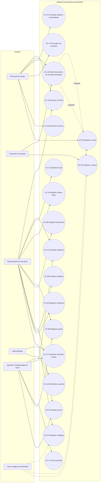

### 5.2 Descripción de casos de uso

**UC-01 — Mantener catálogo de productos**
- **Actor:** Responsable de inventario. **RF:** RF-01, RF-02.
- **Precondición:** Usuario autenticado con permiso sobre catálogo.
- **Flujo principal:** 1) Selecciona "Nuevo producto". 2) Ingresa producto, marca, presentación, código de barras. 3) Define unidad base y conversiones. 4) Define tipo de rastreo (ninguno/lote/serie). 5) El sistema valida unicidad del código. 6) El sistema guarda la referencia.
- **Flujo alterno:** 5a) Código duplicado → el sistema rechaza y solicita corrección.
- **Postcondición:** Referencia disponible para compra, venta e inventario.

**UC-02 — Registrar compra**
- **Actor:** Personal de compras. **RF:** RF-03.
- **Precondición:** Proveedor y productos existentes.
- **Flujo principal:** 1) Selecciona proveedor. 2) Agrega líneas (producto, cantidad, costo pactado). 3) Confirma la compra. 4) El sistema registra la compra en estado pendiente de recepción.
- **Flujo alterno:** 2a) Producto inexistente → se redirige a UC-01.
- **Postcondición:** Compra visible para recepción (UC-03); inventario sin cambios.

**UC-03 — Registrar recepción de mercancía**
- **Actor:** Responsable de inventario/compras. **RF:** RF-17.
- **Precondición:** Compra registrada con líneas pendientes.
- **Flujo principal:** 1) Selecciona la compra. 2) Indica cantidades recibidas por línea y adjunta la factura del proveedor. 3) El sistema genera el documento de ingreso con consecutivo. 4) El sistema aumenta el inventario y recalcula el costo promedio (dispara UC-07 como propuesta).
- **Flujo alterno:** 2a) Recepción parcial → la compra queda con saldo pendiente para una nueva recepción.
- **Postcondición:** Inventario aumentado solo por lo recibido; documento de ingreso trazable.

**UC-04 — Registrar venta**
- **Actor:** Personal de ventas. **RF:** RF-04.
- **Precondición:** Cliente y productos identificados; conexión a internet activa (RN-10).
- **Flujo principal:** 1) Selecciona cliente. 2) Agrega líneas (producto, cantidad). 3) El sistema valida disponible suficiente. 4) Confirma la venta. 5) El sistema descuenta el disponible de forma atómica y emite la factura (numeración interna + fiscal DIAN).
- **Flujo alterno:** 3a) Disponible insuficiente → rechazo. 4a) Concurrencia sobre el mismo saldo → gana la primera confirmación exitosa (RN-11), la otra se rechaza.
- **Postcondición:** Venta, movimiento de inventario y factura correlacionados y auditados.

**UC-05 — Gestionar reserva**
- **Actor:** Personal de ventas. **RF:** RF-05.
- **Precondición:** Disponible suficiente.
- **Flujo principal:** 1) Indica cliente, pedido, cantidad y fecha límite. 2) El sistema mueve la cantidad de disponible a reservado.
- **Flujo alterno:** Liberación por venta asociada, cancelación autorizada o vencimiento de la fecha límite (nunca "por compra").
- **Postcondición:** Disponible y reservado consistentes con el total físico.

**UC-06 — Clasificar producto dañado**
- **Actor:** Responsable de inventario. **RF:** RF-05.
- **Flujo principal:** 1) Selecciona la unidad y la marca como dañada, con motivo. 2) El sistema mueve la cantidad de disponible a dañado. 3) Opcionalmente genera una solicitud de cambio al proveedor.
- **Postcondición:** Unidad dañada trazable, sin eliminación física.

**UC-07 — Aprobar precio**
- **Actor:** Gerencia (aprueba); responsable de inventario (propone). **RF:** RF-07, RF-16.
- **Precondición:** Precio propuesto a partir del costo promedio.
- **Flujo principal:** 1) El sistema presenta la propuesta. 2) Gerencia revisa y aprueba o rechaza. 3) Si se aprueba, el sistema actualiza el precio vigente y el historial.
- **Postcondición:** Precio vigente cambia solo tras aprobación.

**UC-08 — Registrar devolución**
- **Actor:** Responsable de inventario/ventas. **RF:** RF-13.
- **Flujo principal:** 1) Selecciona el documento original (venta o compra). 2) Indica producto, cantidad y motivo. 3) El sistema valida autorización y registra el movimiento vinculado.
- **Postcondición:** Saldo actualizado y devolución trazable al documento original.

**UC-09 — Registrar ajuste**
- **Actor:** Responsable de inventario (registra); gerencia (autoriza). **RF:** RF-14.
- **Flujo principal:** 1) Indica producto, cantidad, signo y motivo. 2) El sistema valida autorización. 3) Registra el ajuste como nuevo movimiento.
- **Postcondición:** Saldo corregido sin editar movimientos históricos (RN-16).

**UC-10 — Realizar conteo físico**
- **Actor:** Responsable de inventario. **RF:** RF-15.
- **Flujo principal:** 1) Registra la cantidad física contada. 2) El sistema calcula la diferencia frente al saldo del sistema. 3) Si se aprueba, dispara UC-09 (ajuste).
- **Postcondición:** El saldo no cambia hasta que el ajuste derivado sea aprobado.

**UC-11 — Cerrar período**
- **Actor:** Gerencia/responsable de cierre. **RF:** RF-08.
- **Flujo principal:** 1) Selecciona el período. 2) El sistema valida movimientos pendientes de revisión. 3) Confirma el cierre.
- **Flujo alterno:** 2a) Pendientes sin resolver → el sistema impide el cierre hasta su tratamiento.
- **Postcondición:** Período cerrado con constancia de fecha y responsable.

**UC-12 — Administrar usuarios y permisos**
- **Actor:** Administrador. **RF:** RF-09.
- **Flujo principal:** 1) Crea o modifica un usuario. 2) Asigna un rol de la matriz de permisos. 3) El sistema aplica el permiso desde ese momento.
- **Postcondición:** Usuario con permisos vigentes y auditados.

**UC-13 — Importar datos desde Excel**
- **Actor:** Responsable de migración/inventario. **RF:** RF-10.
- **Flujo principal:** 1) Carga el archivo. 2) El sistema valida formato y detecta errores. 3) El sistema detecta posibles duplicados. 4) El usuario revisa y decide. 5) El sistema consolida e importa.
- **Postcondición:** Datos importados sin duplicados no resueltos.

**UC-14 — Consultar catálogo sin conexión**
- **Actor:** Personal operativo. **RF:** RF-12.
- **Flujo principal:** 1) Sin conexión, abre el catálogo local. 2) El sistema muestra la información previamente sincronizada.
- **Flujo alterno:** Intento de confirmar una venta/compra sin conexión → bloqueado (RN-10).
- **Postcondición:** Ninguna transacción se confirma sin conexión.

**UC-15 — Consultar detalle y comprobante de venta**
- **Actor:** Ventas, inventario, administrador, gerencia. **RF:** RF-18, RF-19.
- **Flujo principal:** 1) Busca la venta en el listado (número, factura, fechas, estado). 2) Abre el detalle. 3) Abre el comprobante. 4) Imprime o descarga el PDF.
- **Flujo alterno:** 4a) Venta anulada o incompleta → el sistema muestra los motivos y bloquea la exportación.
- **Postcondición:** Ninguna (consulta); el documento indica si es comprobante interno o factura electrónica.

**UC-16 — Consultar auditoría**
- **Actor:** Inventario, administrador, gerencia. **RF:** RF-20.
- **Flujo principal:** 1) Filtra eventos o movimientos. 2) Abre el detalle de un evento. 3) Exporta los movimientos a Excel.
- **Postcondición:** Ninguna; los registros son inmutables.

**UC-17 — Gestionar monedas y tasas de cambio**
- **Actor:** Gerencia o administrador. **RF:** RF-23.
- **Precondición:** Moneda existente y distinta de la funcional (COP).
- **Flujo principal:** 1) Abre *Monedas*. 2) Registra la tasa (COP por 1 unidad), su fecha de vigencia y su fuente. 3) El sistema valida (positiva, no futura) y la registra de forma inmutable y auditada.
- **Flujos alternos:** 2a) Alta de una moneda ISO 4217 nueva. 2b) Activar o desactivar una moneda (COP no se desactiva). 3a) Corrección → se registra una tasa nueva.
- **Postcondición:** La tasa queda vigente para los documentos emitidos desde su fecha.

**UC-18 — Emitir venta o compra en moneda extranjera** (extiende UC-04 y UC-02)
- **Actor:** Ventas o compras. **RF:** RF-23, RF-04, RF-03.
- **Precondición:** Moneda activa con tasa vigente; conexión activa (RN-10).
- **Flujo principal:** 1) Elige la moneda del documento. 2) El sistema muestra precios o costos en esa moneda y el equivalente en COP. 3) Confirma. 4) El sistema guarda moneda, tasa, importes en la moneda y su equivalente en COP; el inventario y el costo promedio se afectan en COP.
- **Flujo alterno:** 1a) Moneda sin tasa vigente → no se puede elegir; si llega una solicitud, se rechaza (422) sin cambios.
- **Postcondición:** Documento con tasa congelada; registros de tasa posteriores no lo alteran.

**UC-19 — Exportar a Excel**
- **Actor:** Según módulo. **RF:** RF-22.
- **Flujo principal:** 1) Aplica filtros. 2) Exporta. 3) El sistema genera el `.xlsx` con fórmulas neutralizadas y registra el evento.

---

## 6. Matriz de trazabilidad

| RN | RF | HU | UC | RNF |
|---|---|---|---|---|
| RN-01 | RF-01 | HU-01 | UC-01 | RNF-01, RNF-03 |
| RN-02 | RF-02 | HU-02 | UC-01 | RNF-02 |
| RN-09 | RF-03, RF-17 | HU-03, HU-04 | UC-02, UC-03 | RNF-02, RNF-04, RNF-06 |
| RN-11, RN-14 | RF-04 | HU-05 | UC-04 | RNF-01, RNF-02 |
| RN-03 | RF-05 | HU-06 | UC-05 | RNF-02, RNF-06 |
| RN-04, RN-05 | RF-05 | HU-07 | UC-06 | RNF-06 |
| RN-06 | RF-06 | HU-08 | — | RNF-03 |
| RN-07 | RF-07, RF-16 | HU-09, HU-10 | UC-07 | RNF-03, RNF-06 |
| RN-13, RN-16 | RF-08 | HU-11, HU-12 | UC-11 | RNF-03, RNF-04, RNF-06 |
| — | RF-09 | HU-13 | UC-12 | RNF-03 |
| RN-15 | RF-10 | HU-14 | UC-13 | RNF-01, RNF-04 |
| RN-01 | RF-11 | HU-15 | — | RNF-01, RNF-05 |
| RN-10 | RF-12 | HU-16 | UC-14 | RNF-02, RNF-05 |
| RN-08 | RF-13 | HU-17 | UC-08 | RNF-06 |
| RN-08, RN-16 | RF-14 | HU-18 | UC-09 | RNF-06 |
| RN-08 | RF-15 | HU-19 | UC-10 | RNF-06 |
| RN-14 | RF-18, RF-19 | HU-20, HU-21 | UC-15 | RNF-03, RNF-05 |
| RN-13, RN-16 | RF-20 | HU-22 | UC-16 | RNF-03, RNF-06 |
| RN-03 | RF-21 | HU-06 | UC-05 | RNF-02, RNF-06 |
| — | RF-22 | HU-23 | UC-19 | RNF-03 |
| RN-17 | RF-23 | HU-24, HU-25, HU-26, HU-27 | UC-17, UC-18 | RNF-02, RNF-03, RNF-06 |
| RN-12 | — | — | — | RNF-01 |

---

## 7. Modelo de procesos

### 7.1 Proceso macro

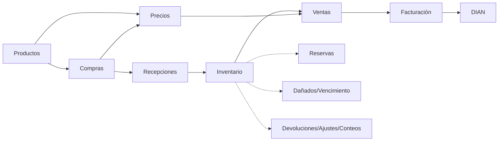

### 7.2 Proceso de compra y recepción

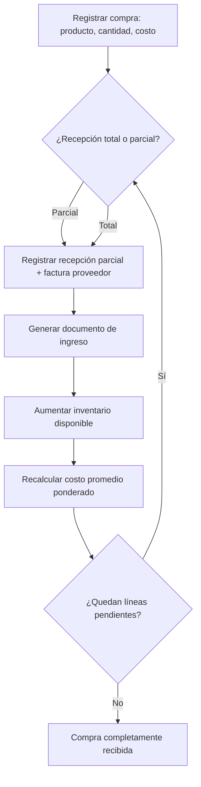

### 7.3 Proceso de venta con verificación de saldo

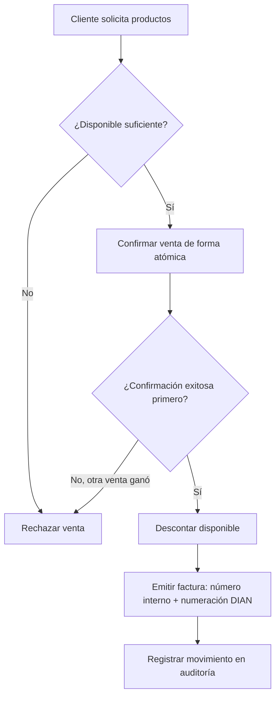

### 7.4 Proceso de conteo físico y ajuste

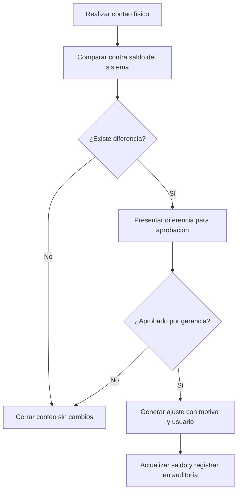

### 7.5 Proceso de venta en moneda extranjera (RF-23, RN-17)

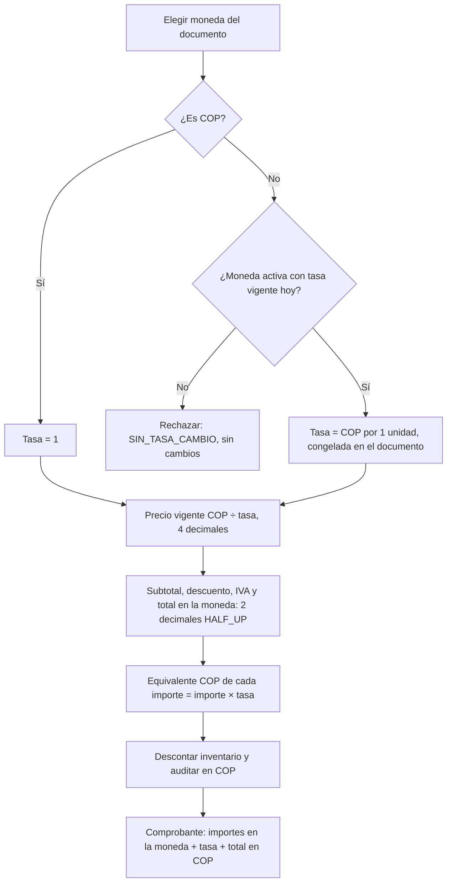

---

## 8. Diagrama de contexto

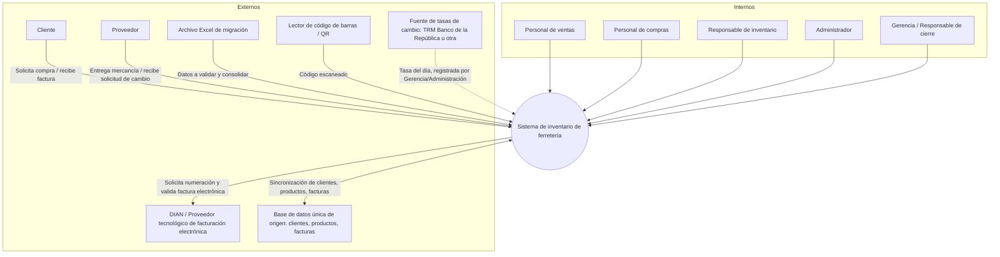

---

## 9. Diagrama de clases conceptual

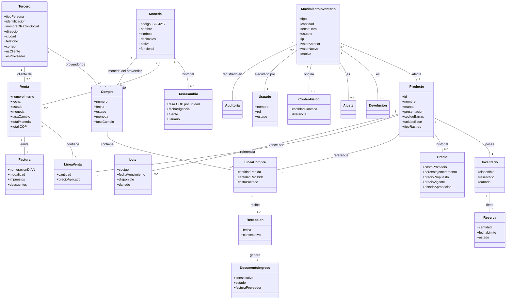

---

## 10. Diccionario de datos

### 10.1 Producto (Referencia)
| Atributo | Tipo | Obligatorio | Descripción |
|---|---|---|---|
| id_producto | Entero (PK) | Sí | Identificador interno. |
| nombre | Texto (150) | Sí | Nombre del producto. |
| marca | Texto (100) | Sí | Marca comercial. |
| presentacion | Texto (100) | Sí | Presentación (potencia, tamaño, etc.). |
| codigo_barras | Texto (50), único | Sí | Código único en todo el catálogo (RN-01). |
| unidad_base | Texto (20) | Sí | Unidad en la que se controla el saldo. |
| tipo_rastreo | Enum {ninguno, lote, serie} | Sí | Rastreo parametrizado (RN-05). |
| tiene_vencimiento | Booleano | Sí | Indica si aplica control de vencimiento. |
| tiene_garantia | Booleano | Sí | Indica si aplica garantía. |

### 10.2 Conversion_Unidad
| Atributo | Tipo | Obligatorio | Descripción |
|---|---|---|---|
| id_conversion | Entero (PK) | Sí | Identificador. |
| id_producto | Entero (FK) | Sí | Producto al que aplica. |
| unidad_presentacion | Texto (20) | Sí | Ej.: caja, paquete. |
| factor_a_unidad_base | Decimal | Sí | Equivalencia a la unidad base. |
| precision | Entero | Sí | Decimales admitidos (por país/producto). |

### 10.3 Inventario
| Atributo | Tipo | Obligatorio | Descripción |
|---|---|---|---|
| id_producto | Entero (FK, PK) | Sí | Producto asociado. |
| disponible | Decimal | Sí | Saldo disponible en unidad base. |
| reservado | Decimal | Sí | Saldo reservado. |
| danado | Decimal | Sí | Saldo clasificado como dañado. |

### 10.4 Reserva
| Atributo | Tipo | Obligatorio | Descripción |
|---|---|---|---|
| id_reserva | Entero (PK) | Sí | Identificador. |
| id_producto | Entero (FK) | Sí | Producto reservado. |
| id_cliente | Entero (FK) | Sí | Tercero cliente. |
| id_pedido | Texto | Sí | Referencia del pedido. |
| cantidad | Decimal | Sí | Cantidad reservada. |
| fecha_limite | Fecha | Sí | Vencimiento de la reserva. |
| estado | Enum {activa, liberada_venta, liberada_cancelacion, liberada_vencimiento} | Sí | Causa de liberación (RN-03). |

### 10.5 Tercero
| Atributo | Tipo | Obligatorio | Descripción |
|---|---|---|---|
| id_tercero | Entero (PK) | Sí | Identificador. |
| tipo_persona | Enum {natural, juridica} | Sí | Define campos obligatorios. |
| tipo_identificacion | Enum {CC, NIT, ...} | Sí | Tipo de documento. |
| numero_identificacion | Texto (20), único | Sí | Número de identificación. |
| primer_nombre / segundo_nombre / primer_apellido / segundo_apellido | Texto | Condicional (persona natural) | Nombre completo. |
| razon_social | Texto (200) | Condicional (persona jurídica) | Nombre legal. |
| direccion, ciudad, telefono, correo | Texto | Sí | Datos de contacto. |
| es_cliente | Booleano | Sí | Rol cliente. |
| es_proveedor | Booleano | Sí | Rol proveedor. |

### 10.6 Compra / Línea de compra
| Atributo | Tipo | Obligatorio | Descripción |
|---|---|---|---|
| id_compra | Entero (PK) | Sí | Identificador de la compra. |
| id_proveedor | Entero (FK) | Sí | Tercero proveedor. |
| fecha | Fecha | Sí | Fecha de registro. |
| estado | Enum {activa, anulada} | Sí | RN-09. |
| id_linea_compra | Entero (PK) | Sí | Línea de la compra. |
| id_producto | Entero (FK) | Sí | Producto pedido. |
| cantidad_pedida | Decimal | Sí | Cantidad solicitada. |
| cantidad_recibida | Decimal | Sí | Acumulado recibido (RF-03/RF-17). |
| costo_pactado | Decimal | Sí | Costo unitario pactado en COP (moneda funcional; ver 10.14 para la moneda del proveedor). |

### 10.7 Recepción / Documento de ingreso
| Atributo | Tipo | Obligatorio | Descripción |
|---|---|---|---|
| id_recepcion | Entero (PK) | Sí | Identificador. |
| id_linea_compra | Entero (FK) | Sí | Línea recibida. |
| cantidad_recibida | Decimal | Sí | Cantidad de esta recepción. |
| id_documento_ingreso | Entero (FK) | Sí | Documento generado. |
| consecutivo | Texto, único | Sí | Numeración interna (RN-09). |
| estado | Enum {activo, anulado} | Sí | RN-09. |
| factura_proveedor | Texto | Sí | Soporte del documento. |

### 10.8 Venta / Línea de venta / Factura
| Atributo | Tipo | Obligatorio | Descripción |
|---|---|---|---|
| id_venta | Entero (PK) | Sí | Identificador interno. |
| numero_interno | Texto, único | Sí | Distinto de la numeración fiscal (RN-14). |
| id_cliente | Entero (FK) | Sí | Tercero cliente. |
| fecha | Fecha/Hora | Sí | Momento de confirmación. |
| id_linea_venta | Entero (PK) | Sí | Línea de venta. |
| id_producto | Entero (FK) | Sí | Producto vendido. |
| cantidad | Decimal | Sí | Cantidad vendida. |
| precio_aplicado | Decimal | Sí | Precio vigente en COP al momento de la venta (ver 10.14 para la moneda del documento). |
| id_factura | Entero (PK) | Sí | Factura emitida. |
| numeracion_dian | Texto, único | Condicional | Rango/numeración autorizada (RN-14). |
| modalidad | Enum {electronica, impresa} | Sí | RN-14. |
| impuestos, descuentos | Decimal | Sí | Valores aplicados. |

### 10.9 Precio
| Atributo | Tipo | Obligatorio | Descripción |
|---|---|---|---|
| id_precio | Entero (PK) | Sí | Identificador. |
| id_producto | Entero (FK) | Sí | Producto. |
| costo_promedio | Decimal | Sí | Calculado por RF-07. |
| porcentaje_incremento | Decimal | Sí | Margen configurado. |
| precio_propuesto | Decimal | Sí | Calculado, no vigente. |
| precio_vigente | Decimal | Condicional | Solo tras aprobación (RN-07). |
| estado_aprobacion | Enum {propuesto, aprobado, rechazado} | Sí | RF-16. |
| usuario_aprobador | Entero (FK) | Condicional | Quien aprueba. |
| fecha_vigencia | Fecha | Condicional | Desde cuándo rige. |

### 10.10 Movimiento de inventario / Auditoría
| Atributo | Tipo | Obligatorio | Descripción |
|---|---|---|---|
| id_movimiento | Entero (PK) | Sí | Identificador único. |
| tipo | Enum {compra, venta, devolucion_cliente, devolucion_proveedor, ajuste, conteo} | Sí | RN-08. |
| id_producto | Entero (FK) | Sí | Producto afectado. |
| cantidad | Decimal | Sí | Cantidad del movimiento (con signo). |
| fecha_hora | Fecha/Hora | Sí | Momento del registro. |
| usuario | Entero (FK) | Sí | Autor del movimiento. |
| ip | Texto | Sí | Origen de la operación. |
| documento_relacionado | Texto | Sí | Compra, venta, devolución, ajuste, etc. |
| valor_anterior / valor_nuevo | Decimal | Sí | Saldo antes/después. |
| motivo | Texto | Condicional | Obligatorio en ajustes y anulaciones. |
| id_movimiento_original | Entero (FK) | Condicional | Vínculo cuando es una rectificación (RN-16). |

### 10.11 Usuario / Rol / Permiso
| Atributo | Tipo | Obligatorio | Descripción |
|---|---|---|---|
| id_usuario | Entero (PK) | Sí | Identificador. |
| nombre, correo | Texto | Sí | Datos de acceso. |
| id_rol | Entero (FK) | Sí | Rol asignado (Ventas, Compras, Inventario, Administrador, Gerencia). |
| estado | Enum {activo, inactivo} | Sí | Estado de la cuenta. |
| id_permiso | Entero (PK) | Sí | Permiso concedido a un rol sobre un módulo (según matriz RF-09). |

### 10.12 Moneda (RF-23)
| Atributo | Tipo | Obligatorio | Descripción |
|---|---|---|---|
| codigo | Texto (3), PK | Sí | Código ISO 4217 (COP, USD, EUR, MXN, PEN, BRL…). |
| nombre | Texto (60) | Sí | Nombre de la moneda. |
| simbolo | Texto (5) | Sí | Símbolo para mostrar. |
| decimales | Entero 0–4 | Sí | Decimales de presentación. |
| activa | Booleano | Sí | Disponible para documentos nuevos. |
| funcional | Booleano, única verdadera | Sí | Moneda de inventario, costos y cierres (COP, RN-17); siempre activa. |

### 10.13 Tasa de cambio (RF-23)
| Atributo | Tipo | Obligatorio | Descripción |
|---|---|---|---|
| id_tasa | Entero largo (PK) | Sí | Identificador. |
| codigo_moneda | Texto (3), FK | Sí | Moneda (no la funcional). |
| tasa | Decimal (18,6) > 0 | Sí | Pesos colombianos por 1 unidad de la moneda. |
| fecha_vigencia | Fecha (≤ hoy) | Sí | Desde cuándo aplica. |
| fuente | Texto (100) | No | P. ej. TRM Banco de la República. |
| id_usuario | Entero (FK) | Sí (en la aplicación) | Quién la registró. |
| fecha_registro | Fecha/Hora UTC | Sí | Momento del registro. Inmutable (disparador). |

### 10.14 Moneda en ventas y compras (RF-23)
| Tabla | Atributo | Tipo | Descripción |
|---|---|---|---|
| venta | moneda, tasa_cambio | Texto (3) FK; Decimal (18,6) | Moneda del documento y tasa congelada (COP → tasa 1). |
| venta | subtotal_moneda, descuentos_moneda, impuestos_moneda, total_moneda | Decimal (16,2) | Importes en la moneda del documento; `subtotal`, `total`… siguen en COP. |
| linea_venta | precio_moneda, subtotal_moneda, descuento_moneda, impuesto_moneda, total_moneda | Decimal | Importes de la línea en la moneda del documento. |
| compra | moneda, tasa_cambio | Texto (3) FK; Decimal (18,6) | Moneda del proveedor y tasa pactada en la orden. |
| linea_compra | costo_moneda | Decimal (14,4) | Costo por unidad base en la moneda de la compra; `costo_pactado` es su equivalente en COP. |

### 10.15 Tablas operativas añadidas en la implementación (V4)
| Tabla | Propósito | RF |
|---|---|---|
| lote | Código y fecha de vencimiento por lote; saldos disponible/dañado del lote. | RF-05 |
| linea_venta_lote | Lotes descontados por cada línea de venta (FEFO). | RF-05 |
| documento_devolucion / devolucion | Documento de devolución (cliente o proveedor) y sus líneas. | RF-13 |
| ajuste_inventario | Solicitud de ajuste con aprobación por otra persona. | RF-14 |
| sesion_conteo / conteo_fisico | Sesión de conteo y cantidades contadas. | RF-15 |
| cierre_periodo | Cierre mensual con resumen, reapertura auditada. | RF-08 |
| evento_auditoria | Evento funcional inmutable (módulo, acción, entidad, detalle JSON). | RF-08, RF-20 |
| importacion | Validación, revisión y confirmación de archivos Excel (hash SHA-256). | RF-10 |

---

# PARTE II — DISEÑO

## 11. Arquitectura del sistema

Se adopta una **arquitectura en capas con principios de arquitectura hexagonal (puertos y adaptadores)**: el dominio (reglas de negocio RN-01 a RN-17) queda aislado de la infraestructura (base de datos, API REST, integraciones externas), de modo que las reglas se puedan probar y evolucionar sin depender del framework o del motor de base de datos.

**Componentes principales:**

| Componente | Responsabilidad |
|---|---|
| Cliente web (SPA) | Interfaz para ventas, compras, inventario, precios, administración. |
| API REST (Backend) | Expone los casos de uso; aplica autenticación y permisos (RF-09). |
| Capa de dominio | Entidades, reglas de negocio (RN) y servicios de aplicación (Inventario, Precios, Facturación). |
| Capa de persistencia | Repositorios sobre la base de datos relacional. |
| Base de datos relacional | Persistencia transaccional (ver sección 13). |
| Adaptador de facturación electrónica | Integración con un proveedor tecnológico autorizado por la DIAN (RN-14). |
| Servicio de auditoría | Registro inmutable de movimientos (RF-08, RNF-06). |
| Módulo de importación | Validación y consolidación de Excel (RF-10). |
| Adaptador de lectores | Recepción de eventos de códigos de barras/QR (RF-11). Implementado como lectores en modo teclado en los selectores de producto. |
| Servicio de monedas | Catálogo de monedas, tasas de cambio inmutables, tasa vigente y conversión (RF-23, RN-17). |
| Servicio de kardex | Único punto que modifica saldos: bloqueo por fila, sin negativos, periodo cerrado y movimiento auditable (RNF-02, RNF-06). |

## 12. Diagrama de arquitectura

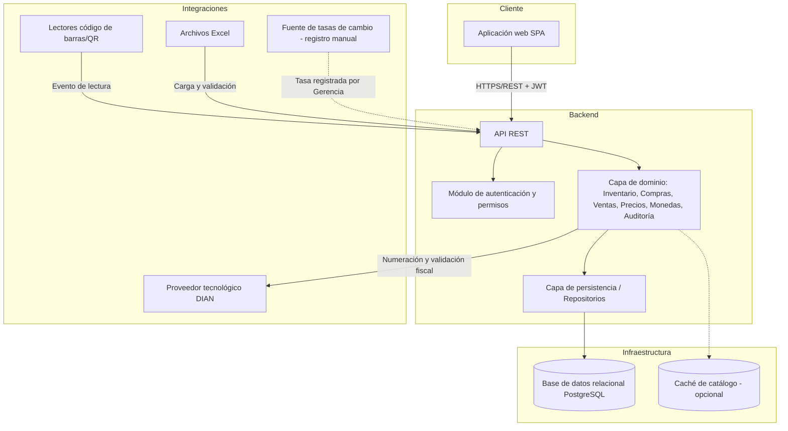

## 13. Diseño de base de datos

**Motor:** relacional (PostgreSQL), normalizado a 3FN, con integridad referencial declarada en el motor (no en la aplicación) para garantizar RN-03 (saldos no negativos, vía restricción `CHECK`) y RN-09 (documentos nunca eliminados: solo `UPDATE` de estado, sin `DELETE`).

**Tablas principales:** `producto`, `conversion_unidad`, `inventario`, `lote`, `reserva`, `tercero`, `compra`, `linea_compra`, `recepcion`, `documento_ingreso`, `venta`, `linea_venta`, `linea_venta_lote`, `factura`, `precio`, `documento_devolucion`, `devolucion`, `ajuste_inventario`, `sesion_conteo`, `conteo_fisico`, `cierre_periodo`, `movimiento_inventario`, `auditoria`, `evento_auditoria`, `importacion`, `moneda`, `tasa_cambio`, `usuario`, `rol`, `permiso`.

**Convenciones:**
- Toda tabla transaccional tiene `estado` (activo/anulado) en lugar de borrado físico (RN-09).
- Todo movimiento de inventario se inserta, nunca se actualiza (RN-16); las correcciones insertan un nuevo registro con `id_movimiento_original`.
- Los saldos de `inventario` se actualizan dentro de la misma transacción que el movimiento que los origina (RNF-02).
- Los importes de inventario, costos y cierres se guardan en COP; las ventas y compras guardan además su moneda, la tasa aplicada y los importes en esa moneda (RN-17). Las tasas de cambio solo se insertan (disparador que bloquea `UPDATE`/`DELETE`).

## 14. Modelo entidad-relación (ER)

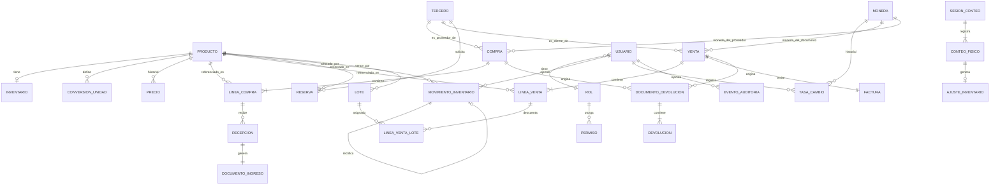

## 15. Diagrama de clases (diseño técnico)

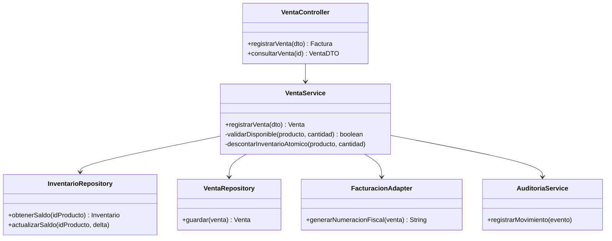

## 16. Diagramas de secuencia

### 16.1 Registrar venta

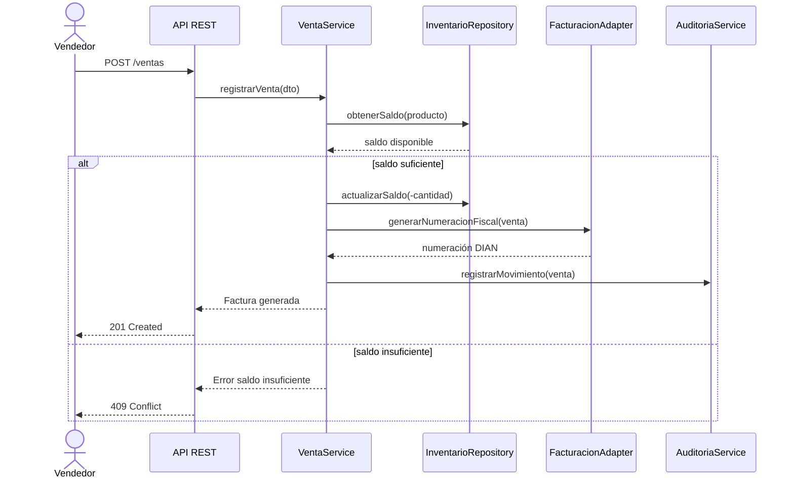

### 16.2 Registrar compra y recepción

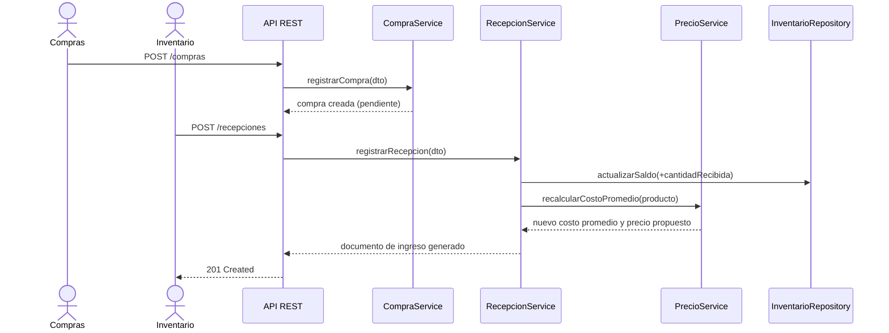

### 16.3 Aprobación de precio

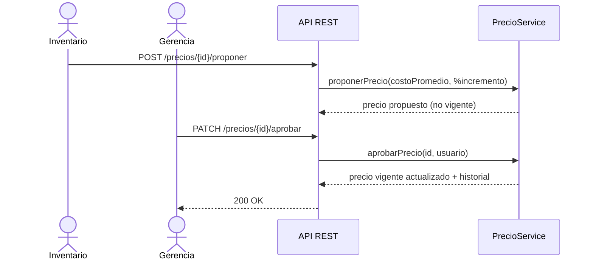

### 16.4 Conteo físico y ajuste

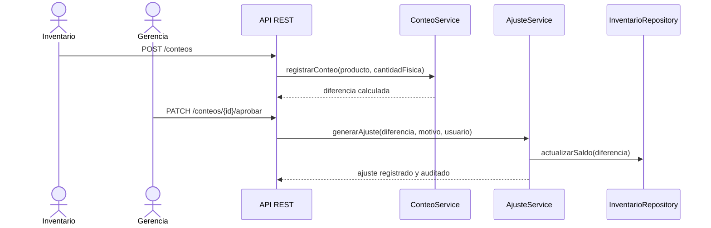

### 16.5 Venta en moneda extranjera (RF-23)

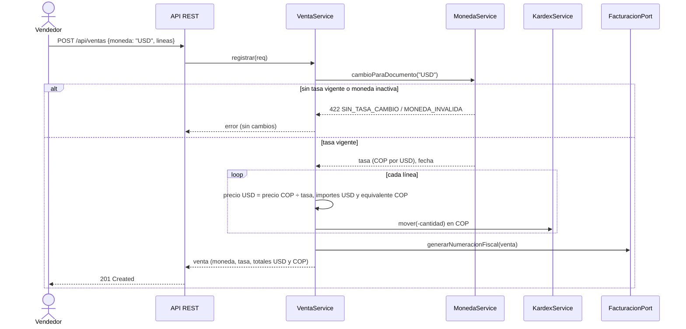

## 17. Diseño de API (REST)

Todos los recursos usan JSON, autenticación `Bearer <JWT>` y HTTPS. Respuestas de error siguen el formato `{codigo, mensaje}`.

| Módulo | Método | Endpoint | Descripción | RF |
|---|---|---|---|---|
| Productos | POST | `/api/productos` | Crea una referencia (producto+marca+presentación). | RF-01 |
| Productos | GET | `/api/productos/{codigoBarras}` | Consulta por código de barras. | RF-01, RF-11 |
| Productos | PUT | `/api/productos/{id}/unidades` | Configura unidad base y conversiones. | RF-02 |
| Compras | POST | `/api/compras` | Registra una compra con sus líneas. | RF-03 |
| Compras | POST | `/api/compras/{id}/recepciones` | Registra una recepción parcial o total. | RF-17 |
| Ventas | POST | `/api/ventas` | Registra una venta y emite factura. | RF-04 |
| Inventario | POST | `/api/reservas` | Crea una reserva. | RF-05 |
| Inventario | PATCH | `/api/reservas/{id}/liberar` | Libera una reserva (venta/cancelación/vencimiento). | RF-05 |
| Inventario | PATCH | `/api/productos/{id}/danar` | Clasifica una unidad como dañada. | RF-05 |
| Terceros | POST | `/api/terceros` | Registra cliente y/o proveedor. | RF-06 |
| Precios | GET | `/api/precios/{producto}/propuesta` | Consulta el precio propuesto. | RF-07 |
| Precios | PATCH | `/api/precios/{id}/aprobar` | Aprueba o rechaza un precio propuesto. | RF-16 |
| Auditoría | GET | `/api/auditoria?filtros` | Consulta movimientos auditados. | RF-08 |
| Cierres | POST | `/api/cierres` | Cierra un período mensual. | RF-08 |
| Usuarios | POST | `/api/usuarios` | Crea un usuario con rol asignado. | RF-09 |
| Migración | POST | `/api/migracion/excel` | Carga y valida un archivo Excel. | RF-10 |
| Migración | POST | `/api/migracion/excel/{lote}/confirmar` | Consolida e importa tras revisión. | RF-10 |
| Devoluciones | POST | `/api/devoluciones` | Registra una devolución vinculada. | RF-13 |
| Ajustes | POST | `/api/ajustes` | Registra un ajuste autorizado. | RF-14 |
| Conteos | POST | `/api/conteos` | Registra un conteo físico. | RF-15 |
| Conteos | PATCH | `/api/conteos/{id}/aprobar` | Aprueba el ajuste derivado del conteo. | RF-15 |

### 17.1 API implementada (versión 1.1)

La implementación conserva el estilo REST/JSON/JWT descrito arriba con estas rutas reales (documentadas en OpenAPI, `/swagger-ui.html`). Diferencias respecto de la tabla de diseño: la consulta por código usa `/api/productos/codigo/{codigo}` (evita la colisión con `/{id}`); las reservas viven en `/api/inventario/reservas`; la migración Excel en `/api/importaciones`; las aprobaciones son `POST …/aprobar`.

| Módulo | Método | Endpoint | Descripción | RF |
|---|---|---|---|---|
| Ventas | GET | `/api/ventas`, `/api/ventas/{id}/detalle` | Listado con filtros y detalle (factura, devoluciones, trazabilidad, exportable). | RF-04, RF-18, RF-19 |
| Ventas | POST | `/api/ventas` | Registra la venta; `moneda` opcional (ISO 4217, COP por defecto); `idOperacion` para idempotencia. | RF-04, RF-23 |
| Compras | GET/POST | `/api/compras`, `/api/compras/{id}` | Órdenes con `moneda` del proveedor; detalle con documentos de ingreso. | RF-03, RF-23 |
| Compras | POST | `/api/compras/{id}/recepciones`, `/api/compras/ingresos/{id}/anular`, `/api/compras/{id}/anular` | Recepción parcial con lote y vencimiento; anulaciones con motivo. | RF-17 |
| Inventario | GET/POST | `/api/inventario/existencias`, `/alertas`, `/productos/{id}/lotes`, `/productos/{id}/movimientos`, `/cambios-estado`, `/lotes/{id}/baja-vencimiento`, `/reservas` | Existencias, alertas, kardex, estados, bajas y reservas. | RF-05, RF-21 |
| Precios | GET/POST | `/api/precios/propuestas`, `/propuestas/{id}/aprobar`, `/propuestas/{id}/rechazar`, `/productos/{id}` | Propuestas, aprobación por Gerencia e historial. | RF-07, RF-16 |
| Devoluciones | GET/POST | `/api/devoluciones`, `/clientes`, `/proveedores` | Devoluciones vinculadas al documento original. | RF-13 |
| Ajustes / Conteos | GET/POST | `/api/ajustes…`, `/api/conteos…` | Solicitud y aprobación; sesiones de conteo. | RF-14, RF-15 |
| Cierres | GET/POST | `/api/cierres/resumen`, `/api/cierres`, `/api/cierres/{periodo}/reabrir` | Resumen, cierre y reapertura. | RF-08 |
| Auditoría | GET | `/api/auditoria/eventos`, `/eventos/{id}`, `/movimientos`, `/catalogo` | Consulta de eventos y movimientos. | RF-20 |
| Usuarios | GET/POST/PUT | `/api/usuarios…` | Usuarios, roles y contraseñas. | RF-09 |
| Importación / Exportación | POST/GET | `/api/importaciones/{tipo}/validar`, `/{id}/confirmar`, `/plantillas/{tipo}`, `/api/exportaciones/{que}` | Excel con revisión previa; exportación protegida. | RF-10, RF-22 |
| **Monedas** | GET | `/api/monedas` | Monedas con su tasa vigente (todos los roles). | RF-23 |
| **Monedas** | POST | `/api/monedas` | Alta de moneda ISO 4217 (Gerencia, Administrador). | RF-23 |
| **Monedas** | PATCH | `/api/monedas/{codigo}/estado` | Activar o desactivar (COP no se desactiva). | RF-23 |
| **Monedas** | GET/POST | `/api/monedas/{codigo}/tasas` | Historial y registro de tasas (registro: Gerencia, Administrador). | RF-23 |
| **Monedas** | GET | `/api/monedas/conversion?monto&desde&hacia` | Conversión con las tasas vigentes. | RF-23 |
| Catálogo offline | GET | `/api/catalogo/sincronizacion` | Copia del catálogo para consulta sin conexión. | RF-12 |

## 18. Decisiones de arquitectura (ADR)

**ADR-01 — Arquitectura en capas con principios hexagonales**
- **Contexto:** las reglas de negocio (RN-01 a RN-16) son numerosas y deben poder probarse sin depender de la base de datos o el framework web.
- **Decisión:** aislar el dominio en una capa independiente, con puertos (interfaces) hacia persistencia e integraciones externas.
- **Alternativas consideradas:** arquitectura monolítica transaccional simple (sin separación de capas) — descartada por dificultar las pruebas unitarias de reglas críticas (concurrencia, saldos, aprobaciones).
- **Consecuencias:** mayor curva de diseño inicial; a cambio, reglas de negocio testeables y reemplazo de infraestructura sin tocar el dominio.

**ADR-02 — Base de datos relacional (PostgreSQL) en lugar de NoSQL**
- **Contexto:** el dominio exige transacciones ACID (saldo nunca negativo, venta atómica, concurrencia con "primera confirmación exitosa").
- **Decisión:** usar una base de datos relacional con soporte de transacciones e integridad referencial declarativa.
- **Alternativas consideradas:** base documental (NoSQL) — descartada porque exigiría implementar en la aplicación el control transaccional que el motor relacional ya ofrece nativamente.
- **Consecuencias:** modelo más rígido ante cambios de esquema, pero consistencia garantizada por el motor.

**ADR-03 — Backend en una plataforma con soporte maduro de transacciones declarativas**
- **Contexto:** se requieren transacciones consistentes en compras, ventas y ajustes, e integración con proveedores tecnológicos de facturación electrónica DIAN, mayoritariamente disponibles en ecosistemas Java/.NET.
- **Decisión:** backend en Java (Spring Boot) u otra plataforma equivalente con soporte de transacciones declarativas y SDKs de facturación electrónica.
- **Alternativas consideradas:** Node.js — viable, pero con menor disponibilidad de SDKs certificados de facturación electrónica colombiana y manejo de transacciones menos declarativo.
- **Consecuencias:** ecosistema maduro y mayor disponibilidad de integraciones DIAN; curva de aprendizaje mayor que un stack basado en JavaScript.

**ADR-04 — Autenticación JWT con control de acceso basado en roles (RBAC)**
- **Contexto:** RF-09 exige que cada usuario opere solo dentro de la matriz de permisos por rol.
- **Decisión:** autenticación por token JWT de vida corta, con rol y permisos embebidos, validados en cada endpoint.
- **Alternativas consideradas:** sesiones de servidor con estado — descartadas por complicar el escalamiento horizontal del backend.
- **Consecuencias:** requiere gestión de expiración/renovación de tokens; facilita escalar el backend sin estado compartido.

**ADR-05 — Frontend como aplicación web de una sola página (SPA)**
- **Contexto:** los usuarios (ventas, compras, inventario, gerencia) requieren una interfaz ágil para tareas frecuentes (RNF-05).
- **Decisión:** SPA que consume la API REST vía HTTPS.
- **Alternativas consideradas:** renderizado en servidor — descartado por menor fluidez en operaciones repetitivas como la captura de ventas.
- **Consecuencias:** requiere manejo de estado en cliente; mejora la experiencia de uso frecuente.

**ADR-06 — Sin sincronización offline de transacciones**
- **Contexto:** RN-10 exige que ninguna transacción se confirme sin conexión, eliminando la necesidad original de un motor de sincronización.
- **Decisión:** el cliente solo cachea catálogo e información de solo lectura; toda escritura requiere conexión activa al backend.
- **Alternativas consideradas:** arquitectura offline-first con cola de sincronización — descartada por la decisión de negocio de no permitir transacciones desconectadas, lo que habría añadido complejidad sin beneficio funcional.
- **Consecuencias:** arquitectura más simple y con menor riesgo de conflictos de datos; el sistema depende de conectividad para operar.

**ADR-07 — Integración con proveedor tecnológico autorizado por la DIAN**
- **Contexto:** la certificación directa como facturador electrónico ante la DIAN implica un proceso normativo independiente del desarrollo del sistema.
- **Decisión:** integrar la generación de la numeración fiscal y el envío de la factura electrónica a través de un proveedor tecnológico autorizado, manteniendo el número interno de venta como identificador propio del sistema (RN-14).
- **Alternativas consideradas:** implementar la certificación DIAN directamente — descartada por quedar fuera del alcance técnico de este proyecto y por el riesgo de mantener actualizada la normativa tributaria dentro del propio sistema.
- **Consecuencias:** el sistema depende de la disponibilidad del proveedor tecnológico; se reduce el riesgo de incumplimiento normativo al delegarlo en un tercero certificado.

**ADR-08 — Moneda funcional COP con documentos multimoneda**
- **Contexto:** el interesado requiere operar en COP, USD y otras monedas; el inventario, el costo promedio, los cierres y la auditoría deben seguir siendo comparables en el tiempo.
- **Decisión:** COP es la moneda funcional (RN-17). Cada venta o compra guarda su moneda y la tasa aplicada; los importes en la moneda del documento se guardan junto a su equivalente en COP, y todo cálculo de inventario, costo, cierre y conciliación usa COP.
- **Alternativas consideradas:** convertir todo a COP sin conservar la moneda original (pierde el documento tal como se pactó); llevar saldos y costos por moneda (multiplica la complejidad de costo promedio y cierres sin beneficio para una ferretería).
- **Consecuencias:** compatibilidad total con los datos existentes (COP con tasa 1); el total en COP de un documento extranjero es la suma de equivalentes por importe y puede diferir en centavos de un cálculo directo.

**ADR-09 — Tasas de cambio registradas e inmutables (sin consulta automática de la TRM)**
- **Contexto:** la tasa debe ser trazable y no depender de servicios externos no contratados.
- **Decisión:** las tasas las registran Gerencia o Administración con fecha de vigencia (no futura) y fuente; son inmutables (disparador de BD) y auditadas; la vigente es la de fecha más reciente no posterior al día de la operación y, el mismo día, la última registrada. La compra congela la tasa de la orden.
- **Alternativas consideradas:** consultar la TRM en línea en cada operación — descartada por depender de un servicio externo y porque no se simulan integraciones (queda como pendiente P-09).
- **Consecuencias:** sin tasa vigente no se emiten documentos en esa moneda; la carga diaria es manual hasta implementar P-09.

**ADR-10 — Comprobante interno hasta la integración fiscal**
- **Contexto:** RN-14 exige factura electrónica DIAN, pero la integración con un proveedor tecnológico (ADR-07) aún no existe.
- **Decisión:** el documento de venta se presenta como **comprobante interno**, con leyenda explícita de que no tiene validez fiscal, hasta que un adaptador de `FacturacionPort` declare `esValidaFiscalmente() = true`.
- **Consecuencias:** no se induce a error al cliente; el cambio a factura electrónica se concentra en un solo adaptador.

---

## 19. Conclusión

Este documento (versión 1.1) entrega la trazabilidad completa desde las reglas de negocio (RN-01 a RN-17) hasta el diseño técnico, incluida la operación multimoneda (RF-23): cada regla (RN) se refleja en al menos un requisito funcional (RF), cada RF en una o más historias de usuario (HU) y casos de uso (UC), y cada UC queda soportado por una arquitectura, un modelo de datos y una API concretos. Con esta base, el equipo de desarrollo puede iniciar la construcción del sistema con reglas de negocio, calidad (RNF) y diseño de solución alineados y sin contradicciones pendientes.


# Scripts de base de datos — Sistema de inventario de ferretería

**Versión:** 1.0
**Motor:** PostgreSQL 14+ (ver ADR-02 de `especificacion_requisitos_diseno_ferreteria.md`).
**Basado en:** diccionario de datos, modelo entidad-relación y reglas de negocio (RN-01 a RN-16) del documento de especificación de requisitos y diseño.

Este documento contiene cuatro scripts ejecutables en orden:

1. **DDL** — creación de tipos, tablas, restricciones, índices y disparadores (`gafas` de integridad de las reglas de negocio).
2. **Datos de prueba (seed)** — un conjunto mínimo y coherente de datos para poder ejecutar los scripts siguientes.
3. **Pruebas automatizadas de reglas de negocio** — bloques `DO` en PL/pgSQL que verifican, con éxito/fallo, que las restricciones de la base de datos hacen cumplir las reglas de negocio (RN) y dejan constancia en una tabla de resultados.
4. **Consultas de verificación de integridad de datos** — consultas de solo lectura que deben devolver **cero filas** en una base de datos sana; cualquier fila devuelta señala una anomalía.

> Cada script asume que el anterior ya se ejecutó sobre la misma base de datos. Se recomienda ejecutarlos en una base de datos de prueba, nunca directamente en producción.

---

## 0. Cómo ejecutar los scripts

```bash
# 1) Crear la base de datos
createdb ferreteria_db

# 2) Ejecutar en orden
psql -d ferreteria_db -f 01_ddl.sql
psql -d ferreteria_db -f 02_seed.sql
psql -d ferreteria_db -f 03_pruebas.sql
psql -d ferreteria_db -f 04_verificaciones.sql

# 3) Revisar el resultado de las pruebas
psql -d ferreteria_db -c "SELECT * FROM test_resultados ORDER BY id;"
```

(Los nombres de archivo son sugeridos; cada bloque de código de este documento puede guardarse tal cual en el archivo correspondiente.)

---

## 1. Script DDL — creación de la base de datos

```sql
-- =====================================================================
-- 01_ddl.sql — Creación de tipos, tablas, restricciones e índices
-- Sistema de inventario de ferretería
-- =====================================================================

BEGIN;

-- ---------------------------------------------------------------------
-- 1. Tipos enumerados (representan los estados y catálogos cerrados
--    definidos en las reglas de negocio)
-- ---------------------------------------------------------------------
CREATE TYPE tipo_persona_enum        AS ENUM ('natural', 'juridica');
CREATE TYPE tipo_identificacion_enum AS ENUM ('CC', 'NIT', 'CE', 'PASAPORTE');
CREATE TYPE tipo_rastreo_enum        AS ENUM ('ninguno', 'lote', 'serie');
CREATE TYPE estado_documento_enum    AS ENUM ('activo', 'anulado');      -- RN-09
CREATE TYPE estado_reserva_enum      AS ENUM ('activa', 'liberada_venta',
                                               'liberada_cancelacion',
                                               'liberada_vencimiento');   -- RN-03
CREATE TYPE modalidad_factura_enum   AS ENUM ('electronica', 'impresa'); -- RN-14
CREATE TYPE estado_aprobacion_enum   AS ENUM ('propuesto', 'aprobado', 'rechazado'); -- RN-07
CREATE TYPE tipo_movimiento_enum     AS ENUM ('compra', 'venta',
                                               'devolucion_cliente',
                                               'devolucion_proveedor',
                                               'ajuste', 'conteo');       -- RN-08
CREATE TYPE tipo_devolucion_enum     AS ENUM ('cliente', 'proveedor');
CREATE TYPE estado_conteo_enum       AS ENUM ('pendiente', 'aprobado', 'rechazado');
CREATE TYPE estado_cuenta_enum       AS ENUM ('activo', 'inactivo');

-- ---------------------------------------------------------------------
-- 2. Seguridad: roles, permisos y usuarios (RF-09)
-- ---------------------------------------------------------------------
CREATE TABLE rol (
    id_rol      SERIAL PRIMARY KEY,
    nombre      VARCHAR(50) UNIQUE NOT NULL
);

CREATE TABLE permiso (
    id_permiso   SERIAL PRIMARY KEY,
    id_rol       INTEGER NOT NULL REFERENCES rol(id_rol),
    modulo       VARCHAR(50) NOT NULL,   -- Compras, Ventas, Inventario, Precios, Usuarios, Auditoria, Cierres
    nivel_acceso VARCHAR(20) NOT NULL,   -- no, ver, consultar, si, proponer, aprobar
    UNIQUE (id_rol, modulo)
);

CREATE TABLE usuario (
    id_usuario     SERIAL PRIMARY KEY,
    nombre         VARCHAR(150) NOT NULL,
    correo         VARCHAR(150) UNIQUE NOT NULL,
    password_hash  VARCHAR(255) NOT NULL,
    id_rol         INTEGER NOT NULL REFERENCES rol(id_rol),
    estado         estado_cuenta_enum NOT NULL DEFAULT 'activo'
);

-- ---------------------------------------------------------------------
-- 3. Terceros (RF-06 / RN-06)
-- ---------------------------------------------------------------------
CREATE TABLE tercero (
    id_tercero            SERIAL PRIMARY KEY,
    tipo_persona          tipo_persona_enum NOT NULL,
    tipo_identificacion   tipo_identificacion_enum NOT NULL,
    numero_identificacion VARCHAR(20) UNIQUE NOT NULL,
    primer_nombre         VARCHAR(80),
    segundo_nombre        VARCHAR(80),
    primer_apellido       VARCHAR(80),
    segundo_apellido      VARCHAR(80),
    razon_social          VARCHAR(200),
    direccion             VARCHAR(200) NOT NULL,
    ciudad                VARCHAR(80)  NOT NULL,
    telefono              VARCHAR(30)  NOT NULL,
    correo                VARCHAR(150) NOT NULL,
    es_cliente            BOOLEAN NOT NULL DEFAULT FALSE,
    es_proveedor          BOOLEAN NOT NULL DEFAULT FALSE,
    CONSTRAINT chk_tercero_rol
        CHECK (es_cliente OR es_proveedor),
    -- RN-06: persona natural exige nombre/apellido; jurídica exige razón social
    CONSTRAINT chk_tercero_natural
        CHECK (tipo_persona <> 'natural'
               OR (primer_nombre IS NOT NULL AND primer_apellido IS NOT NULL)),
    CONSTRAINT chk_tercero_juridica
        CHECK (tipo_persona <> 'juridica' OR razon_social IS NOT NULL)
);

-- ---------------------------------------------------------------------
-- 4. Productos, unidades e inventario (RF-01, RF-02, RN-01, RN-02, RN-03)
-- ---------------------------------------------------------------------
CREATE TABLE producto (
    id_producto      SERIAL PRIMARY KEY,
    nombre           VARCHAR(150) NOT NULL,
    marca            VARCHAR(100) NOT NULL,
    presentacion     VARCHAR(100) NOT NULL,
    codigo_barras    VARCHAR(50)  UNIQUE NOT NULL,      -- RN-01
    unidad_base      VARCHAR(20)  NOT NULL,
    tipo_rastreo     tipo_rastreo_enum NOT NULL DEFAULT 'ninguno', -- RN-05
    tiene_vencimiento BOOLEAN NOT NULL DEFAULT FALSE,
    tiene_garantia   BOOLEAN NOT NULL DEFAULT FALSE,
    UNIQUE (nombre, marca, presentacion)                -- RN-01: referencia única
);

CREATE TABLE conversion_unidad (
    id_conversion       SERIAL PRIMARY KEY,
    id_producto         INTEGER NOT NULL REFERENCES producto(id_producto),
    unidad_presentacion VARCHAR(20) NOT NULL,
    factor_a_unidad_base NUMERIC(14,4) NOT NULL CHECK (factor_a_unidad_base > 0),
    precision_decimales  INTEGER NOT NULL DEFAULT 0 CHECK (precision_decimales >= 0),
    UNIQUE (id_producto, unidad_presentacion)
);

CREATE TABLE inventario (
    id_producto INTEGER PRIMARY KEY REFERENCES producto(id_producto),
    disponible  NUMERIC(14,4) NOT NULL DEFAULT 0 CHECK (disponible >= 0),  -- RN-03
    reservado   NUMERIC(14,4) NOT NULL DEFAULT 0 CHECK (reservado  >= 0),  -- RN-03
    danado      NUMERIC(14,4) NOT NULL DEFAULT 0 CHECK (danado     >= 0)   -- RN-03
);

CREATE TABLE reserva (
    id_reserva   SERIAL PRIMARY KEY,
    id_producto  INTEGER NOT NULL REFERENCES producto(id_producto),
    id_cliente   INTEGER NOT NULL REFERENCES tercero(id_tercero),
    id_pedido    VARCHAR(50) NOT NULL,
    cantidad     NUMERIC(14,4) NOT NULL CHECK (cantidad > 0),
    fecha_limite DATE NOT NULL,
    estado       estado_reserva_enum NOT NULL DEFAULT 'activa'            -- RN-03
);

-- ---------------------------------------------------------------------
-- 5. Compras y recepciones (RF-03, RF-17, RN-09)
-- ---------------------------------------------------------------------
CREATE TABLE compra (
    id_compra   SERIAL PRIMARY KEY,
    id_proveedor INTEGER NOT NULL REFERENCES tercero(id_tercero),
    fecha        TIMESTAMP NOT NULL DEFAULT now(),
    estado       estado_documento_enum NOT NULL DEFAULT 'activo',
    motivo_anulacion VARCHAR(255)
);

CREATE TABLE linea_compra (
    id_linea_compra   SERIAL PRIMARY KEY,
    id_compra         INTEGER NOT NULL REFERENCES compra(id_compra),
    id_producto       INTEGER NOT NULL REFERENCES producto(id_producto),
    cantidad_pedida   NUMERIC(14,4) NOT NULL CHECK (cantidad_pedida > 0),
    cantidad_recibida NUMERIC(14,4) NOT NULL DEFAULT 0 CHECK (cantidad_recibida >= 0),
    costo_pactado     NUMERIC(14,4) NOT NULL CHECK (costo_pactado >= 0),
    CONSTRAINT chk_recepcion_no_excede
        CHECK (cantidad_recibida <= cantidad_pedida)                     -- RF-03/RF-17
);

CREATE TABLE documento_ingreso (
    id_documento_ingreso SERIAL PRIMARY KEY,
    consecutivo          VARCHAR(30) UNIQUE NOT NULL,
    estado                estado_documento_enum NOT NULL DEFAULT 'activo', -- RN-09
    factura_proveedor     VARCHAR(100) NOT NULL,
    motivo_anulacion      VARCHAR(255),
    fecha                 TIMESTAMP NOT NULL DEFAULT now()
);

CREATE TABLE recepcion (
    id_recepcion         SERIAL PRIMARY KEY,
    id_linea_compra      INTEGER NOT NULL REFERENCES linea_compra(id_linea_compra),
    id_documento_ingreso INTEGER NOT NULL REFERENCES documento_ingreso(id_documento_ingreso),
    cantidad_recibida    NUMERIC(14,4) NOT NULL CHECK (cantidad_recibida > 0),
    fecha                TIMESTAMP NOT NULL DEFAULT now()
);

-- ---------------------------------------------------------------------
-- 6. Ventas y facturación (RF-04, RN-11, RN-14)
-- ---------------------------------------------------------------------
CREATE TABLE venta (
    id_venta      SERIAL PRIMARY KEY,
    numero_interno VARCHAR(30) UNIQUE NOT NULL,          -- RN-14
    id_cliente    INTEGER NOT NULL REFERENCES tercero(id_tercero),
    fecha         TIMESTAMP NOT NULL DEFAULT now(),
    estado        estado_documento_enum NOT NULL DEFAULT 'activo'
);

CREATE TABLE linea_venta (
    id_linea_venta  SERIAL PRIMARY KEY,
    id_venta        INTEGER NOT NULL REFERENCES venta(id_venta),
    id_producto     INTEGER NOT NULL REFERENCES producto(id_producto),
    cantidad        NUMERIC(14,4) NOT NULL CHECK (cantidad > 0),
    precio_aplicado NUMERIC(14,4) NOT NULL CHECK (precio_aplicado >= 0)
);

CREATE TABLE factura (
    id_factura      SERIAL PRIMARY KEY,
    id_venta        INTEGER UNIQUE NOT NULL REFERENCES venta(id_venta),
    numeracion_dian VARCHAR(30) UNIQUE,                   -- RN-14: distinta del numero_interno
    modalidad       modalidad_factura_enum NOT NULL DEFAULT 'electronica',
    impuestos       NUMERIC(14,4) NOT NULL DEFAULT 0 CHECK (impuestos >= 0),
    descuentos      NUMERIC(14,4) NOT NULL DEFAULT 0 CHECK (descuentos >= 0),
    fecha_emision   TIMESTAMP NOT NULL DEFAULT now()
);

-- ---------------------------------------------------------------------
-- 7. Precios (RF-07, RF-16, RN-07)
-- ---------------------------------------------------------------------
CREATE TABLE precio (
    id_precio            SERIAL PRIMARY KEY,
    id_producto          INTEGER NOT NULL REFERENCES producto(id_producto),
    costo_promedio       NUMERIC(14,4) NOT NULL CHECK (costo_promedio >= 0),
    porcentaje_incremento NUMERIC(6,4) NOT NULL CHECK (porcentaje_incremento >= 0),
    precio_propuesto     NUMERIC(14,4) NOT NULL CHECK (precio_propuesto >= 0),
    precio_vigente       NUMERIC(14,4) CHECK (precio_vigente >= 0),
    estado_aprobacion    estado_aprobacion_enum NOT NULL DEFAULT 'propuesto',
    usuario_aprobador    INTEGER REFERENCES usuario(id_usuario),
    fecha_propuesta      TIMESTAMP NOT NULL DEFAULT now(),
    fecha_vigencia       TIMESTAMP,
    -- RN-07: no puede haber precio vigente sin aprobación
    CONSTRAINT chk_precio_vigente_requiere_aprobacion
        CHECK (precio_vigente IS NULL OR estado_aprobacion = 'aprobado')
);

-- ---------------------------------------------------------------------
-- 8. Movimientos de inventario y auditoría (RF-08, RN-08, RN-16, RNF-06)
-- ---------------------------------------------------------------------
CREATE TABLE movimiento_inventario (
    id_movimiento          SERIAL PRIMARY KEY,
    tipo                   tipo_movimiento_enum NOT NULL,
    id_producto            INTEGER NOT NULL REFERENCES producto(id_producto),
    cantidad               NUMERIC(14,4) NOT NULL,          -- con signo: + entrada, - salida
    fecha_hora             TIMESTAMP NOT NULL DEFAULT now(),
    id_usuario             INTEGER NOT NULL REFERENCES usuario(id_usuario),
    ip                     INET,
    documento_relacionado  VARCHAR(100) NOT NULL,
    valor_anterior         NUMERIC(14,4) NOT NULL,
    valor_nuevo            NUMERIC(14,4) NOT NULL,
    motivo                 VARCHAR(255),
    id_movimiento_original INTEGER REFERENCES movimiento_inventario(id_movimiento) -- RN-16
);

CREATE TABLE devolucion (
    id_devolucion       SERIAL PRIMARY KEY,
    tipo                tipo_devolucion_enum NOT NULL,
    id_documento_origen VARCHAR(50) NOT NULL,
    id_producto         INTEGER NOT NULL REFERENCES producto(id_producto),
    cantidad            NUMERIC(14,4) NOT NULL CHECK (cantidad > 0),
    motivo              VARCHAR(255) NOT NULL,
    id_movimiento       INTEGER NOT NULL REFERENCES movimiento_inventario(id_movimiento)
);

CREATE TABLE conteo_fisico (
    id_conteo          SERIAL PRIMARY KEY,
    id_producto        INTEGER NOT NULL REFERENCES producto(id_producto),
    cantidad_contada   NUMERIC(14,4) NOT NULL CHECK (cantidad_contada >= 0),
    diferencia         NUMERIC(14,4) NOT NULL,
    fecha              TIMESTAMP NOT NULL DEFAULT now(),
    estado             estado_conteo_enum NOT NULL DEFAULT 'pendiente',
    id_usuario         INTEGER NOT NULL REFERENCES usuario(id_usuario),
    id_movimiento_ajuste INTEGER REFERENCES movimiento_inventario(id_movimiento)
);

CREATE TABLE cierre_periodo (
    id_cierre    SERIAL PRIMARY KEY,
    periodo      DATE NOT NULL UNIQUE,
    fecha_cierre TIMESTAMP NOT NULL DEFAULT now(),
    id_usuario   INTEGER NOT NULL REFERENCES usuario(id_usuario),
    estado       VARCHAR(20) NOT NULL DEFAULT 'cerrado'
);

-- ---------------------------------------------------------------------
-- 9. Índices de apoyo a las consultas más frecuentes
-- ---------------------------------------------------------------------
CREATE INDEX idx_movimiento_producto_fecha ON movimiento_inventario (id_producto, fecha_hora);
CREATE INDEX idx_linea_venta_producto      ON linea_venta (id_producto);
CREATE INDEX idx_linea_compra_producto     ON linea_compra (id_producto);
CREATE INDEX idx_reserva_producto_estado   ON reserva (id_producto, estado);
CREATE INDEX idx_precio_producto_estado    ON precio (id_producto, estado_aprobacion);

-- ---------------------------------------------------------------------
-- 10. Disparadores que hacen cumplir RN-09 (nunca eliminar documentos)
--     y RN-16 (nunca editar un movimiento histórico)
-- ---------------------------------------------------------------------
CREATE OR REPLACE FUNCTION fn_bloquear_borrado()
RETURNS TRIGGER AS $$
BEGIN
    RAISE EXCEPTION
        'RN-09: no se permite eliminar registros de %. Use el estado "anulado".',
        TG_TABLE_NAME;
END;
$$ LANGUAGE plpgsql;

CREATE TRIGGER trg_bloquear_borrado_compra
    BEFORE DELETE ON compra
    FOR EACH ROW EXECUTE FUNCTION fn_bloquear_borrado();

CREATE TRIGGER trg_bloquear_borrado_venta
    BEFORE DELETE ON venta
    FOR EACH ROW EXECUTE FUNCTION fn_bloquear_borrado();

CREATE TRIGGER trg_bloquear_borrado_doc_ingreso
    BEFORE DELETE ON documento_ingreso
    FOR EACH ROW EXECUTE FUNCTION fn_bloquear_borrado();

CREATE TRIGGER trg_bloquear_borrado_factura
    BEFORE DELETE ON factura
    FOR EACH ROW EXECUTE FUNCTION fn_bloquear_borrado();

CREATE OR REPLACE FUNCTION fn_bloquear_edicion_movimiento()
RETURNS TRIGGER AS $$
BEGIN
    RAISE EXCEPTION
        'RN-16: un movimiento de inventario no se edita ni se elimina; registre una nota de ajuste.';
END;
$$ LANGUAGE plpgsql;

CREATE TRIGGER trg_bloquear_update_movimiento
    BEFORE UPDATE OR DELETE ON movimiento_inventario
    FOR EACH ROW EXECUTE FUNCTION fn_bloquear_edicion_movimiento();

COMMIT;
```

---

## 2. Script de datos de prueba (seed)

Datos mínimos y coherentes, tomados de los ejemplos usados en el levantamiento de requisitos (taladros, tornillos, pegante).

```sql
-- =====================================================================
-- 02_seed.sql — Datos de prueba
-- =====================================================================

BEGIN;

-- Roles y usuarios
INSERT INTO rol (nombre) VALUES ('Ventas'), ('Compras'), ('Inventario'), ('Administrador'), ('Gerencia');

INSERT INTO usuario (nombre, correo, password_hash, id_rol) VALUES
    ('Laura Ventas',     'laura.ventas@ferreteria.com',     'hash_demo', (SELECT id_rol FROM rol WHERE nombre = 'Ventas')),
    ('Carlos Compras',   'carlos.compras@ferreteria.com',   'hash_demo', (SELECT id_rol FROM rol WHERE nombre = 'Compras')),
    ('Marta Inventario', 'marta.inventario@ferreteria.com', 'hash_demo', (SELECT id_rol FROM rol WHERE nombre = 'Inventario')),
    ('Admin Sistema',    'admin@ferreteria.com',            'hash_demo', (SELECT id_rol FROM rol WHERE nombre = 'Administrador')),
    ('Gerente General',  'gerencia@ferreteria.com',         'hash_demo', (SELECT id_rol FROM rol WHERE nombre = 'Gerencia'));

-- Terceros
INSERT INTO tercero (tipo_persona, tipo_identificacion, numero_identificacion,
                      primer_nombre, primer_apellido, direccion, ciudad, telefono, correo,
                      es_cliente, es_proveedor)
VALUES ('natural', 'CC', '1002003000', 'Juan', 'Pérez', 'Cra 10 # 20-30', 'Cali', '3001234567',
        'juan.perez@correo.com', TRUE, FALSE);

INSERT INTO tercero (tipo_persona, tipo_identificacion, numero_identificacion,
                      razon_social, direccion, ciudad, telefono, correo,
                      es_cliente, es_proveedor)
VALUES ('juridica', 'NIT', '900123456', 'Distribuidora Bosch S.A.S.', 'Av. Industrial 45',
        'Bogotá', '6015551234', 'ventas@distribosch.com', FALSE, TRUE);

-- Productos (referencia = producto + marca + presentación)
INSERT INTO producto (nombre, marca, presentacion, codigo_barras, unidad_base, tipo_rastreo, tiene_vencimiento, tiene_garantia)
VALUES
    ('Taladro', 'Bosch', '500W', '7701234500015', 'unidad', 'serie', FALSE, TRUE),
    ('Tornillo', 'Genérico', '1 pulgada', '7701234500022', 'unidad', 'ninguno', FALSE, FALSE),
    ('Pegante', 'Sika', '250ml', '7701234500039', 'unidad', 'lote', TRUE, FALSE);

-- Conversiones (tornillo: caja = 100 unidades, paquete = 10 unidades)
INSERT INTO conversion_unidad (id_producto, unidad_presentacion, factor_a_unidad_base, precision_decimales)
SELECT id_producto, 'caja', 100, 0 FROM producto WHERE codigo_barras = '7701234500022'
UNION ALL
SELECT id_producto, 'paquete', 10, 0 FROM producto WHERE codigo_barras = '7701234500022';

-- Inventario inicial en cero (se alimentará con la recepción de compra)
INSERT INTO inventario (id_producto, disponible, reservado, danado)
SELECT id_producto, 0, 0, 0 FROM producto;

-- Compra al proveedor Bosch: 20 taladros a $500.000 c/u
INSERT INTO compra (id_proveedor, estado)
SELECT id_tercero, 'activo' FROM tercero WHERE numero_identificacion = '900123456';

INSERT INTO linea_compra (id_compra, id_producto, cantidad_pedida, costo_pactado)
SELECT c.id_compra, p.id_producto, 20, 500000
FROM compra c, producto p
WHERE p.codigo_barras = '7701234500015'
ORDER BY c.id_compra DESC LIMIT 1;

-- Documento de ingreso y recepción total de los 20 taladros
INSERT INTO documento_ingreso (consecutivo, estado, factura_proveedor)
VALUES ('ING-000001', 'activo', 'FACT-BOSCH-0001');

INSERT INTO recepcion (id_linea_compra, id_documento_ingreso, cantidad_recibida)
SELECT lc.id_linea_compra, di.id_documento_ingreso, 20
FROM linea_compra lc, documento_ingreso di
WHERE di.consecutivo = 'ING-000001'
ORDER BY lc.id_linea_compra DESC LIMIT 1;

UPDATE linea_compra SET cantidad_recibida = 20
WHERE id_linea_compra = (SELECT MAX(id_linea_compra) FROM linea_compra);

-- Efecto de la recepción sobre el inventario (+20 taladros disponibles)
UPDATE inventario SET disponible = disponible + 20
WHERE id_producto = (SELECT id_producto FROM producto WHERE codigo_barras = '7701234500015');

INSERT INTO movimiento_inventario (tipo, id_producto, cantidad, id_usuario, ip,
                                    documento_relacionado, valor_anterior, valor_nuevo, motivo)
SELECT 'compra', p.id_producto, 20, u.id_usuario, '192.168.1.10'::inet,
       'ING-000001', 0, 20, 'Recepción de compra al proveedor Bosch'
FROM producto p, usuario u
WHERE p.codigo_barras = '7701234500015' AND u.correo = 'marta.inventario@ferreteria.com';

-- Precio propuesto y aprobado (costo promedio $500.000, margen 30% => $650.000)
INSERT INTO precio (id_producto, costo_promedio, porcentaje_incremento, precio_propuesto,
                     precio_vigente, estado_aprobacion, usuario_aprobador, fecha_vigencia)
SELECT p.id_producto, 500000, 0.30, 650000, 650000, 'aprobado', u.id_usuario, now()
FROM producto p, usuario u
WHERE p.codigo_barras = '7701234500015' AND u.correo = 'gerencia@ferreteria.com';

-- Venta de 2 taladros al cliente Juan Pérez
INSERT INTO venta (numero_interno, id_cliente, estado)
SELECT 'VTA-000001', id_tercero, 'activo' FROM tercero WHERE numero_identificacion = '1002003000';

INSERT INTO linea_venta (id_venta, id_producto, cantidad, precio_aplicado)
SELECT v.id_venta, p.id_producto, 2, 650000
FROM venta v, producto p
WHERE v.numero_interno = 'VTA-000001' AND p.codigo_barras = '7701234500015';

INSERT INTO factura (id_venta, numeracion_dian, modalidad, impuestos, descuentos)
SELECT id_venta, 'DIAN-SETP-0001', 'electronica', 0, 0
FROM venta WHERE numero_interno = 'VTA-000001';

UPDATE inventario SET disponible = disponible - 2
WHERE id_producto = (SELECT id_producto FROM producto WHERE codigo_barras = '7701234500015');

INSERT INTO movimiento_inventario (tipo, id_producto, cantidad, id_usuario, ip,
                                    documento_relacionado, valor_anterior, valor_nuevo, motivo)
SELECT 'venta', p.id_producto, -2, u.id_usuario, '192.168.1.20'::inet,
       'VTA-000001', 20, 18, 'Venta a cliente Juan Pérez'
FROM producto p, usuario u
WHERE p.codigo_barras = '7701234500015' AND u.correo = 'laura.ventas@ferreteria.com';

-- Tornillos: simular la entrada de 3 cajas (300 unidades) y la venta de 17,
-- registrando también sus movimientos de auditoría (mismo patrón que el taladro).
UPDATE inventario SET disponible = disponible + 300
WHERE id_producto = (SELECT id_producto FROM producto WHERE codigo_barras = '7701234500022');

INSERT INTO movimiento_inventario (tipo, id_producto, cantidad, id_usuario, ip,
                                    documento_relacionado, valor_anterior, valor_nuevo, motivo)
SELECT 'compra', p.id_producto, 300, u.id_usuario, '192.168.1.10'::inet,
       'ING-000002', 0, 300, 'Recepción de 3 cajas de tornillos (100 c/u)'
FROM producto p, usuario u
WHERE p.codigo_barras = '7701234500022' AND u.correo = 'marta.inventario@ferreteria.com';

UPDATE inventario SET disponible = disponible - 17
WHERE id_producto = (SELECT id_producto FROM producto WHERE codigo_barras = '7701234500022');

INSERT INTO movimiento_inventario (tipo, id_producto, cantidad, id_usuario, ip,
                                    documento_relacionado, valor_anterior, valor_nuevo, motivo)
SELECT 'venta', p.id_producto, -17, u.id_usuario, '192.168.1.20'::inet,
       'VTA-000002', 300, 283, 'Venta de 17 tornillos'
FROM producto p, usuario u
WHERE p.codigo_barras = '7701234500022' AND u.correo = 'laura.ventas@ferreteria.com';

COMMIT;
```

El saldo final de tornillos queda en 283 unidades (300 recibidas − 17 vendidas), reproduciendo el ejemplo del documento de levantamiento de requisitos, con sus movimientos de auditoría correspondientes.

---

## 3. Script de pruebas automatizadas de reglas de negocio

Cada prueba intenta una operación y verifica si el resultado (éxito o rechazo) coincide con lo que exige la regla de negocio. Los resultados quedan en la tabla `test_resultados`.

```sql
-- =====================================================================
-- 03_pruebas.sql — Pruebas automatizadas de reglas de negocio
-- =====================================================================

CREATE TABLE IF NOT EXISTS test_resultados (
    id             SERIAL PRIMARY KEY,
    nombre_prueba  VARCHAR(150) NOT NULL,
    regla          VARCHAR(20)  NOT NULL,
    resultado      VARCHAR(10)  NOT NULL,   -- EXITO | FALLO
    detalle        TEXT,
    fecha          TIMESTAMP NOT NULL DEFAULT now()
);

-- -----------------------------------------------------------------
-- PRUEBA 1 (RN-01): código de barras duplicado debe rechazarse
-- -----------------------------------------------------------------
DO $$
BEGIN
    BEGIN
        INSERT INTO producto (nombre, marca, presentacion, codigo_barras, unidad_base)
        VALUES ('Taladro', 'Bosch', '750W', '7701234500015', 'unidad'); -- código repetido
        INSERT INTO test_resultados (nombre_prueba, regla, resultado, detalle)
        VALUES ('Código de barras duplicado', 'RN-01', 'FALLO',
                'El sistema permitió un código de barras repetido.');
    EXCEPTION WHEN unique_violation THEN
        INSERT INTO test_resultados (nombre_prueba, regla, resultado, detalle)
        VALUES ('Código de barras duplicado', 'RN-01', 'EXITO',
                'El sistema rechazó correctamente el código de barras duplicado.');
    END;
END $$;

-- -----------------------------------------------------------------
-- PRUEBA 2 (RN-03): el inventario no puede quedar negativo
-- -----------------------------------------------------------------
DO $$
DECLARE
    v_producto INTEGER;
BEGIN
    SELECT id_producto INTO v_producto FROM producto WHERE codigo_barras = '7701234500015';
    BEGIN
        UPDATE inventario SET disponible = disponible - 999999 WHERE id_producto = v_producto;
        INSERT INTO test_resultados (nombre_prueba, regla, resultado, detalle)
        VALUES ('Inventario negativo', 'RN-03', 'FALLO',
                'El sistema permitió un saldo disponible negativo.');
    EXCEPTION WHEN check_violation THEN
        INSERT INTO test_resultados (nombre_prueba, regla, resultado, detalle)
        VALUES ('Inventario negativo', 'RN-03', 'EXITO',
                'El sistema rechazó el intento de dejar el disponible en negativo.');
    END;
END $$;

-- -----------------------------------------------------------------
-- PRUEBA 3 (RN-03): estado de reserva "por compra" no es un valor válido
-- -----------------------------------------------------------------
DO $$
BEGIN
    BEGIN
        INSERT INTO reserva (id_producto, id_cliente, id_pedido, cantidad, fecha_limite, estado)
        SELECT p.id_producto, t.id_tercero, 'PED-999', 1, CURRENT_DATE + 5, 'liberada_compra'
        FROM producto p, tercero t
        WHERE p.codigo_barras = '7701234500015' AND t.numero_identificacion = '1002003000';
        INSERT INTO test_resultados (nombre_prueba, regla, resultado, detalle)
        VALUES ('Liberación de reserva "por compra"', 'RN-03', 'FALLO',
                'El sistema aceptó un estado de reserva no contemplado ("por compra").');
    EXCEPTION WHEN invalid_text_representation THEN
        INSERT INTO test_resultados (nombre_prueba, regla, resultado, detalle)
        VALUES ('Liberación de reserva "por compra"', 'RN-03', 'EXITO',
                'El sistema rechazó el estado "liberada_compra"; solo existen venta/cancelación/vencimiento.');
    END;
END $$;

-- -----------------------------------------------------------------
-- PRUEBA 4 (RN-05): recepción no puede exceder lo pedido
-- -----------------------------------------------------------------
DO $$
DECLARE
    v_id_linea INTEGER;
BEGIN
    SELECT id_linea_compra INTO v_id_linea FROM linea_compra ORDER BY id_linea_compra LIMIT 1;
    BEGIN
        UPDATE linea_compra SET cantidad_recibida = cantidad_pedida + 100
        WHERE id_linea_compra = v_id_linea;
        INSERT INTO test_resultados (nombre_prueba, regla, resultado, detalle)
        VALUES ('Recepción mayor a lo pedido', 'RF-03/RF-17', 'FALLO',
                'El sistema permitió recibir más de lo pedido en la compra.');
    EXCEPTION WHEN check_violation THEN
        INSERT INTO test_resultados (nombre_prueba, regla, resultado, detalle)
        VALUES ('Recepción mayor a lo pedido', 'RF-03/RF-17', 'EXITO',
                'El sistema rechazó una recepción mayor a la cantidad pedida.');
    END;
END $$;

-- -----------------------------------------------------------------
-- PRUEBA 5 (RN-07): no puede existir precio vigente sin aprobación
-- -----------------------------------------------------------------
DO $$
BEGIN
    BEGIN
        INSERT INTO precio (id_producto, costo_promedio, porcentaje_incremento,
                             precio_propuesto, precio_vigente, estado_aprobacion)
        SELECT id_producto, 100000, 0.20, 120000, 120000, 'propuesto'
        FROM producto WHERE codigo_barras = '7701234500022';
        INSERT INTO test_resultados (nombre_prueba, regla, resultado, detalle)
        VALUES ('Precio vigente sin aprobación', 'RN-07', 'FALLO',
                'El sistema permitió un precio_vigente con estado "propuesto".');
    EXCEPTION WHEN check_violation THEN
        INSERT INTO test_resultados (nombre_prueba, regla, resultado, detalle)
        VALUES ('Precio vigente sin aprobación', 'RN-07', 'EXITO',
                'El sistema exigió que el precio esté "aprobado" para tener precio_vigente.');
    END;
END $$;

-- -----------------------------------------------------------------
-- PRUEBA 6 (RN-09): un documento de ingreso no se puede eliminar
-- -----------------------------------------------------------------
DO $$
BEGIN
    BEGIN
        DELETE FROM documento_ingreso WHERE consecutivo = 'ING-000001';
        INSERT INTO test_resultados (nombre_prueba, regla, resultado, detalle)
        VALUES ('Eliminación de documento de ingreso', 'RN-09', 'FALLO',
                'El sistema permitió eliminar un documento de ingreso.');
    EXCEPTION WHEN OTHERS THEN
        INSERT INTO test_resultados (nombre_prueba, regla, resultado, detalle)
        VALUES ('Eliminación de documento de ingreso', 'RN-09', 'EXITO',
                'El disparador bloqueó el DELETE: ' || SQLERRM);
    END;
END $$;

-- -----------------------------------------------------------------
-- PRUEBA 7 (RN-16): un movimiento de inventario no se puede editar
-- -----------------------------------------------------------------
DO $$
DECLARE
    v_id_mov INTEGER;
BEGIN
    SELECT id_movimiento INTO v_id_mov FROM movimiento_inventario LIMIT 1;
    BEGIN
        UPDATE movimiento_inventario SET cantidad = 999 WHERE id_movimiento = v_id_mov;
        INSERT INTO test_resultados (nombre_prueba, regla, resultado, detalle)
        VALUES ('Edición de movimiento histórico', 'RN-16', 'FALLO',
                'El sistema permitió editar un movimiento de inventario ya registrado.');
    EXCEPTION WHEN OTHERS THEN
        INSERT INTO test_resultados (nombre_prueba, regla, resultado, detalle)
        VALUES ('Edición de movimiento histórico', 'RN-16', 'EXITO',
                'El disparador bloqueó el UPDATE: ' || SQLERRM);
    END;
END $$;

-- -----------------------------------------------------------------
-- PRUEBA 8 (RN-06): persona jurídica sin razón social debe rechazarse
-- -----------------------------------------------------------------
DO $$
BEGIN
    BEGIN
        INSERT INTO tercero (tipo_persona, tipo_identificacion, numero_identificacion,
                              direccion, ciudad, telefono, correo, es_proveedor)
        VALUES ('juridica', 'NIT', '900999999', 'Cra 1 # 2-3', 'Cali', '3000000000',
                'sinrazon@correo.com', TRUE); -- sin razon_social
        INSERT INTO test_resultados (nombre_prueba, regla, resultado, detalle)
        VALUES ('Persona jurídica sin razón social', 'RN-06', 'FALLO',
                'El sistema permitió una persona jurídica sin razón social.');
    EXCEPTION WHEN check_violation THEN
        INSERT INTO test_resultados (nombre_prueba, regla, resultado, detalle)
        VALUES ('Persona jurídica sin razón social', 'RN-06', 'EXITO',
                'El sistema exigió razón social para persona jurídica.');
    END;
END $$;

-- -----------------------------------------------------------------
-- PRUEBA 9 (RN-06): tercero sin rol de cliente ni proveedor debe rechazarse
-- -----------------------------------------------------------------
DO $$
BEGIN
    BEGIN
        INSERT INTO tercero (tipo_persona, tipo_identificacion, numero_identificacion,
                              primer_nombre, primer_apellido, direccion, ciudad, telefono, correo)
        VALUES ('natural', 'CC', '1000000999', 'Sin', 'Rol', 'Cra 1', 'Cali', '3000000001',
                'sinrol@correo.com'); -- es_cliente y es_proveedor en FALSE por defecto
        INSERT INTO test_resultados (nombre_prueba, regla, resultado, detalle)
        VALUES ('Tercero sin ningún rol', 'RN-06', 'FALLO',
                'El sistema permitió un tercero sin rol de cliente ni proveedor.');
    EXCEPTION WHEN check_violation THEN
        INSERT INTO test_resultados (nombre_prueba, regla, resultado, detalle)
        VALUES ('Tercero sin ningún rol', 'RN-06', 'EXITO',
                'El sistema exigió al menos un rol (cliente y/o proveedor).');
    END;
END $$;

-- -----------------------------------------------------------------
-- PRUEBA 10 (RN-14): dos ventas no pueden compartir número interno
-- -----------------------------------------------------------------
DO $$
BEGIN
    BEGIN
        INSERT INTO venta (numero_interno, id_cliente, estado)
        SELECT 'VTA-000001', id_tercero, 'activo' FROM tercero WHERE numero_identificacion = '1002003000';
        INSERT INTO test_resultados (nombre_prueba, regla, resultado, detalle)
        VALUES ('Número interno de venta duplicado', 'RN-14', 'FALLO',
                'El sistema permitió repetir el número interno de venta.');
    EXCEPTION WHEN unique_violation THEN
        INSERT INTO test_resultados (nombre_prueba, regla, resultado, detalle)
        VALUES ('Número interno de venta duplicado', 'RN-14', 'EXITO',
                'El sistema rechazó el número interno de venta repetido.');
    END;
END $$;

-- -----------------------------------------------------------------
-- PRUEBA 11 (RF-02): conversión de unidades — 3 cajas de 100 = 300 unidades
-- -----------------------------------------------------------------
DO $$
DECLARE
    v_factor NUMERIC;
    v_resultado NUMERIC;
BEGIN
    SELECT factor_a_unidad_base INTO v_factor
    FROM conversion_unidad cu JOIN producto p ON p.id_producto = cu.id_producto
    WHERE p.codigo_barras = '7701234500022' AND cu.unidad_presentacion = 'caja';

    v_resultado := 3 * v_factor;

    IF v_resultado = 300 THEN
        INSERT INTO test_resultados (nombre_prueba, regla, resultado, detalle)
        VALUES ('Conversión de 3 cajas a unidades', 'RF-02', 'EXITO',
                'La conversión 3 cajas x 100 = ' || v_resultado || ' unidades es correcta.');
    ELSE
        INSERT INTO test_resultados (nombre_prueba, regla, resultado, detalle)
        VALUES ('Conversión de 3 cajas a unidades', 'RF-02', 'FALLO',
                'Se esperaba 300 unidades y se obtuvo ' || v_resultado || '.');
    END IF;
END $$;

-- -----------------------------------------------------------------
-- PRUEBA 12 (RF-07): cálculo de costo promedio ponderado
-- -----------------------------------------------------------------
DO $$
DECLARE
    v_costo_promedio NUMERIC;
BEGIN
    -- 10 unidades a $10.000 + 10 unidades a $14.000 => promedio ponderado $12.000
    v_costo_promedio := ((10 * 10000) + (10 * 14000)) / (10 + 10);

    IF v_costo_promedio = 12000 THEN
        INSERT INTO test_resultados (nombre_prueba, regla, resultado, detalle)
        VALUES ('Costo promedio ponderado', 'RF-07', 'EXITO',
                'El costo promedio ponderado calculado es $' || v_costo_promedio || ', como se esperaba.');
    ELSE
        INSERT INTO test_resultados (nombre_prueba, regla, resultado, detalle)
        VALUES ('Costo promedio ponderado', 'RF-07', 'FALLO',
                'Se esperaba $12.000 y se obtuvo $' || v_costo_promedio || '.');
    END IF;
END $$;

-- Resumen final de la ejecución de pruebas
SELECT regla, resultado, COUNT(*) AS cantidad
FROM test_resultados
GROUP BY regla, resultado
ORDER BY regla;
```

---

## 4. Consultas de verificación de integridad de datos

Estas consultas son de solo lectura. En una base de datos sana, **todas deben devolver cero filas**. Cualquier fila devuelta identifica el registro con la anomalía.

```sql
-- =====================================================================
-- 04_verificaciones.sql — Verificación de integridad de datos
-- =====================================================================

-- 4.1 Productos sin código de barras o con código vacío (RN-01)
SELECT id_producto, nombre, marca, presentacion
FROM producto
WHERE codigo_barras IS NULL OR TRIM(codigo_barras) = '';

-- 4.2 Inventario con algún saldo negativo (RN-03) — no debería ocurrir por los CHECK,
--     pero se deja como verificación de defensa en profundidad
SELECT * FROM inventario
WHERE disponible < 0 OR reservado < 0 OR danado < 0;

-- 4.3 Reservas activas cuya cantidad supera el disponible + reservado del producto
SELECT r.id_reserva, r.id_producto, r.cantidad, i.disponible, i.reservado
FROM reserva r
JOIN inventario i ON i.id_producto = r.id_producto
WHERE r.estado = 'activa' AND r.cantidad > (i.disponible + i.reservado);

-- 4.4 Líneas de compra cuya cantidad recibida supera la cantidad pedida (RF-03/RF-17)
SELECT * FROM linea_compra WHERE cantidad_recibida > cantidad_pedida;

-- 4.5 Ventas activas sin factura asociada (RF-04)
SELECT v.id_venta, v.numero_interno
FROM venta v
LEFT JOIN factura f ON f.id_venta = v.id_venta
WHERE v.estado = 'activo' AND f.id_factura IS NULL;

-- 4.6 Facturas cuyo número interno de venta coincide con la numeración DIAN (RN-14)
SELECT v.numero_interno, f.numeracion_dian
FROM venta v
JOIN factura f ON f.id_venta = v.id_venta
WHERE v.numero_interno = f.numeracion_dian;

-- 4.7 Precios vigentes sin estado "aprobado" (defensa en profundidad de RN-07)
SELECT * FROM precio WHERE precio_vigente IS NOT NULL AND estado_aprobacion <> 'aprobado';

-- 4.8 Terceros duplicados por número de identificación (no debería ser posible por el UNIQUE,
--     pero se verifica por si se cargaron datos históricos sin esa restricción)
SELECT numero_identificacion, COUNT(*)
FROM tercero
GROUP BY numero_identificacion
HAVING COUNT(*) > 1;

-- 4.9 Terceros marcados como natural con razón social diligenciada (dato inconsistente)
SELECT * FROM tercero WHERE tipo_persona = 'natural' AND razon_social IS NOT NULL;

-- 4.10 Movimientos de tipo "ajuste" sin motivo registrado (RN-08)
SELECT * FROM movimiento_inventario WHERE tipo = 'ajuste' AND (motivo IS NULL OR TRIM(motivo) = '');

-- 4.11 Conteos físicos aprobados sin un movimiento de ajuste vinculado (RF-15)
SELECT * FROM conteo_fisico WHERE estado = 'aprobado' AND id_movimiento_ajuste IS NULL;

-- 4.12 Consistencia global de inventario: saldo actual vs. suma de movimientos
--      (el saldo "disponible" debe coincidir con la suma algebraica de los
--       movimientos que afectan disponible para ese producto)
SELECT i.id_producto,
       i.disponible AS saldo_actual,
       COALESCE(SUM(m.cantidad), 0) AS suma_movimientos,
       i.disponible - COALESCE(SUM(m.cantidad), 0) AS diferencia
FROM inventario i
LEFT JOIN movimiento_inventario m ON m.id_producto = i.id_producto
GROUP BY i.id_producto, i.disponible
HAVING i.disponible <> COALESCE(SUM(m.cantidad), 0);
```

---

## 5. Cobertura de las pruebas frente a las reglas de negocio

| Prueba | Regla / Requisito verificado | Mecanismo de base de datos |
|---|---|---|
| 1 | RN-01 — código de barras único | `UNIQUE (codigo_barras)` |
| 2 | RN-03 — saldo nunca negativo | `CHECK (disponible >= 0)` |
| 3 | RN-03 — solo 3 causas de liberación de reserva | Tipo `estado_reserva_enum` |
| 4 | RF-03/RF-17 — no recibir más de lo pedido | `CHECK (cantidad_recibida <= cantidad_pedida)` |
| 5 | RN-07 — precio vigente requiere aprobación | `CHECK` cruzado en tabla `precio` |
| 6 | RN-09 — documentos nunca se eliminan | Disparador `fn_bloquear_borrado` |
| 7 | RN-16 — movimiento histórico inmutable | Disparador `fn_bloquear_edicion_movimiento` |
| 8 | RN-06 — persona jurídica exige razón social | `CHECK chk_tercero_juridica` |
| 9 | RN-06 — tercero exige al menos un rol | `CHECK chk_tercero_rol` |
| 10 | RN-14 — número interno de venta único | `UNIQUE (numero_interno)` |
| 11 | RF-02 — conversión de unidades | Cálculo verificado contra `conversion_unidad` |
| 12 | RF-07 — costo promedio ponderado | Cálculo verificado con datos del ejemplo del levantamiento |

Las consultas de la sección 4 complementan estas pruebas con verificaciones de **datos ya existentes** (en lugar de intentos de inserción), útiles para auditorías periódicas o para ejecutarse como parte de un pipeline de calidad de datos.

---

## 6. Scripts vigentes en el repositorio (versión 1.1, 2026-10-16)

Los scripts de las secciones 1 a 4 corresponden a la versión 1.0 del diseño y se conservan como referencia. La **fuente vigente del esquema** es el repositorio:

| Archivo | Contenido |
|---|---|
| `database/01_ddl.sql` | DDL inicial (equivale a la migración V1). |
| `database/migrations/V2__roles_permisos.sql` | Roles y matriz de permisos (RF-09). |
| `database/migrations/V3__tipos_movimiento.sql` | Tipos de movimiento reserva, cambio de estado y baja por vencimiento. |
| `database/migrations/V4__modulos_operativos.sql` | Lotes y vencimientos, totales e IVA de ventas, compras y recepciones trazables, precios con proponente/aprobador, reservas, devoluciones, ajustes, conteos, cierres, auditoría de eventos e importaciones. |
| `database/migrations/V5__monedas.sql` | **Monedas y tasas de cambio (RF-23, RN-17):** tabla `moneda` (COP funcional, USD, EUR, MXN, PEN, BRL), tabla `tasa_cambio` inmutable (COP por unidad, fecha de vigencia, fuente), columnas `moneda`, `tasa_cambio` e importes `*_moneda` en ventas y compras, restricciones (COP ⇒ tasa 1, tasa > 0, una sola moneda funcional) y permiso del módulo. Las ventas y compras existentes quedan en COP con tasa 1. |
| `database/02_seed.sql` | Datos de ejemplo (no carga tasas de cambio). |
| `database/03_pruebas.sql` | 30 pruebas de reglas de negocio (incluye pruebas 21 y 22 de monedas). |
| `database/04_verificaciones.sql` | Verificaciones de integridad (incluye totales en la moneda del documento, coherencia moneda/tasa y moneda funcional única). |
| `database/init-db.sh` | Ejecuta todo en orden: `01_ddl` → V2 → seed → V3…Vn → pruebas → verificaciones; falla si alguna verificación devuelve filas. |

Todas las migraciones V2 en adelante son idempotentes (pueden reaplicarse) y Flyway las aplica al arrancar el backend.

### 6.1 Cobertura añadida en la versión 1.1

| Prueba | Regla / Requisito verificado | Mecanismo de base de datos |
|---|---|---|
| 13–20 | RN-05, RF-08, RF-14, RF-13, RN-09, RF-11, RF-04 | Lotes, auditoría inmutable, ajustes con movimiento y motivo, devoluciones con documento, anulaciones con motivo, cierre único mensual, idempotencia de ventas, totales históricos |
| 21 | RF-23 — tasa positiva, inmutable; COP sin tasa | `CHECK (tasa > 0)`, disparadores `fn_bloquear_edicion_tasa` y `fn_tasa_moneda_no_funcional` |
| 21 | RN-17 — documento en COP con tasa 1 | `CHECK chk_venta_cop_tasa_uno` / `chk_compra_cop_tasa_uno` |
| 22 | RN-17 — documentos históricos en COP | Valores migrados por V5 |
